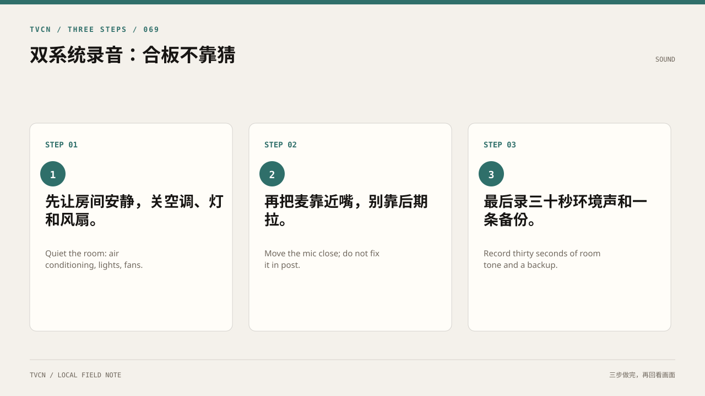

双系统录音要么拍手合板，要么时间码同步；两样都没有，后期只能猜。

<!-- DIAGRAM_START -->
<h2>图解</h2>
<figure>
  
  <figcaption>把三步按顺序做完，再回看画面或文件。</figcaption>
</figure>
<!-- DIAGRAM_END -->
<h2>现场</h2>

开机时拍三次手，或让录音机对时码。每条结尾报一次场号，后期就不用猜。

<h2>怎么做</h2>

双系统录音要么拍手合板，要么时间码同步；两样都没有，后期只能猜。开机和收工都要留同步标记。
<ol><li>开机时拍三次手，让摄影机和录音机都收到。</li><li>让录音机对时间码，或每条结尾报一次场号和镜号。</li><li>后期先对拍手帧或时码，再逐条检查声画偏移。</li></ol>
<h2>别踩</h2>

别指望后期靠波形自动对齐；没有拍手或时码，漂移会越修越大。

<h2>验收</h2>
<ul><li>每条素材的开头有三次拍手，画面和声音都能看到。</li><li>时间码或场号记录完整，后期能按场次找到对应音频。</li><li>对齐后整条播放，唇音没有越走越偏。</li></ul>

<!-- DEEP_DIVE_START -->
## 深读

<strong>约 6 分钟。</strong> 双系统录音真正的成本不是设备，是合板。合板对了，声音才有意义。

### 合板前先拍三样

每次换场先拍手、拍板、拍摄影机上的时间码；没有时间码就拍手，手要清楚、脆、离麦近。场记板写场次、镜号、条数，别只写日期。

相机机头麦一定要开，哪怕不能用；它是最后一条救命线，能对嘴型。

### 没有时间码怎么对

先看波形尖峰，再听爆破音，最后看嘴型；三步只差一两帧就够。多机位先对主收音，再把其他机位贴过去。长镜头每十分钟检查一次漂移。

合完先抽查三条：一条对白、一条动作、一条环境。三条都对，再开始剪；不对就回现场找场记表。

### 时间码不是万能

时间码能省合板时间，但电池、帧率、线材任何一处不对，它就会安静地错。每次换卡、换电池后，重新拍一次板。

长镜头每十分钟看一次漂移。声音比画面早半帧，观众会觉得演员口型怪；晚半帧，会觉得机器坏。

### 多机位合板顺序

先对主收音，再把 A 机贴上去，最后贴 B 机和 C 机。不要同时对三台，否则错了不知道从哪改。

合完给每条轨改名：场次_镜号_机位_条数。剪辑打开就能用，不用再猜“Audio 3”是哪台。

### 双系统开机前，十项确认
<ul><li>换场先拍手，手要清楚、脆、离麦近</li><li>再拍板，板上的字要能读</li><li>再拍摄影机上的时间码</li><li>场记板写场次、镜号、条数</li><li>相机机头麦一定开着</li><li>录音机增益留足余量</li><li>多机位先对主收音</li><li>合板先看波形尖峰</li><li>再听爆破音，最后看嘴型</li><li>长镜头每十分钟检查一次漂移</li></ul>
合板错了，最好的表演也会变成配音片。现场十秒，后期十小时。合板后随机抽三个转场，各听前后五秒，确认声音没有提前或延后，再继续剪。先听再剪，别一边合板一边剪。

<!-- DEEP_DIVE_END -->
