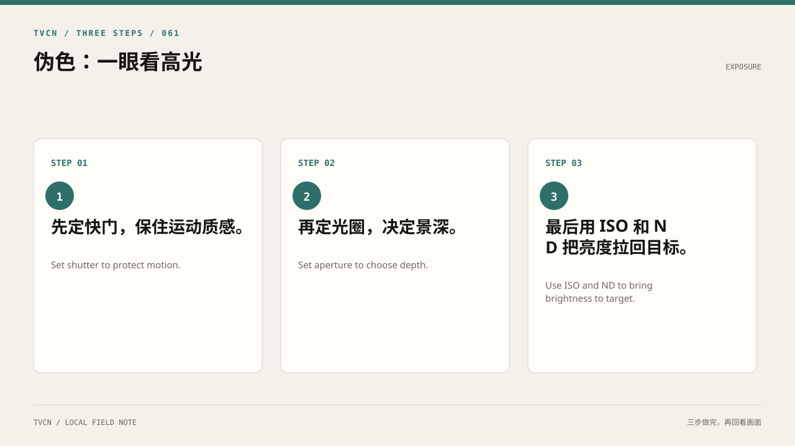

伪色把亮度分成色块，一眼就能看到脸是不是过曝、天空是不是死了。先看肤色区，再看高光区。

<!-- DIAGRAM_START -->
<h2>图解</h2>
<figure>
  
  <figcaption>看“把人脸放进肤色区，不要出现红色警告”和“让天空避开红色，保住高光细节”两处，判断高光、肤色和声音有没有被同时保住。</figcaption>
</figure>
<!-- DIAGRAM_END -->
<section><h2 id="section-1">现场</h2>
把人脸放进肤色区，让天空避开红色。先改光，不要先升 ISO。
</section><section><h2 id="section-2">怎么做</h2><ol><li>把人脸放进肤色区，不要出现红色警告。</li><li>让天空避开红色，保住高光细节。</li><li>先改光或加 ND，不要先升 ISO 硬压。</li></ol></section><section><h2 id="section-3">别踩</h2>
别把伪色当滤镜；红色是警告，不是风格。
</section><section><h2 id="section-4">先校准监视器</h2>
伪色不是统一标准：不同品牌把 70–90% 亮度映射成不同颜色。先在监视器上确认肤色区、高光警告和过曝红；不要拿相机背屏的颜色当最终判断。

把斑马纹设到 95%，伪色看分布，波形看数值。两者冲突时，以波形和 Log/Raw 的余量为准；伪色只是快速定位，不是测光表。
</section><section><h2 id="section-5">布光顺序</h2><ol><li>先定主光，让脸落在肤色区；不要先升 ISO 把背景提亮。</li><li>再处理窗户和实用灯：加 ND、换灯泡、拉窗帘，让高光避开红色。</li><li>最后看暗部：黑衣服保留一点纹理，不要为了高光把暗部压死。</li></ol>
如果没有 ND，先改光位和拍摄角度；ISO 只用来补最后 1/3 档，不用来救 3 档过曝。
</section><section><h2 id="section-6">伪色误判</h2><ol><li>把红色当风格：红色是警告，不是 LUT。先降高光，再谈色调。</li><li>只看脸不看背景：脸对了，窗外全白，后期拉不回来。</li><li>用背屏判断：背屏亮度随环境变，必须外接监视器或看波形。</li><li>不同机器混用同一套颜色：先确认每台机器的伪色映射。</li></ol></section><section><h2 id="section-7">曝光验收记录</h2><ul><li>人脸在伪色里落在肤色区，没有红色斑块；鼻尖和额头不先爆。</li><li>窗户、灯泡、白墙保留层次；高光不是一片纯白。</li><li>暗部黑衣服还能看到褶子，不糊成一块。</li><li>记录 EI、ND 档位、光位、监视器型号；换镜头后重新看一遍。</li></ul></section><section><h2 id="section-8">曝光记录</h2>
每条场景记一行：机器、EI、ND 档位、主光位置、监视器型号、窗户外最高亮度、人脸所在伪色区。换镜头或换窗后重看一遍，别用上一场的曝光结论。
</section><section><h2>判断</h2>
这一页的判断只看三条可观察的验收，不靠口号：
<ul><li><strong>1.</strong> 人脸在伪色里落在肤色区，没有红色斑块。</li><li><strong>2.</strong> 天空和窗户没有变成红色，亮部还有层次。</li><li><strong>3.</strong> 调整来自光或 ND，不是靠 ISO 硬压。</li></ul></section><section><h2>失败</h2>
下面任一条出现，先停，不要靠后期补：
<ul><li><strong>1.</strong> 只做到“人脸在伪色里落在肤色区，没有红色斑块”的形式，换一个机位或场景就重现不了。</li><li><strong>2.</strong> 把“天空和窗户没有变成红色，亮部还有层次”留到后期或口头解释，现场没有留下能复查的记录。</li><li><strong>3.</strong> 别把伪色当滤镜；红色是警告，不是风格。</li></ul></section><section><h2>延伸</h2>
<strong>10 分钟练习：</strong>用同一扇窗拍三条 10 秒，只改“把人脸放进肤色区，不要出现红色警告”；比较高光、肤色和背景，选一条能直接剪的。
</section>
<h2>验收</h2><ul><li>人脸在伪色里落在肤色区，没有红色斑块。</li><li>天空和窗户没有变成红色，亮部还有层次。</li><li>调整来自光或 ND，不是靠 ISO 硬压。</li></ul>

<!-- SOURCES_START -->
## 参考与延伸阅读

- [S52] [ARRI：ALEXA 35](https://www.arri.com/en/camera-systems/cameras/legacy-camera-systems/alexa-35) — 2026-11-26 访问。用于核对首段“伪色把亮度分成色块，一眼就能看到脸是不是过曝、天空是不是死了。”中的术语与公开背景（摄影机规格、Log-C 与色彩流程）；不替代现场测试。
- [S25] [ITU-R BT.709](https://www.itu.int/rec/R-REC-BT.709/en) — 2026-11-26 访问。用于核对首段“伪色把亮度分成色块，一眼就能看到脸是不是过曝、天空是不是死了。”中的术语与公开背景（HD SDR 的色域、传递函数与观看条件）；不替代现场测试。
<!-- SOURCES_END -->

