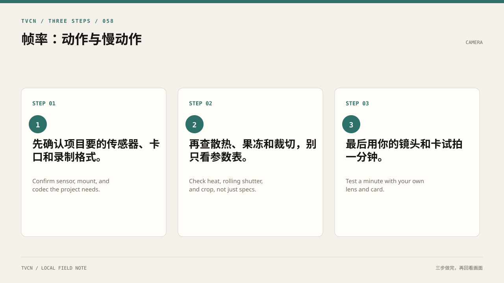

帧率决定动作的时间感；升格不是慢，是让观众看清一个瞬间。

<!-- DIAGRAM_START -->
<h2>图解</h2>
<figure>
  
  <figcaption>把三步按顺序做完，再回看画面或文件。</figcaption>
</figure>
<!-- DIAGRAM_END -->
<h2>现场</h2>

25p 项目就用 25p 拍。要做两倍慢动作，用 50p、1/100 快门拍，回放检查有没有频闪。

<h2>怎么做</h2>

帧率决定动作的时间感；升格不是慢，是让观众看清一个瞬间。拍之前先决定成片时间线和慢动作倍数。
<ol><li>25p 项目就用 25p 拍，时间线和素材保持一致。</li><li>要做两倍慢动作，用 50p、1/100 快门拍。</li><li>回放检查有没有频闪，再确认慢动作段落要放在哪一秒。</li></ol>
<h2>别踩</h2>

别把升格当慢放；拍的时候就要决定，后期硬慢会掉帧。

<h2>验收</h2>
<ul><li>时间线和素材帧率一致，没有把 50p 当 25p 直接铺。</li><li>慢动作镜头用 50p、1/100 快门拍，回放没有频闪。</li><li>慢动作只用在需要看清的瞬间，成片没有为慢而慢。</li></ul>

<!-- DEEP_DIVE_START -->
## 深读

<strong>约 5 分钟。</strong> 帧率改变的是时间感。24 帧像电影，50 帧像电视，120 帧用来拆开动作。

### 先定项目帧率

叙事片用 24 或 25，新闻和活动用 25 或 30。全片统一，不要一个镜头一个帧率。

快门按帧率的两倍：24 帧用 1/48 或 1/50，运动才自然。快门太高，动作会变得生硬。

### 升格要算清楚

120 帧放进 24 帧时间线，是五倍慢。拍之前想好要慢几倍，别拍完才发现不够，或者慢得看不下去。

升格需要更多光，快门也更高；室内先测曝光，再决定。不要用升格救一场没有设计的动作。

### 混合帧率的坑

同一场戏混 24 和 60，回放会跳。要用就整段用，并在剪辑里统一；不要这一段 24、下一段 60。

声音不要跟着升格录，慢动作里的对白后期配。现场录的声只能当参考，不能直接进时间线。

### 慢动作的叙事用途

慢动作只给一个转折：跳跃、撞击、回头。整片慢，等于没有重点。

升格前问：观众需要看清什么？看不清，就不要慢。

### 现场怎么标帧率

场记板写帧率，录音也报一句。后期不用猜素材是 24 还是 120。

不同帧率分文件夹，文件名加 fps。回套时少一次错误。

### 开机前，帧率十项确认
<ul><li>全片统一帧率</li><li>快门是帧率的两倍</li><li>升格先算慢几倍</li><li>升格前确认光线够</li><li>升格镜头单独录参考声</li><li>混合帧率只在一整段</li><li>时间线帧率与素材匹配</li><li>检查运动模糊是否自然</li><li>场记板写清帧率</li><li>输出前完整播放一遍</li></ul>
帧率不是越高越好。观众要的是对的时间感，不是最大的数字。

### 只剩五分钟时
<ul><li>全片先统一帧率</li><li>快门按帧率两倍</li><li>升格先算慢几倍</li><li>升格前确认光线</li><li>不同帧率分文件夹</li><li>场记板写帧率</li></ul>
帧率先是纪律，才是风格；纪律乱了，风格就是事故。拍板前再看一眼项目帧率，别让第一条素材就错。

<!-- DEEP_DIVE_END -->
