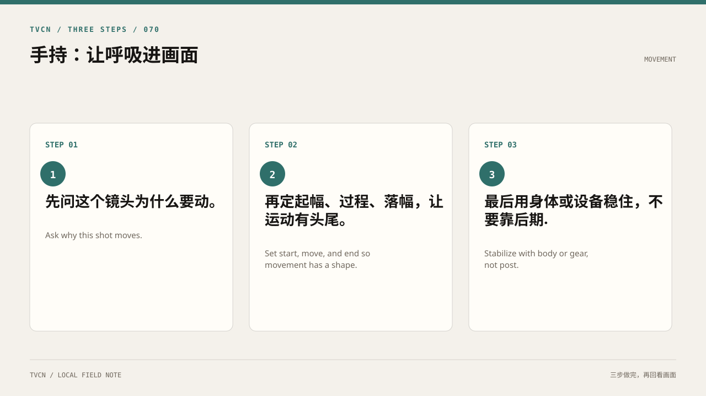

别为了晃而晃；没有理由的抖动会抢走表演。

<!-- DIAGRAM_START -->
<h2>图解</h2>
<figure>
  
  <figcaption>看“双脚与肩同宽，手肘贴住肋骨，两条之间…”和“十秒走三步，让身体带着机器走，不要用…”两处，判断高光、肤色和声音有没有被同时保住。</figcaption>
</figure>
<!-- DIAGRAM_END -->
<section><h2 id="section-1">现场</h2>
双脚与肩同宽，手肘贴住肋骨，两条之间换气。十秒走三步，回放检查：要像呼吸，不要像地震。
</section><section><h2 id="section-2">怎么做</h2><ol><li>双脚与肩同宽，手肘贴住肋骨，两条之间换气。</li><li>十秒走三步，让身体带着机器走，不要用手臂甩。</li><li>回放检查：要像呼吸，不要像地震。</li></ol></section><section><h2 id="section-3">别踩</h2></section><section><h2 id="section-4">什么时候不用手持</h2>
手持适合跟人走、进窄空间、需要临场反应的镜头；不适合长焦、低照度、需要精确重复的轨道镜头，也不适合让观众读小字的产品特写。

三个硬边界：焦距超过 85mm、快门慢于 1/50 秒、镜头里要连续读文字或标签。任一成立，先上三脚架、滑轨或稳定器，不要用“呼吸感”给抖动找理由。
</section><section><h2 id="section-5">站位与参数</h2>
用 24–50mm 焦段，4K 25p 时快门 1/50；如果要保留一点运动模糊，不要低于 1/50。防抖开标准模式；横摇时切到仅纵向防抖，避免和手的横向运动打架。
<ol><li>双脚与肩同宽，左脚略前，膝盖微屈；相机带绕手腕一圈，右手握柄，左手托镜头。</li><li>开机前先站 10 秒，找到呼吸最稳的区间；呼气到一半时按录制，不要在吸气顶点按。</li><li>走三步停一下，脚跟先落地，身体带着机器走；转身时先转脚，再转腰，不要扭手臂。</li></ol></section><section><h2 id="section-6">会拍坏的动作</h2><ol><li>手臂甩动：画面会左右摆，回放时人物像在船边。改成身体重心转移。</li><li>走得太快：步频高于呼吸，画面上下跳；把三步拉长到 10 秒。</li><li>憋气太死：手会抖，结尾还会突然喘；保持正常呼吸，只压低幅度。</li><li>一路走不停：没有停顿就没有剪点；每三步留一个稳定停点。</li></ol>
如果镜头要跟着演员跑，先拍一条固定机位做参照，再拍手持；不要拿手持去救走位。
</section><section><h2 id="section-7">手持验收记录</h2><ul><li>24mm 和 50mm 各拍 10 秒三步；回放时地平线漂移不超过画面高度 2%。</li><li>人物头部保持在画面上三分之一附近，上下漂移不超过 2% 画幅高。</li><li>呼吸节奏 3–4 秒一次，没有无理由的急停或突然加速。</li><li>记录机器、镜头、焦段、帧率、快门、防抖模式；同一条镜头换人拍，能复现同样节奏。</li></ul></section><section><h2>判断</h2>
现场只认三个信号：
<ul><li>高光没有死白，暗部仍保留可恢复的细节</li><li>同一条片子里肤色一致，切机位不跳</li><li>声音有独立音轨，不靠机头麦兜底</li></ul></section><section><h2>失败</h2>
下面三种做法会让页面上的细节白做：
<ul><li>曝光对了，但光没有方向，脸和背景粘在一起</li><li>声音只靠机头麦，现场一吵就废</li><li>机位越轴，观众失去空间方向</li></ul></section><section><h2>延伸</h2>
<strong>10 分钟练习：</strong>用同一扇窗拍三条 10 秒，只改“双脚与肩同宽，手肘贴住肋骨，两条之间…”；比较高光、肤色和背景，选一条能直接剪的。
</section>
<h2>验收</h2><ul><li>十秒三步的节奏稳定，画面没有突然的上下跳。</li><li>呼吸感来自身体，不是手臂乱晃。</li><li>地平线和人物头部没有持续漂移。</li></ul>
