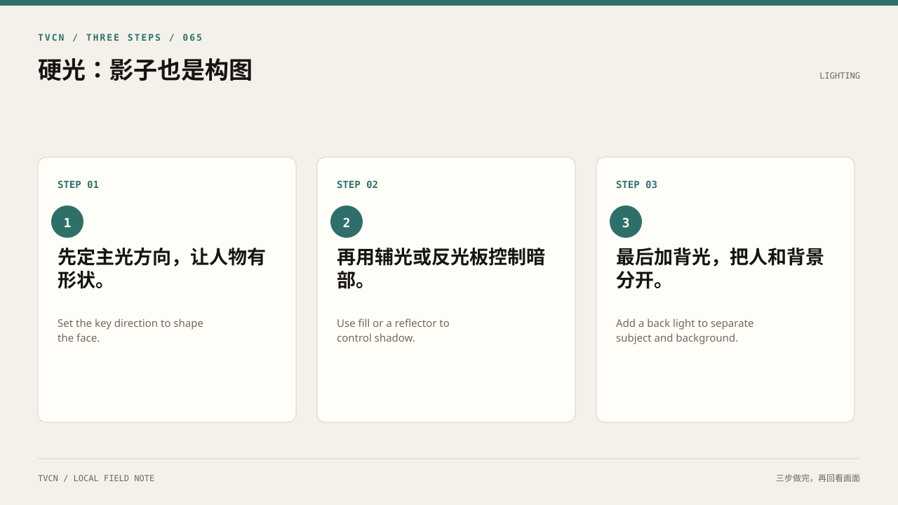

硬光的特征是影子边缘清楚、反差高。用小块光源、裸灯或远距离太阳光；想要硬但不想过曝，就降输出或加 ND，不要用大柔光箱。

<!-- DIAGRAM_START -->
<h2>图解</h2>
<figure>
  
  <figcaption>看“把硬光放在侧面，让影子落在背景或墙上”和“盯住影子是否切过眼睛或嘴”两处，判断高光、肤色和声音有没有被同时保住。</figcaption>
</figure>
<!-- DIAGRAM_END -->
<section><h2 id="section-1">硬光先看“影子边缘”</h2>
硬光适合表现权力、冲突、质感；拍人脸时注意鼻影和眼窝，必要时用一块小反光补暗部。
<h2 id="section-2">边界</h2>
硬光不是“不打光”。它需要更精确的位置和控制；影子方向错了，画面会像事故现场。
</section><section><h2 id="section-3">现场</h2>
把硬光当侧光，盯住影子落在哪里。影子切过眼睛或嘴时，把灯或演员移动十厘米。
</section><section><h2 id="section-4">怎么做</h2>
把硬光当侧光，盯住影子。
<ol><li>把硬光放在侧面，让影子落在背景或墙上。</li><li>盯住影子是否切过眼睛或嘴。</li><li>切到五官时，把灯或演员移动十厘米，再拍一条。</li></ol></section><section><h2 id="section-5">别踩</h2>
别用硬光正面直打；影子会变成脸上的污点。
</section><section><h2>判断</h2>
这一页的判断只看三条可观察的验收，不靠口号：
<ul><li><strong>1.</strong> 影子落在背景或墙面上，成为构图的一部分。</li><li><strong>2.</strong> 眼睛和嘴没有被影子切断，五官仍读得清。</li><li><strong>3.</strong> 调整只动了灯或演员十厘米，不是换柔光箱把硬光毁掉。</li></ul></section><section><h2>失败</h2>
下面任一条出现，先停，不要靠后期补：
<ul><li><strong>1.</strong> 只做到“影子落在背景或墙面上，成为构图的一部分”的形式，换一个机位或场景就重现不了。</li><li><strong>2.</strong> 把“眼睛和嘴没有被影子切断，五官仍读得清”留到后期或口头解释，现场没有留下能复查的记录。</li><li><strong>3.</strong> 别用硬光正面直打；影子会变成脸上的污点。</li></ul></section><section><h2>延伸</h2>
<strong>10 分钟练习：</strong>用同一扇窗拍三条 10 秒，只改“把硬光放在侧面，让影子落在背景或墙上”；比较高光、肤色和背景，选一条能直接剪的。
</section>
<h2>验收</h2><ul><li>影子落在背景或墙面上，成为构图的一部分。</li><li>眼睛和嘴没有被影子切断，五官仍读得清。</li><li>调整只动了灯或演员十厘米，不是换柔光箱把硬光毁掉。</li></ul>

<!-- SOURCES_START -->
## 参考与延伸阅读

- [S31] [ARRI：电影系统](https://www.arri.com/en/cine-systems) — 2026-11-26 访问。用于核对「硬光先看“影子边缘”」一节的术语/方法/规则（ARRI 摄影机、镜头与灯光资料，不是通用拍摄教程）；不核对其中由本页经验得出的数字、型号与现场结论，也不替代测试。
- [S23] [SMPTE：标准入口](https://www.smpte.org/standards) — 2026-11-26 访问。用于核对「现场」一节的术语/方法/规则（SMPTE 标准入口，不是具体机型参数）；不核对其中由本页经验得出的数字、型号与现场结论，也不替代测试。
<!-- SOURCES_END -->

