<!-- DIAGRAM_START -->
<h2>图解</h2>
<figure>
  
  <figcaption>示意：墙的刷新、相机的跟踪和引擎的时间必须同一条；只把画面投上墙，不叫虚拟拍摄。</figcaption>
</figure>
<!-- DIAGRAM_END -->
<h2>先判断：什么时候用墙，什么时候用绿幕</h2>
墙适合“演员能看到、光能打到”的场景：车窗、室内窗景、远景山脊、可互动屏幕。它给演员真实的眼神方向和的环境光。绿幕适合需要大幅改景、换角色、或墙的分辨率不够的近景；后期合成更自由，但现场没有参考。

如果片子里有大量近景人脸、透明材质、细发丝，先不要为了省后期上墙。墙的分辨率和摩尔纹会把这些问题放大。先问：这个镜头演员需要看见什么？看见的东西值得为它搭墙吗？
<h2>墙与跟踪：先把“看见”变成坐标</h2>
跟踪系统至少要有相机位置、镜头焦距、镜头畸变三组数据。只跟相机不跟镜头，推近时背景会滑；只跟镜头不跟相机，走位时背景会漂。跟踪标记不能贴在演员会挡到的地方，也不能贴得太密让画面全是点。

开机前用一张测试图走完整路径：近、中、远、俯、仰各一次，回看背景和演员的相对位置。只要有一个位置对不上，演员走到那里就会“穿帮”，后期也救不回。
<h2>同步与延迟：演员看到的是过去</h2>
墙的画面从引擎算出来到发光，有延迟；相机跟踪到引擎，也有延迟。演员看墙，看到的是几十毫秒前的世界。延迟大，演员的眼神会慢半拍，走位会追着背景跑。先测延迟：让演员看墙上的移动物体，拍一条，回看口型和眼神。

墙的刷新率和相机的快门要匹配。快门太快会拍到扫描线，快门太慢会拖影。先用 1/50 或 1/60 试，再按当地电网频率调；不同地区的 LED 墙刷新不一样，不要照搬。
<h2>色彩：墙是灯，不是监视器</h2>
墙的色温、亮度、光谱都会打到演员脸上。先把墙调成和现场 practical 一致的白，再谈背景风格。墙太蓝，演员脸就蓝；墙太亮，演员脸就被墙当主光。用测光表量演员脸，不要只看监视器。

色彩管线要在开机前定：相机 Log 或 RAW、引擎输出、墙的校正 LUT、后期 ACES/Rec.709。每一段都要有转换，不是把同一个 LUT 从头套到尾。拍一张灰卡和一张肤色参考，后期至少有共同锚点。
<h2>失败案例：墙亮、脸黑、背景像贴纸</h2>
一条汽车广告，墙的亮度按背景调得很高，演员脸没有补光。现场监视器看背景很漂亮，后期发现演员脸比背景暗三档，提亮后噪点和肤色一起崩。跟踪只跟了相机，推近时背景放大，车窗边缘像贴纸。

补救是把墙降两档、给演员补一盏柔光、推近镜头重拍。多花的不是灯，是重新搭墙和演员档期。墙的亮度永远先服务人脸，再服务背景。
<h2>成本与验收</h2>
低成本：小间距 LED 墙 + 固定机位 + 2D 背景，¥15,000–40,000/天。中成本：跟踪、实时引擎、同步、色彩管理，¥40,000–100,000/天。高成本：多机位、复杂交互、现场合成团队，¥100,000–300,000/天。价格不含内容制作、演员和场地。
<h2>验收</h2><ul><li>演员需要看见的背景，确实值得搭墙。</li><li>跟踪同时记录相机、焦距、畸变。</li><li>延迟已用移动物体和口型测试。</li><li>墙刷新与快门匹配，无扫描线。</li><li>墙的色温和亮度先服务人脸。</li><li>色彩管线每段有转换，并有灰卡/肤色参考。</li></ul>

<!-- SOURCES_START -->
## 参考与延伸阅读

- [S31] [ARRI：电影系统](https://www.arri.com/en/cine-systems) — 2026-11-26 访问。用于核对「先判断：什么时候用墙，什么时候用绿幕」一节的术语/方法/规则（ARRI 摄影机、镜头与灯光资料，不是通用拍摄教程）；不核对其中由本页经验得出的数字、型号与现场结论，也不替代测试。
- [S52] [ARRI：ALEXA 35](https://www.arri.com/en/camera-systems/cameras/legacy-camera-systems/alexa-35) — 2026-11-26 访问。用于核对「墙与跟踪：先把“看见”变成坐标」一节的术语/方法/规则（ALEXA 35 官方规格，不是独立测试）；不核对其中由本页经验得出的数字、型号与现场结论，也不替代测试。
<!-- SOURCES_END -->

