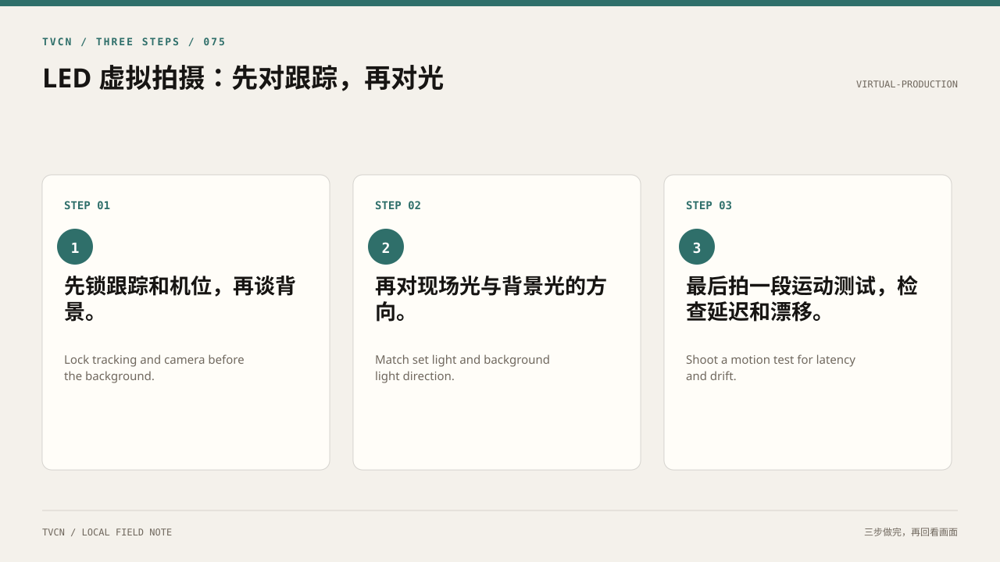

别先做漂亮背景；跟踪一漂，全部白做。

<!-- DIAGRAM_START -->
<h2>图解</h2>
<figure>
  
  <figcaption>看“先拍一个横摇和一个推近，检查背景跟踪…”和“让现场布光方向与背景光源一致，再谈亮…”两处，判断高光、肤色和声音有没有被同时保住。</figcaption>
</figure>
<!-- DIAGRAM_END -->
<section><h2 id="section-1">现场</h2>
先拍一个横摇和一个推近，检查背景跟踪。布光方向要跟背景一致，再调色。
</section><section><h2 id="section-2">怎么做</h2>
把这件事拆成现场能检查的动作。
<ol><li>先拍一个横摇和一个推近，检查背景跟踪和延迟。</li><li>让现场布光方向与背景光源一致，再谈亮度。</li><li>最后调色，确认背景没有扫描线、漂移或色偏。</li></ol></section><section><h2 id="section-3">别踩</h2></section><section><h2 id="section-4">开机与跟踪</h2>
先确认 LED 墙的刷新率和摄影机快门匹配，再谈画面。24p/25p 下常见 1/50 或 1/60；如果出现扫描线，先调快门或墙的刷新，不要先调色。
<ol><li>用跟踪标定板做一次横摇、一次推近、一次绕人半圈；看背景边缘有没有延迟。</li><li>把跟踪延迟、genlock、镜头畸变标定写进开机清单；换镜头要重标。</li><li>先拍一条没有人、只有墙和地面的测试片，确认透视和地平线。</li></ol></section><section><h2 id="section-5">墙光与色温</h2>
墙是背景，不是主光。人物主光仍要从前侧来；墙的亮度比主光低 1–2 档，避免人脸被墙的绿/蓝反光染色。

把墙的色温和现场灯统一到 5600K 或 3200K 的同一侧；不要一边暖一边冷。演员离墙至少 1.5 米，减少溢色和摩尔纹。
</section><section><h2 id="section-6">虚拟拍摄失败</h2><ol><li>跟踪漂移：背景像贴纸，人物一走就露馅；先重标，不要用后期跟踪硬救。</li><li>扫描线/摩尔纹：快门和刷新不匹配；换快门或改变拍摄距离。</li><li>墙光反打：人脸发绿；降低墙亮度，加负补光或黑旗。</li><li>透视不对：地平线和地面接不上；先调相机高度和镜头，不要拉背景。</li></ol></section><section><h2 id="section-7">跟踪验收记录</h2><ul><li>横摇和推近各 10 秒，背景边缘没有滞后、漂移或跳帧。</li><li>人物走到墙前 1.5 米，脸上没有明显绿/蓝溢色。</li><li>成片尺寸下看不到扫描线、摩尔纹；100% 放大才看到的瑕疵不作为失败。</li><li>记录刷新率、快门、镜头、跟踪软件版本、标定日期。</li></ul></section><section><h2 id="section-8">开机记录</h2>
开机先记：墙刷新率、快门、genlock 状态、跟踪软件版本、镜头畸变标定日期、演员离墙距离。任何一项变了，跟踪和颜色都要重测，不要沿用上一场的参数。
</section><section><h2>判断</h2>
现场只认三个信号：
<ul><li>高光没有死白，暗部仍保留可恢复的细节</li><li>同一条片子里肤色一致，切机位不跳</li><li>声音有独立音轨，不靠机头麦兜底</li></ul></section><section><h2>失败</h2>
下面三种做法会让页面上的细节白做：
<ul><li>曝光对了，但光没有方向，脸和背景粘在一起</li><li>声音只靠机头麦，现场一吵就废</li><li>机位越轴，观众失去空间方向</li></ul></section><section><h2>延伸</h2>
<strong>10 分钟练习：</strong>用同一扇窗拍三条 10 秒，只改“先拍一个横摇和一个推近，检查背景跟踪…”；比较高光、肤色和背景，选一条能直接剪的。
</section>
<h2>验收</h2><ul><li>横摇和推近时背景没有滞后或漂移。</li><li>人物身上的光向和背景里的光源一致。</li><li>成片尺寸下看不到扫描线、摩尔纹或明显色偏。</li></ul>
