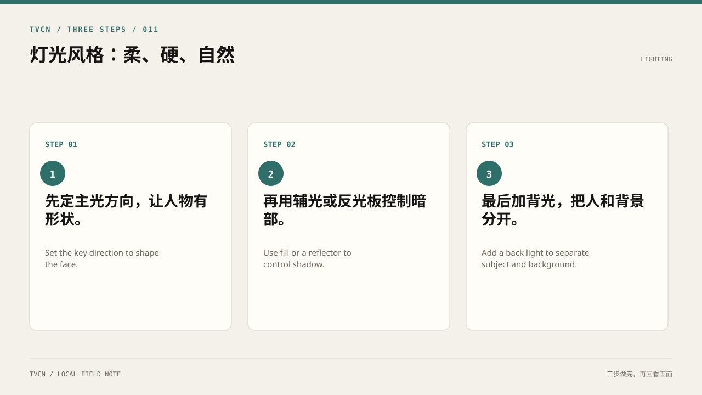

灯光风格不是套预设。先定光比：人脸亮部与暗部差几档；再定方向：主光从哪来；最后定颜色：暖、冷还是混合。三项定下来，风格才可复制。

<!-- DIAGRAM_START -->
<h2>图解</h2>
<figure>
  
  <figcaption>看“先选一个参考：柔光、硬光或窗光，只用…”和“用同一方向拍三档强度，比较脸上结构”两处，判断高光、肤色和声音有没有被同时保住。</figcaption>
</figure>
<!-- DIAGRAM_END -->
<section><h2 id="section-1">风格先写“光比”，再写“颜色”</h2>
用参考图只看“光从哪来、影子多硬、脸亮多少”，不要只看色调；色调可以后期，光位不能。
<h2 id="section-2">边界</h2>
风格不是每场换一种。整片要有一条光比主线；每场都换，观众只感到乱。
</section><section><h2 id="section-3">现场</h2>
先选一个参考：柔光、硬光或窗光。只用一种方向，拍三档不同强度；挑脸上结构最清楚的一条。
</section><section><h2 id="section-4">怎么做</h2>
灯光风格先选一个方向：柔、硬或自然，再谈亮度。三个都要，脸就会没有态度。
<ol><li>先选一个参考：柔光、硬光或窗光，只用一个方向。</li><li>用同一方向拍三档强度，比较脸上结构。</li><li>挑结构最清楚的一条，再决定要不要补暗部。</li></ol></section><section><h2 id="section-5">别踩</h2>
别一上来就开三盏；没有方向，三盏只是更亮。
</section><section><h2>判断</h2>
现场只认三个信号：
<ul><li>高光没有死白，暗部仍保留可恢复的细节</li><li>同一条片子里肤色一致，切机位不跳</li><li>声音有独立音轨，不靠机头麦兜底</li></ul></section><section><h2>失败</h2>
下面三种做法会让页面上的细节白做：
<ul><li>曝光对了，但光没有方向，脸和背景粘在一起</li><li>声音只靠机头麦，现场一吵就废</li><li>机位越轴，观众失去空间方向</li></ul></section><section><h2>延伸</h2>
<strong>10 分钟练习：</strong>用同一扇窗拍三条 10 秒，只改“先选一个参考：柔光、硬光或窗光，只用…”；比较高光、肤色和背景，选一条能直接剪的。
</section>
<h2>验收</h2><ul><li>三张成片只有一个主光方向，不是三种风格混在一张脸上。</li><li>能指出哪一档脸上结构最清楚，并说出理由。</li><li>暗部有细节但没有被辅光打平，阴影仍在。</li></ul>

<!-- DEEP_DIVE_START -->
## 深读

<strong>约 6 分钟。</strong> 柔、硬、自然不是三种滤镜，是三种光源尺寸、距离和方向。

### 柔光看相对面积

光源越大、离脸越近，阴影边缘越柔；120cm 柔光箱在 1.5m 比 60cm 在 2m 更柔。

柔光不是没有影子，是影子边缘有过渡；没有影子，脸会平。

### 硬光不是错

硬光给鼻影、颧骨、墙面影子，适合类型片、舞蹈、产品。硬光要控制角度，不要让鼻影切断上唇；加一块反光板补暗部。

硬光最怕半硬不硬：灯太远、柔光布太小，影子边缘又脏又不好看。要么更硬，要么更柔。

### 自然光先找方向

北窗、阴天、白墙是免费的柔光；中午顶光先让脸进阴影，或用柔光布。室内混合光先关掉不需要的灯，再决定加什么。

自然光会变；开机前拍一张，十分钟后再拍一张，别让一场戏从阴天变晴天。

### 一张脸，三层就够

主光决定影子方向，反光板决定暗部有多黑，背景光决定人站在哪。三层都能量出来，不要靠“感觉对了”。

先关掉所有灯，只留主光；脸能看，再加反光；背景太亮，用黑旗或关掉背景灯。每加一层，回放一次。

柔光箱和窗光可以混，但色温要靠近；差太多，后期也拉不回来。如果三层做完还不满意，先换光源位置，不要急着换灯。

### 五分钟练习：一张脸，两盏光

拿一盏台灯和一张白纸，站在 1.5 米外：先直接照，再隔白纸照，同一张脸各拍一张，比较影子边缘。然后把灯移到侧 45 度，看鼻影落在哪。

不要加第二盏灯，先把一盏灯的方向练熟；方向不对，第二盏只会把问题藏起来。

### 布光前，十项确认
<ul><li>先决定影子要多长</li><li>柔光看光源相对面积</li><li>柔光箱离脸越近越柔</li><li>硬光控制鼻影角度</li><li>暗部用反光板补</li><li>自然光先找窗和阴影</li><li>关掉不需要的混合光</li><li>开机前后各拍一张</li><li>检查肤色和背景分离</li><li>不要半硬不硬</li></ul>
先决定影子要多长，再决定买什么灯。

<!-- DEEP_DIVE_END -->

<!-- SOURCES_START -->
## 参考与延伸阅读

- [S23] [SMPTE 标准入口](https://www.smpte.org/standards) — 2026-11-26 访问。用于核对首段“灯光风格先选一个方向：柔、硬、自然；三个都要，画面就会没有态度。”中的术语与公开背景（时间码、色彩、影院与信号链标准的机构入口）；不替代现场测试。
- [S31] [ARRI Cine Systems](https://www.arri.com/en/cine-systems) — 2026-11-26 访问。用于核对首段“灯光风格先选一个方向：柔、硬、自然；三个都要，画面就会没有态度。”中的术语与公开背景（摄影机、镜头与灯光的技术资料入口）；不替代现场测试。
- [S32] [Sony 专业影像支持](https://pro.sony/ue_US/support) — 2026-11-26 访问。用于核对首段“灯光风格先选一个方向：柔、硬、自然；三个都要，画面就会没有态度。”中的术语与公开背景（专业摄影机与镜头的支持、固件与文档）；不替代现场测试。
- [S33] [Canon 支持](https://www.usa.canon.com/support) — 2026-11-26 访问。用于核对首段“灯光风格先选一个方向：柔、硬、自然；三个都要，画面就会没有态度。”中的术语与公开背景（相机、镜头与固件的官方支持入口）；不替代现场测试。
- [S52] [ARRI：ALEXA 35](https://www.arri.com/en/camera-systems/cameras/legacy-camera-systems/alexa-35) — 2026-11-26 访问。用于核对首段“灯光风格先选一个方向：柔、硬、自然；三个都要，画面就会没有态度。”中的术语与公开背景（摄影机规格、Log-C 与色彩流程）；不替代现场测试。
<!-- SOURCES_END -->

