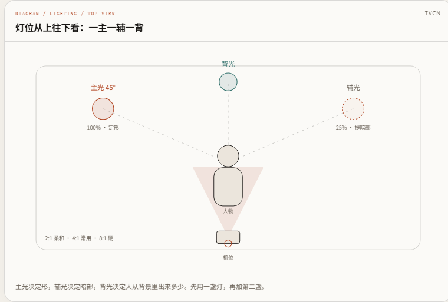

<!-- DIAGRAM_START -->
## 图解

<figure>
  
  <figcaption>主光决定形，辅光决定暗部，背光决定人从背景里出来多少。先用一盏灯，再加第二盏。</figcaption>
</figure>
<!-- DIAGRAM_END -->

一盏主灯加一块反光板，已经能拍出大部分人物场景。先控制亮暗差，再追求灯位花样。

## 主灯决定形状

主灯放在人物前方偏一侧，大约 45 度，略高于眼睛。硬光勾出结构，软光抹平瑕疵；先选你要哪一种，再调强度。

主灯不是越亮越好。它要和背景、环境光形成关系。人脸比背景亮一档，通常就够把人物从环境里提出来。

## 三种 ratio

1:1 是平光，信息清楚，适合喜剧和教学；2:1 有立体感，最通用；4:1 阴影更重，适合悬疑、夜戏和人物秘密。

ratio 是主灯与补光的亮度差，不是“灯的数量”。没有补光时，用反光板或负补光（黑旗）把暗部压下去。

## 窗光 + 反光板

把人物放在窗边，让窗光从一侧进来；把白板或泡沫板放在另一侧，把阴影提一点。先拍一条，再决定要不要加黑旗。

不要一开始就买灯。窗光的颜色和方向已经很好，你只需要学会控制它的大小和反差。

## 3 条验收

- 能说清 1:1、2:1、4:1 各自适合什么情绪。
- 主灯与补光有明确的亮度差。
- 没有补光时，会用反光板或黑旗。
<!-- SOURCES_START -->
<h2>参考与延伸阅读</h2>

经验来源：TVCN 现场手册与项目复盘；实测来源：页面标注的复核环境与可复现练习；参考来源：以下公开链接。

<ul><li>[S23] SMPTE 标准入口</li><li>[S31] ARRI 技术文档</li><li>[S32] Sony 专业影像支持</li><li>[S33] Canon 支持</li></ul>

<a href="../../about/">完整链接与用途见 SOURCES.md</a>

<!-- SOURCES_END -->
