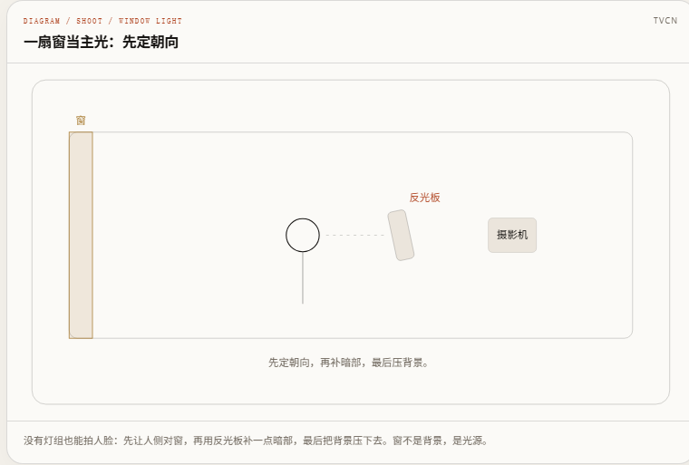

<!-- DIAGRAM_START -->
## 图解

<figure>
  
  <figcaption>没有灯组也能拍人脸：先让人侧对窗，再用反光板补一点暗部，最后把背景压下去。窗不是背景，是光源。</figcaption>
</figure>
<!-- DIAGRAM_END -->

## 先让人转脸，不要移窗

让被拍的人慢慢转向窗户，直到鼻影落在脸颊一侧。正对窗会平，背对窗会黑。侧 30–45 度最稳。

直射太阳太硬，拉一层薄窗帘或白布。阴天的窗光反而好用，脸会柔，背景还有层次。

## 反光板放低，不要举到头顶

反光板从胸口高度补过去，阴影会软；举到头顶，脸会变成两个光源。白墙、白纸、泡沫板都能用，不必买专业反光板。

补光只补暗部，不要补到和亮面一样。亮面和暗面差一档，脸才有立体感。

## 背景比脸暗一档

拉上背后的窗帘，或关掉背景的顶灯。脸亮、背景暗，画面才有层次；背景和脸一样亮，人就贴在海报上。

如果背景不能动，就换一个更暗的角度，或者让被拍的人往前坐半米。自然光场景里，移动人比移动灯容易。

## 3 条验收

- 鼻影只落在脸的一侧。
- 暗部有细节，但没有和亮面一样亮。
- 背景比人脸暗，主体能从画面里出来。
