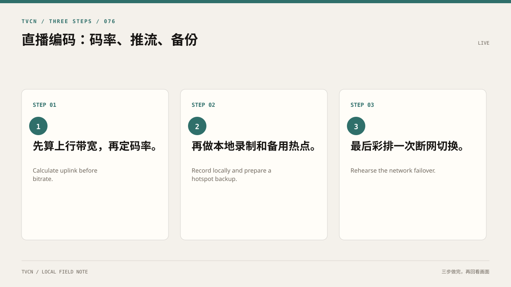

码率按上传带宽的 70% 设，留余量；关键帧间隔 2 秒，音频 128–192 kbps。分辨率高但码率不够，运动画面会糊成块；宁可 720p 稳，不要 4K 卡。

<!-- DIAGRAM_START -->
<h2>图解</h2>
<figure>
  
  <figcaption>看“测上传速度，目标码率的 1.5 倍才…”和“设主推流、热点备份，同时本地录一份高…”两处，判断高光、肤色和声音有没有被同时保住。</figcaption>
</figure>
<!-- DIAGRAM_END -->
<section><h2 id="section-1">直播先保“不断”，再保“好看”</h2>
开播前测 10 分钟：丢帧、延迟、声音同步、备用网络。不要用主网络开播才发现上传不够。
<h2 id="section-2">边界</h2>
直播不是录播。不能靠后期补，所有信息要一次说清；字幕和图表要提前准备，不要现场找。
</section><section><h2 id="section-3">现场</h2>
先测上传速度：要达到目标码率的 1.5 倍才留得出余量。设主推流和热点备份，同时本地录一份高码率。
</section><section><h2 id="section-4">怎么做</h2><ol><li>测上传速度，目标码率的 1.5 倍才安全。</li><li>设主推流、热点备份，同时本地录一份高码率。</li><li>彩排一次断网切换，记录断流时间和恢复步骤。</li></ol></section><section><h2 id="section-5">别踩</h2>
别只推一路、别把直播当一次性；断流比画质差更致命。
</section><section><h2>判断</h2>
这一页的判断只看三条可观察的验收，不靠口号：
<ul><li><strong>1.</strong> 上行带宽至少是目标码率的 1.5 倍，余量有记录。</li><li><strong>2.</strong> 主推流断掉时，热点备份和本地录制都还能工作。</li><li><strong>3.</strong> 彩排记录里能查到断流时间、原因和恢复用了多久。</li></ul></section><section><h2>失败</h2>
下面任一条出现，先停，不要靠后期补：
<ul><li><strong>1.</strong> 只做到“上行带宽至少是目标码率的 1.5 倍，余量有记录”的形式，换一个机位或场景就重现不了。</li><li><strong>2.</strong> 把“主推流断掉时，热点备份和本地录制都还能工作”留到后期或口头解释，现场没有留下能复查的记录。</li><li><strong>3.</strong> 别只推一路、别把直播当一次性；断流比画质差更致命。</li></ul></section><section><h2>延伸</h2>
<strong>10 分钟练习：</strong>用同一扇窗拍三条 10 秒，只改“测上传速度，目标码率的 1.5 倍才…”；比较高光、肤色和背景，选一条能直接剪的。
</section>
<h2>验收</h2><ul><li>上行带宽至少是目标码率的 1.5 倍，余量有记录。</li><li>主推流断掉时，热点备份和本地录制都还能工作。</li><li>彩排记录里能查到断流时间、原因和恢复用了多久。</li></ul>

<!-- SOURCES_START -->
## 参考与延伸阅读

- [S67] [IETF：RFC 8216（HLS）](https://datatracker.ietf.org/doc/html/rfc8216) — 2026-11-26 访问。用于核对「直播先保“不断”，再保“好看”」一节的术语/方法/规则（HLS 协议规范，不是直播运营建议）；不核对其中由本页经验得出的数字、型号与现场结论，也不替代测试。
- [S28] [Netflix：合作伙伴帮助](https://partnerhelp.netflixstudios.com/) — 2026-11-26 访问。用于核对「现场」一节的术语/方法/规则（Netflix 交付帮助，不是通用平台规则）；不核对其中由本页经验得出的数字、型号与现场结论，也不替代测试。
- [S23] [SMPTE：标准入口](https://www.smpte.org/standards) — 2026-11-26 访问。用于核对「怎么做」一节的术语/方法/规则（SMPTE 标准入口，不是具体机型参数）；不核对其中由本页经验得出的数字、型号与现场结论，也不替代测试。
<!-- SOURCES_END -->

