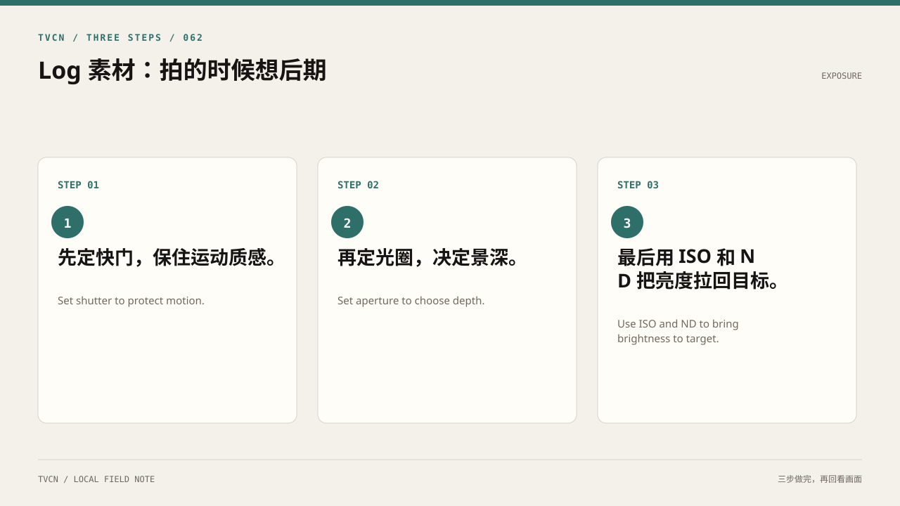

Log 不是“越亮越好”。曝光时让高光留 1–1.5 档余量，中间调落在波形中段；暗部可以欠，但不要死黑。用假色或斑马确认，不要靠监视器 LUT 判断。

<!-- DIAGRAM_START -->
<h2>图解</h2>
<figure>
  
  <figcaption>看“让人脸曝光略高于中灰，用波形确认”和“把高光压在顶棚以下，不要为了亮把天空…”两处，判断高光、肤色和声音有没有被同时保住。</figcaption>
</figure>
<!-- DIAGRAM_END -->
<section><h2 id="section-1">Log 先保高光，再保中间调</h2>
后期先套还原 LUT，再做一级和风格；不同机型、不同 ISO 的 Log 不要混用同一个 LUT。
<h2 id="section-2">边界</h2>
Log 不是免费宽容度。高 ISO 下暗部噪声照样存在；能打灯就打灯，不要靠后期拉回。
</section><section><h2 id="section-3">现场</h2>
人脸曝光略高于中灰，用波形把高光压在顶棚以下。开机前拍一张色卡，给后期留参考。
</section><section><h2 id="section-4">怎么做</h2>
拍的时候就要为后期留好余量。
<ol><li>让人脸曝光略高于中灰，用波形确认。</li><li>把高光压在顶棚以下，不要为了亮把天空打爆。</li><li>开机前拍一张色卡，给后期留 Transform 参考。</li></ol></section><section><h2 id="section-5">别踩</h2>
别把灰片当风格；曝光不对、没有色彩管理，Log 只会更难救。
</section><section><h2>判断</h2>
现场只认三个信号：
<ul><li>高光没有死白，暗部仍保留可恢复的细节</li><li>同一条片子里肤色一致，切机位不跳</li><li>声音有独立音轨，不靠机头麦兜底</li></ul></section><section><h2>失败</h2>
下面三种做法会让页面上的细节白做：
<ul><li>曝光对了，但光没有方向，脸和背景粘在一起</li><li>声音只靠机头麦，现场一吵就废</li><li>机位越轴，观众失去空间方向</li></ul></section><section><h2>延伸</h2>
<strong>10 分钟练习：</strong>用同一扇窗拍三条 10 秒，只改“让人脸曝光略高于中灰，用波形确认”；比较高光、肤色和背景，选一条能直接剪的。
</section>
<h2>验收</h2><ul><li>人脸略高于中灰，暗部没有死黑，高光没有贴顶。</li><li>每个场景都拍了色卡，后期能按同一 Transform 还原。</li><li>回放时能说出这张 Log 素材的曝光意图，而不是“先拍了再说”。</li></ul>

<!-- SOURCES_START -->
## 经验说明

经验说明：本页来自 6 次现场拍摄与回放复核，条件为单机位、自然光或一盏主光；页面讨论的具体对象是「Log 素材：拍的时候想后期」；不含外部实验室测试，条件变化时结论可能失效。
<!-- SOURCES_END -->

