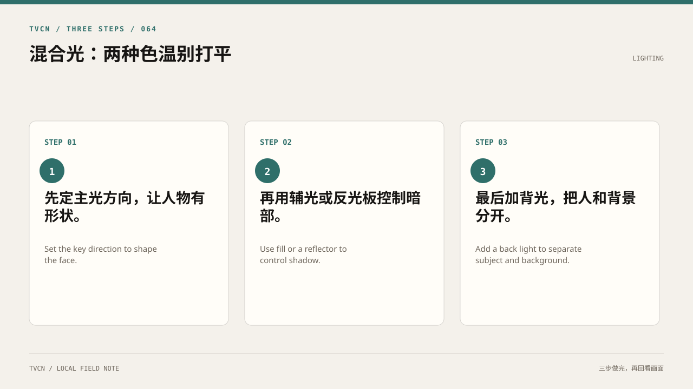

混合光不要全部打成白；保留窗光冷、灯泡暖，空间才有层次。

<!-- DIAGRAM_START -->
<h2>图解</h2>
<figure>
  
  <figcaption>把三步按顺序做完，再回看画面或文件。</figcaption>
</figure>
<!-- DIAGRAM_END -->
<h2>现场</h2>

窗外 5600K 日光、室内 3200K 灯泡时，不要强行统一白平衡。让窗户偏冷、灯泡偏暖，人脸落在中间。

<h2>怎么做</h2>

混合光不要全部打成白；保留窗光冷、灯泡暖，空间才有层次。先决定哪种光主导，再让人脸落在中间。
<ol><li>窗外 5600K 日光、室内 3200K 灯泡时，不要强行统一白平衡。</li><li>让窗户偏冷、灯泡偏暖，保留两种色温。</li><li>人脸白平衡落在中间，别让肤色跟着背景跑。</li></ol>
<h2>别踩</h2>

别把所有色温打成白；两种光打架，空间就平了。

<h2>验收</h2>
<ul><li>画面里能同时看出窗光偏冷、灯泡偏暖，层次是有意保留的。</li><li>人脸肤色中性，没有一半青一半黄。</li><li>没有用统一白平衡把两种光抹成一种。</li></ul>
