<!-- DIAGRAM_START -->
<h2>图解</h2>
<figure>
  
  <figcaption>示意：每一条信号都要有源、有记录、有监看；只画了导播输出，没有 ISO 录制，就不算多机位。</figcaption>
</figure>
<!-- DIAGRAM_END -->
<h2>先判断：什么时候值得上多机位</h2>
只有三种情况值得上多机位：一是同一时刻只能发生一次，比如仪式、比赛、演出；二是需要连续表演，不能为一个机位重来；三是导播要实时切给观众看。只是“想多一个角度”的访谈，单机拍两遍更便宜，也更安全。

先写一张机位职责表：A 机保全景和主动作，B 机保反应和近景，C 机保插入、手部或游机。每台机器只回答一个问题，导播才知道什么时候切。三台都拍中景，等于一台。
<h2>信号链：先画接口，再谈构图</h2>
把信号链画成一张纸：每台机位从哪里出、进哪台切换台、录到哪里、返送到哪块屏。消费级 HDMI 接头没有锁，现场一碰就掉；能上 SDI 就上 SDI，不能上就給 HDMI 加保护套和备用线。线长超过 15 米，先试一遍再布。

导播输出和 ISO 录制必须分开：导播切给观众的是 program，后期要救的是每台机的 clean feed。只录 program，后期没有第二条路；只录 ISO 不录 program，现场看不到最终效果。两台录机、两张卡，别把同一张卡当成两个备份。
<h2>时间码与同步：让三台机器进同一条时间线</h2>
多机位后期最贵的错误不是构图，是三条音轨对不上。能上时码发生器就用同一套时间码；不能上，就在每台机位前拍一次手，后期用音频波形对齐。后者只能救急，不能当流程。

帧率、快门、白平衡三件事开机前统一。混合帧率会让导播台和录机互相不认识；混合白平衡会让切机位时肤色跳。每台机位拍 10 秒同一张灰卡，后期至少有一个人工校正的锚点。
<h2>现场执行：彩排、返送、故障，一样都不能省</h2>
开机前至少走一遍完整彩排：导播喊一次“三号准备”，每台机位回答，Tally 亮，返送屏出现画面。没有这一步，正式开始时每个人都在找自己的画面。返送屏放在摄影师看得见但不会挡住镜头的位置，别放在需要回头才能看的地方。

准备三条故障预案：一条线坏了换哪条、一台机位死机谁去替、录音断了用什么垫。故障预案要写人名，不写“大家注意”。直播没有重来，只有切换。
<h2>失败案例：三机位最后剪成三条片</h2>
一次两小时的行业论坛，三台机位都没有接时码，录音只进了 A 机。现场看起来顺利，后期却发现 B、C 机的音频漂了 12 秒，观众掌声对不上，导播切点也全乱。最后只能按 A 机的声音重剪，B、C 的镜头大量弃用。

真正的成本不是多买一条时码线，是三个人两天在对波形。多机位的预算里必须写出“同步测试”这一项，不然省下的线材会在后期加倍还回来。
<h2>成本与验收</h2>
低成本：一台切换台 + 两台机位 + 机头录音，¥3,000–8,000/天，适合内部直播。中成本：三机位、SDI、时码、独立录音、ISO 录制，¥8,000–20,000/天。高成本：四机位以上、导播团队、通话、返送、双录机，¥20,000–60,000/天。价格不含场地、网络专线和人员差旅。
<h2>验收</h2><ul><li>每台机位都有一句职责，且至少一台保全景。</li><li>所有机位同一帧率、同一快门、同一白平衡。</li><li>时码或拍手同步方案已在彩排中验证。</li><li>Program 与 ISO 分开录制，且有两张卡/两台录机。</li><li>Tally、返送、通话至少彩排一次。</li><li>故障预案写到人名和替换线。</li></ul>
<!-- SOURCES_START -->
<h2>参考与延伸阅读</h2>

经验来源：TVCN 现场手册与项目复盘；实测来源：页面标注的复核环境与可复现练习；参考来源：以下公开链接。

<ul><li>[S23] SMPTE 标准入口</li><li>[S31] ARRI 技术文档</li><li>[S32] Sony 专业影像支持</li><li>[S33] Canon 支持</li></ul>

<a href="../../SOURCES.md">完整链接与用途见 SOURCES.md</a>

<!-- SOURCES_END -->
