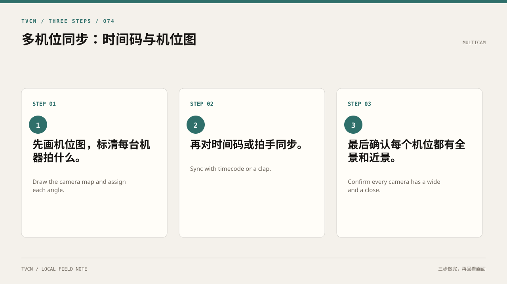

多机位先画机位图，再对时间码；剪辑要知道哪台机器站在哪。

<!-- DIAGRAM_START -->
<h2>图解</h2>
<figure>
  
  <figcaption>把三步按顺序做完，再回看画面或文件。</figcaption>
</figure>
<!-- DIAGRAM_END -->
<h2>现场</h2>

画一张俯视机位图，标清 A、B、C 各拍什么。用时间码或拍手同步，剪辑按这张图找条。

<h2>怎么做</h2>

多机位先画机位图，再对时间码；剪辑要知道哪台机器站在哪。两台机器拍同一个景别，不叫多机位，叫重复。
<ol><li>画一张俯视机位图，标清 A、B、C 各拍什么景别。</li><li>用时间码或拍手同步，确认三路都能对齐。</li><li>检查每个机位都提供不同信息，没有重复景别。</li></ol>
<h2>别踩</h2>

别让两台机器拍同一个景别；多机位不是重复机位。

<h2>验收</h2>
<ul><li>机位图能看出 A、B、C 各自拍什么，没有两台重复。</li><li>三路素材在时间线上逐帧对齐，没有偏移。</li><li>剪辑时每个机位都能提供不同信息，切起来有理由。</li></ul>
