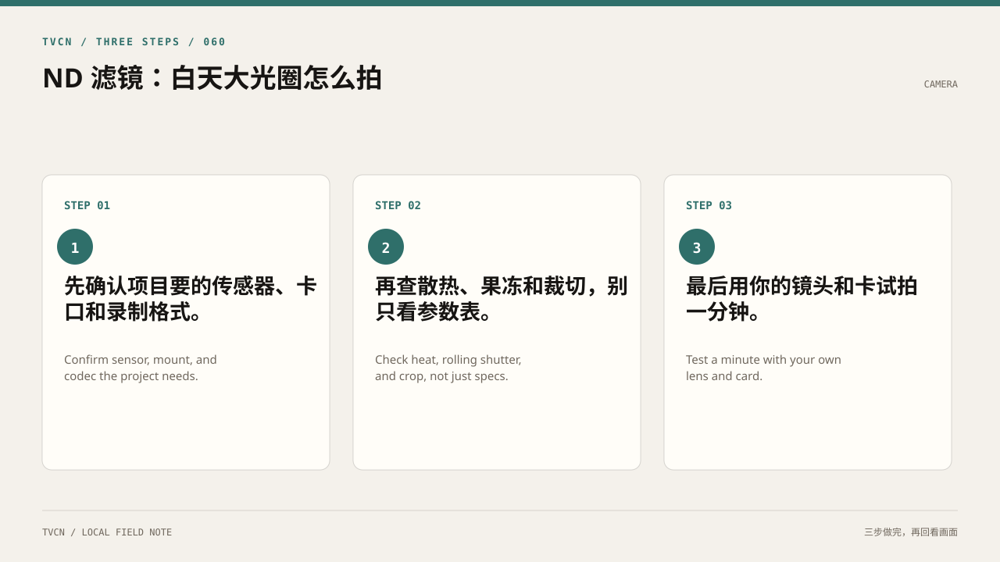

ND 滤镜不是压暗画面，是让白天也能开大光圈、保住景深。

<!-- DIAGRAM_START -->
<h2>图解</h2>
<figure>
  
  <figcaption>把三步按顺序做完，再回看画面或文件。</figcaption>
</figure>
<!-- DIAGRAM_END -->
<h2>现场</h2>

正午、f/2.8、ISO 100，先用 6 档 ND。如果快门仍高于 1/50，再加 3 档。用可变 ND 时先拧到最轻档，避免出现十字暗纹。

<h2>怎么做</h2>

ND 滤镜不是压暗画面，是让白天也能开大光圈、保住景深。先定快门和光圈，再算要减几档。
<ol><li>正午、f/2.8、ISO 100，先用 6 档 ND。</li><li>如果快门仍高于 1/50，再加 3 档，直到回到目标快门。</li><li>用可变 ND 时先拧到最轻档，再逐步加，避免十字暗纹。</li></ol>
<h2>别踩</h2>

别用 ND 压暗后不回调光圈或快门；可变 ND 也别一拧到最黑。

<h2>验收</h2>
<ul><li>白天大光圈下快门仍在 1/50 左右，没有为了曝光牺牲景深。</li><li>可变 ND 没有出现十字暗纹或偏色。</li><li>高光没有爆，画面也不是整体欠曝。</li></ul>

<!-- DEEP_DIVE_START -->
## 深读

<strong>约 5 分钟。</strong> ND 是白天的光圈保险。没有它，要么过曝，要么把光圈收到没有景深。

### 先定快门，再定光圈

白天室外按 180 度快门，光圈想开大就需要 ND。先算总进光，再选档位；不要反过来先买滤镜再找曝光。

不要用高快门压曝光，画面会变得生硬。ND 是让快门回到自然位置的工具，不是装饰。

### 档位怎么算

一档少一半光，两档少四分之三。可变 ND 先拧到最密再回到想要的档，避免十字暗影。

不同镜头的最小档位不一样，广角容易出暗角。拍前在每个镜头上试一遍，别到现场才发现。

### 偏色和红外

便宜 ND 会偏绿或偏品，白平衡不能完全救。拍一张灰卡，后期校；偏得厉害就换滤镜。

黑色化纤在强光下会发紫，这是红外污染。加 IR cut 或换滤镜，别在后期硬拉黑色。

### ND 和偏振不是一回事

ND 减全部光，偏振压反光。水面、玻璃要偏振，大光圈要 ND。

两个一起用先装 ND 再装偏振，顺序反了会暗角。

### 换镜头的换算

同一档 ND 在不同镜头上进光不同，尤其大光圈。换镜头后重新测。

变焦镜头长焦端和广角端也可能差，拍前各试一张。

### 装 ND 前，十项确认
<ul><li>先定快门再定光圈</li><li>算清楚总进光</li><li>记住一档少一半光</li><li>可变 ND 先拧到最密</li><li>广角镜头先试暗角</li><li>拍一张灰卡</li><li>检查偏绿或偏品</li><li>黑色化纤查红外</li><li>滤镜两面擦干净</li><li>换镜头后重新测</li></ul>
ND 用对了，观众只看见浅景深；用错了，他们看见的是偏色和暗角。

### 只剩五分钟时
<ul><li>先定快门再定光圈</li><li>算清楚总进光</li><li>可变 ND 先拧到最密</li><li>广角先试暗角</li><li>拍一张灰卡</li><li>两面擦干净滤镜</li></ul>
ND 是让画面回到自然曝光的工具，不是让画面变暗的装饰。滤镜不是越贵越好，先确保它不偏色、不暗角。换镜头前后都看一眼。

<!-- DEEP_DIVE_END -->
