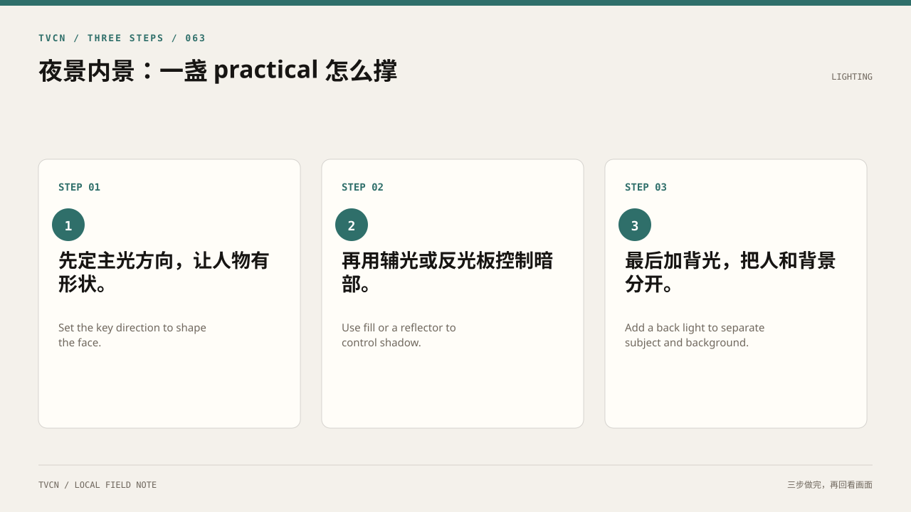

夜景内景先找画面里能信的实用光，再用一盏小灯补人脸，别把整间房打平。

<!-- DIAGRAM_START -->
<h2>图解</h2>
<figure>
  
  <figcaption>把三步按顺序做完，再回看画面或文件。</figcaption>
</figure>
<!-- DIAGRAM_END -->
<h2>现场</h2>

让画面里的一盏实际灯或壁灯当动机光。人脸 45 度补一盏小灯，背景保持暗，不要开顶灯。

<h2>怎么做</h2>

夜景内景先找画面里能信的实用光，再用一盏小灯补人脸，别把整间房打平。
<ol><li>让画面里的一盏实际灯或壁灯当动机光，真的亮着。</li><li>人脸 45 度补一盏小灯，只给眼神光和鼻侧形状。</li><li>背景保持暗，不开顶灯，让亮区和暗区分开。</li></ol>
<h2>别踩</h2>

别开顶灯把房间打平；夜景不是把白天调暗。

<h2>验收</h2>
<ul><li>画面里的实际灯真的亮着，能解释人物为什么被照到。</li><li>人脸有鼻侧影和眼神光，不是正面一片平光。</li><li>背景比人脸暗一档以上，房间仍有暗部层次。</li></ul>

<!-- DEEP_DIVE_START -->
## 深读

<strong>约 6 分钟。</strong> 夜景内景不是把灯全开，是只留一个能解释的光源，再让人脸活下来。

### 先找一个 practical

台灯、冰箱、窗外招牌、走廊灯，都是画面里能看见的光源。先定它，再补光；观众需要一个“为什么这里亮”的理由。

没有 practical，就用窗外的冷光和桌上一盏暖灯，两种颜色分工。冷光给空间，暖光给人。

### 一盏灯也要分三层

主光打脸，反光板补暗部，黑旗压背景。三层不是三盏灯，是三种控制：让脸亮、让暗部有细节、让背景退后。

人脸比背景亮一档就够，别把夜景拍成白天。背景里留一点窗框或墙面的反光，空间才不是黑洞。

### 黑位和噪点

Log 不要欠曝，暗部提亮会出噪点。先保证脸，再让黑下去；脸保不住，什么风格都是空话。

纯黑可以没有细节，但不要死黑一片。留一点边缘光，观众才知道房间还有墙。

### 窗外怎么处理

窗外比室内亮两到三档才像夜。窗框过曝可以，但室内脸不能黑。

百叶窗、纱帘、树影都能把窗外打碎。全白的窗像棚，不像夜。

### 肤色不要掉

夜景肤色容易偏青。主光加一点暖，或在后期把肤色单独提回来。

不要让所有暗部都变蓝。观众相信夜，是因为脸还像人。

### 夜景内景，十项检查
<ul><li>先找画面里的 practical</li><li>人脸比背景亮一档</li><li>主光用柔光</li><li>反光板补暗部</li><li>黑旗压背景</li><li>不要整体提亮成白天</li><li>Log 不要欠曝</li><li>灰卡或白纸拍三秒</li><li>检查窗光和灯的颜色</li><li>回放看暗部噪点</li></ul>
夜景的难不是黑，是让观众相信黑里还有人。

### 只剩五分钟时
<ul><li>先找一个画面里的 practical</li><li>窗外比室内亮三档</li><li>人脸补到比背景亮一档</li><li>黑旗压背景</li><li>Log 不要欠曝</li><li>回放看暗部噪点</li></ul>
夜景先有理由，再谈气氛；理由是一盏灯，气氛是脸还看得见。

<!-- DEEP_DIVE_END -->
