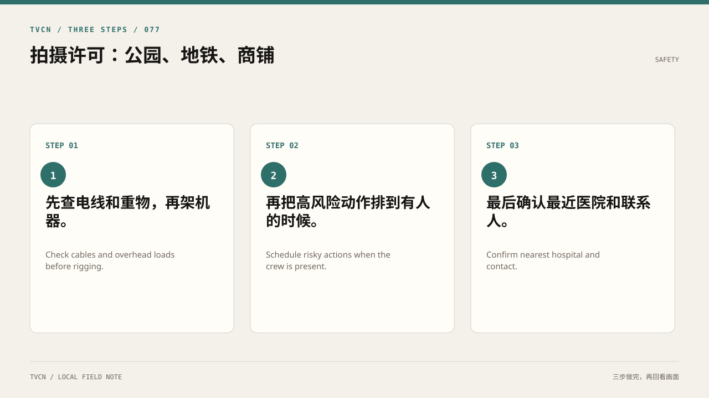

拍摄许可不是一张纸，它决定你能不能架灯、挡路、拍到招牌。

<!-- DIAGRAM_START -->
<h2>图解</h2>
<figure>
  
  <figcaption>把三步按顺序做完，再回看画面或文件。</figcaption>
</figure>
<!-- DIAGRAM_END -->
<h2>现场</h2>

问三个问题：能不能架灯、能不能挡住人行道、能不能拍到店面。把许可联系人写进通告单。

<h2>怎么做</h2>

拍摄许可不是一张纸，它决定你能不能架灯、挡路、拍到招牌。先问清三个问题，再决定机位。
<ol><li>问三个问题：能不能架灯、能不能挡住人行道、能不能拍到店面。</li><li>把答案和许可联系人写进通告单，标出禁止区域。</li><li>有一项答不清楚，就改机位或换方案，不要现场硬拍。</li></ol>
<h2>别踩</h2>

别用“拍一下就走”当许可；保安来了，机器和素材都可能保不住。

<h2>验收</h2>
<ul><li>架灯、挡路、拍招牌三个问题都有明确答案。</li><li>通告单上有许可联系人、有效时间和禁止区域。</li><li>有一项没批时，机位或方案已经改过，没有现场硬拍。</li></ul>
