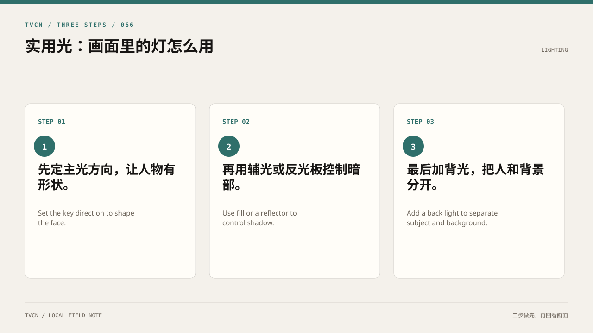

画面里的灯要真的亮、真的灭、真的闪，但它照不亮整张脸，只能当动机。

<!-- DIAGRAM_START -->
<h2>图解</h2>
<figure>
  
  <figcaption>把三步按顺序做完，再回看画面或文件。</figcaption>
</figure>
<!-- DIAGRAM_END -->
<h2>现场</h2>

让画面里的灯真的亮着，但压到 20% 或 30%。人脸用另一盏小灯打，不要拿实际灯当主光。

<h2>怎么做</h2>

画面里的灯要真的亮、真的灭、真的闪，但它照不亮整张脸，只能当动机。人脸需要另一盏小灯。
<ol><li>让画面里的灯真的亮着，但压到 20% 到 30%。</li><li>人脸用另一盏小灯打，实际灯只做背景动机。</li><li>检查灯泡在画面里不过曝，也不把整间房照亮。</li></ol>
<h2>别踩</h2>

别让画面里的灯泡当唯一主光；它照不亮脸，只会过曝。

<h2>验收</h2>
<ul><li>实际灯在画面里亮着，但没有过曝成白块。</li><li>人脸由另一盏灯打出形状，实际灯只解释背景。</li><li>关掉实际灯后，人物仍能被主光支撑。</li></ul>
