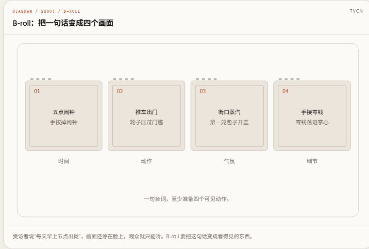

<!-- DIAGRAM_START -->
## 图解

<figure>
  
  <figcaption>受访者说“每天早上五点出摊”，画面还停在脸上，观众就只能听。B-roll 要把这句话变成看得见的东西。</figcaption>
</figure>
<!-- DIAGRAM_END -->

## 先列名词，再出门

把受访者说过的具体名词圈出来：秤、旧自行车、装钱的铁盒、凌晨的巷口。每个名词拍三样：整体、局部、动作。到了现场再找“感觉”，通常什么都找不到。

名词越具体，剪辑时越好用。“生活”拍不出来，“他把零钱一张一张抹平”可以。

## 手、脚、背影，各拍一遍

手在做，脚在走，背在离开。人脸讲情绪，手和脚讲生活。每个动作前后各留十秒，剪辑才有地方下刀。

不要只拍中景。全景交代他在哪，特写交代他怎么做，中间还要有一个能看见动作全过程的镜头。三样都有，一段话才剪得动。

## 环境声也是画面

别把现场声音关掉。菜市场的秤砣声、卷帘门、远处广播，剪进去，画面才立得住。每换一个地方，录三十秒安静的环境声，后期能补很多洞。

回程前在车上回放一遍。缺什么，趁还没离开这条街补。等回到剪辑台才发现少了只手，已经来不及。

## 检查

- 每个具体名词都有整体、局部、动作三种画面。
- 每个动作前后各留了至少十秒。
- 每个拍摄地点都录了三十秒环境声。

<!-- DEEP_DIVE_START -->
## 深读

<strong>约 5 分钟。</strong> 空镜不是填空，是让主叙事有东西可切、有细节可信。

### 先拍手、脚、背影

人物走进门之前，先拍手推门、脚跨过门槛、背影停一下；这些镜头能让剪辑在主叙事的任何位置下刀。

不要只拍脸。脸是情绪，手和脚是动作；动作镜头更耐剪。

每个动作拍两条：一条完整，一条只拍局部；局部那条给剪辑留余地。

### 每个空镜都要回答问题

每个空镜问一句：它回答什么？环境、动作、时间、关系。答不出来，就是漂亮废片。

同一场景至少拍三组：建立空间、人物细节、环境变化；每组两条，方便接。

空镜也要有开始和结束；不要只拍中间一段，剪辑找不到进点和出点。

### 别让空镜抢戏

空镜长度要短于主镜头，除非它承担转折；一个空镜超过三秒，观众会以为它是重点。

如果空镜里的颜色、运动、声音比主叙事强，剪掉；它会把注意力带走。

空镜不是越多越好；一场戏有两三个能用的细节，比二十个漂亮镜头有用。

### 补拍清单：三行就够

每个主场景列三行：空间、动作、环境变化；拍完划掉，不要凭记忆补。

空镜不要一次拍十条，先拍三条能用的；回放确认有进点、有出点，再补第二条。

如果现场只剩五分钟，先拍手和脚，再拍脸；脸可以演，手和脚不能重来。拍完立刻回放，焦点虚了，空镜就只剩颜色；现场回放比后期补救便宜。多拍一条。

### 空镜拍完，十项检查
<ul><li>先拍手、脚、背影</li><li>每个动作都有完整版和局部版</li><li>每个空镜能回答一个问题</li><li>建立空间、人物细节、环境变化各一组</li><li>每组至少两条</li><li>空镜有进点和出点</li><li>单个空镜不超过三秒</li><li>颜色和运动不抢主叙事</li><li>声音没有压过对白</li><li>收工前补拍缺的细节</li></ul>
空镜不是多余，是给剪辑留的退路。

<!-- DEEP_DIVE_END -->
