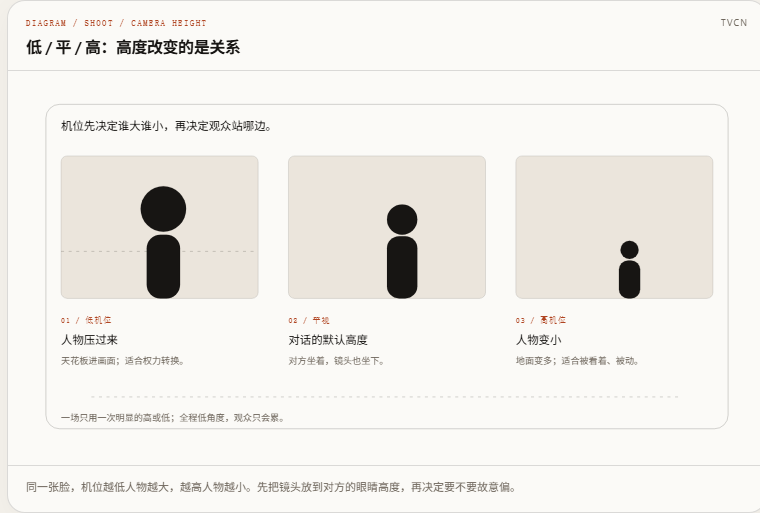

<!-- DIAGRAM_START -->
## 图解

<figure>
  
  <figcaption>同一张脸，机位越低人物越大，越高人物越小。先把镜头放到对方的眼睛高度，再决定要不要故意偏。</figcaption>
</figure>
<!-- DIAGRAM_END -->

同一张脸，机位高一寸，观众就读成另一个人。高度先决定关系，再决定景别；换镜头解决不了站错位置。

## 高机位压人，低机位抬人

相机高于人物眼睛：人物在画面里变小，地面变多，观众容易觉得他被动、被看着。低机位：人物变大，天花板进画面，观众容易觉得他压过来。

这不是“越酷越好”。一场戏里只用一次明显的高或低，变化才有意义。全程低角度，观众只会累。

## 先定眼睛高度，再决定要不要偏

对话默认平视。人物坐着，摄影机也坐到他的眼睛高度，不要站着俯拍，除非你想拍出“被审问”。

手机拍摄最容易犯的错，是站着把手机举到胸口往下拍。蹲下，把镜头放到对方眼睛的高度，脸立刻不一样。桌面三脚架和一块垫高的书，比换镜头便宜。

## 高度要跟着动作走

权力转换时降机位：他站起来，镜头跟着低；她坐下，镜头回到平。镜头高度跟动作走，观众能感觉到关系变了，但说不出为什么。

不要为了“电影感”全程低角度。高度是句子，不是口气。每场只写一句。

## 检查

- 这一场的默认高度是平视，还是有意选择的高/低？
- 坐着的采访对象，镜头是否也坐到了眼睛高度？
- 高度变化是否跟人物的站、坐、走近、退后同步？
