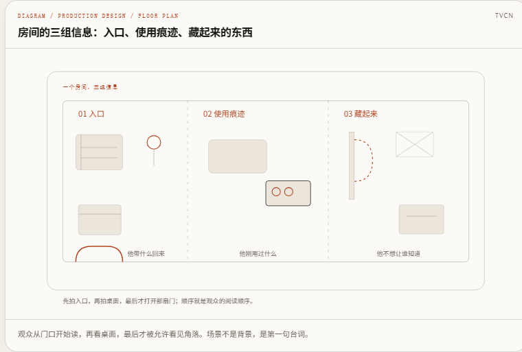

<!-- DIAGRAM_START -->
## 图解

<figure>
  
  <figcaption>观众从门口开始读，再看桌面，最后才被允许看见角落。场景不是背景，是第一句台词。</figcaption>
</figure>
<!-- DIAGRAM_END -->

人物还没说话，观众已经在读房间。场景不是背景，是第一句台词。

## 先定这间屋子住过谁

拿到一个空间，先别问“怎么拍好看”，先写三行：谁住在这里、他刚做了什么、他不想让谁看见什么。三行写不出，房间就只是背景板。

比如一间合租房：门口两双鞋，一双摆得整齐，一双踢倒；水槽里一只碗泡了三天；卧室门把手上挂着一条没送出去的领带。观众不用听解释，已经知道这里住着两个节奏不同的人。

## 道具要能被用，也要有前后

道具不是装饰。它应该被拿起、放下、打翻、藏起来。拍之前给每件关键道具写一个状态：满的、空的、干净的、用过的。观众看的是状态差，不是道具本身。

入口放三件东西：钥匙、快递、鞋。桌面放三件：杯子、药、账单。角落只放一件：他不想被看见的东西。三组信息够了，再多就变成布景仓库。

还有一条：让一件东西不合理。椅子对着门、冰箱上有一张过期的车票、垃圾桶里有一束没拆的花。观众会自己问为什么，戏就开始了。

## 光也属于这个房间

如果房间只有顶灯，人物会像在办公室；如果只有一盏台灯，他就会往光里坐。光的位置决定人物愿不愿意被看见。

先找房间里本来就有的光源：窗、台灯、冰箱门、走廊灯。给每个光源一个理由：天还没黑、他在等人、她忘了关。再用一块反光板或一张白纸补一点暗部，不要把整间屋子打亮。

拍之前从门口走到窗边，用手机拍一遍。观众第一眼看到什么、第二眼看到什么，往往和平面图上的“好看”不是一回事。

## 检查

- 能说出谁住过、刚发生了什么、藏了什么。
- 关键道具有使用痕迹或状态变化。
- 光来自房间本身，并且有一件不合理的东西让观众发问。
