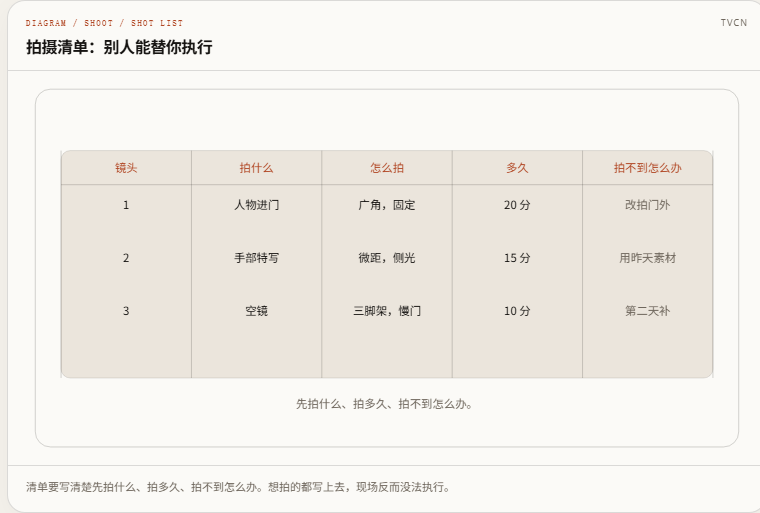

<!-- DIAGRAM_START -->
## 图解

<figure>
  
  <figcaption>清单要写清楚先拍什么、拍多久、拍不到怎么办。想拍的都写上去，现场反而没法执行。</figcaption>
</figure>
<!-- DIAGRAM_END -->

第一次写清单，很容易按剧本页数排：第 1 场、第 2 场。到了现场才发现，灯要重新架、衣服要换、太阳已经走了。

## 按机位和光线排

清单应该按机位和光线排：同一个方向、同一套灯的镜头放在一起。演员的服装连续、场地的时间窗，也写进表头。

我习惯在最上面写三行：今天必须拿到的三个镜头；可以晚一点拍的三个；拍不到就删的三个。三行写完，现场再乱，也知道底线在哪。

## 每一行都留一个替代

每个镜头后面加一列替代：反打、特写、空镜、声音。主机位卡住时，不要全组人等。推轨进不去，就用手持跟着走；全景拍不到，就用门口的空镜加一段环境声。

剪辑台上能救命的，往往是当时顺手多拍的十秒。清单的作用不是把拍摄塞满，是让你在有限的时间里，先拿到能剪成片的那几个。

## 收工前对照清单

拍完一场，站在监视器前把这一场的行划掉。不要凭记忆，记忆会在换卡、换电、换衣服之间漏掉。划完再走，少一次补拍。

清单最后留一页空白，写现场临时加的好东西。那些不在计划里的镜头，常常是最后留在片子里的一刀。

## 检查

- 清单按机位和光线分组，不是按剧本页码。
- 每个必拍镜头后面都写了替代方案。
- 收工前能对照清单说清楚哪几行还没拿到。
