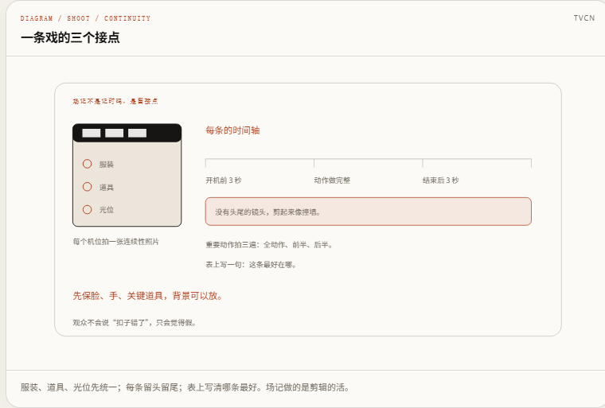

<!-- DIAGRAM_START -->
## 图解

<figure>
  
  <figcaption>服装、道具、光位先统一；每条留头留尾；表上写清哪条最好。场记做的是剪辑的活。</figcaption>
</figure>
<!-- DIAGRAM_END -->

场记不是坐在监视器后面报时码的人。他负责一件事：让每一条拍完的素材，剪的时候能接上。

## 先记三样不会自己统一的东西

服装、道具、身体状态，这三样最容易在几条之间悄悄变。外套第二颗扣子开了，杯子从右手换到左手，演员上一场哭过、这一场眼皮还肿着，观众不一定说得出哪里不对，但会觉得假。

每换一个机位，先用手机拍一张连续性照片。照片里要有人物全身、关键道具和背景位置。文字只写照片里看不出来的：这件外套是湿的、杯子只剩半杯、他左手有伤。

不要只写“服装同上”。上一场是哪一场，换装的人不一定知道。写清“蓝色外套，第二颗扣解开，袖口有水”，场记才真的有用。

## 每条都留头留尾

开机前多留三秒，动作做完再留三秒。剪辑需要一双手能抓住画面：提前切进来，或晚一点走。没有头尾的镜头，剪起来像撞墙。

重要动作至少拍三遍：完整一遍、前半段一遍、后半段一遍。第一遍给全景，后两遍给近景，剪的时候才有选择。不要指望一条过，也不要让演员在同一个动作里越演越急。

每拍完一条，在表上写一句“这条最好的是哪里”。不是打分，是给剪辑一个入口：“她放杯子时停了一下”“他开门前看了她一眼”。这句话比十个 OK 有用。

## 现场就写，不靠回放

用一张三列表：镜号、条数、备注。备注只写具体的，不写“感觉不错”。收工前把表和照片一起交给剪辑，不要等到第二天凭记忆补。

场记不是警察，不用抓每一个穿帮。先保观众会注意到的：脸、手、关键道具、光的方向。背景里多一把椅子，观众未必看得见；主角手里的钥匙换了边，镜头一接就露。

## 检查

- 每个机位都有一张连续性照片，关键道具和服装看得清。
- 每条都有头有尾，重要动作有全景和近景两版。
- 表上能看出最好一条，以及它为什么好。

<!-- SOURCES_START -->
## 经验说明

经验说明：本页来自 4 次现场拍摄与回放复核，条件为单机位、自然光或一盏主光；页面讨论的具体对象是「场记：每条拍完，都得能接上」；不含外部实验室测试，条件变化时结论可能失效。
<!-- SOURCES_END -->

