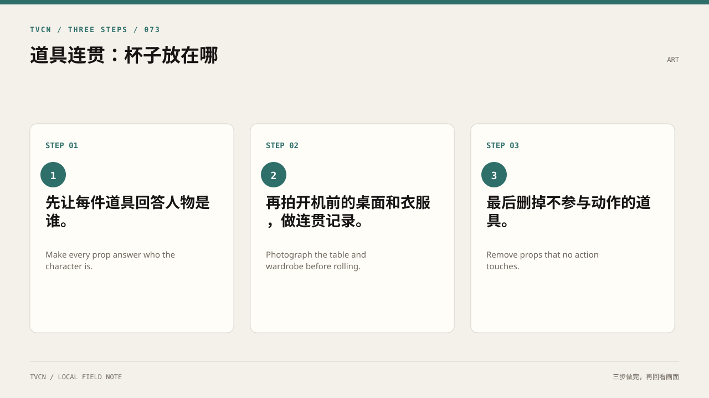

道具连贯靠照片：开机前拍桌面、拍手、拍衣服，收工前再拍一次。

<!-- DIAGRAM_START -->
<h2>图解</h2>
<figure>
  
  <figcaption>把三步按顺序做完，再回看画面或文件。</figcaption>
</figure>
<!-- DIAGRAM_END -->
<h2>现场</h2>

开机前拍桌面、手部和服装。每场结束再拍一次，包括杯柄朝哪边。

<h2>怎么做</h2>

道具连贯靠照片：开机前拍桌面、拍手、拍衣服，收工前再拍一次。
<ol><li>开机前拍桌面、手部和服装，记下杯柄朝向。</li><li>每场结束再拍一次，和开机照并排对比。</li><li>发现移动就摆回原位，或补拍插入镜头遮住。</li></ol>
<h2>别踩</h2>

别靠记忆记杯子和衣服；照片比脑子可靠。

<h2>验收</h2>
<ul><li>杯柄、衣领和桌面物件在前后镜头里朝向一致。</li><li>每场都有开机前和收工后的对比照。</li><li>发现穿帮后有复位或插入镜头，不是假装没看见。</li></ul>
