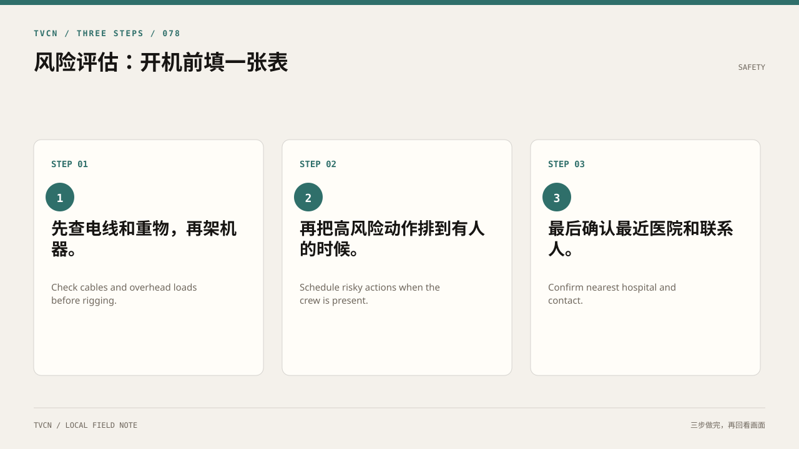

风险表不是列满所有可能，而是找出“一旦发生，今天拍不成”的三五项：天气、关键人缺席、设备故障、场地被拒、交通中断。每项写触发条件、备选方案、决定时间。

<!-- DIAGRAM_START -->
<h2>图解</h2>
<figure>
  
  <figcaption>看“一页纸填四格：谁可能受伤、什么会掉、…”和“开机前读给全组听，指定每个风险点的负…”两处，判断高光、肤色和声音有没有被同时保住。</figcaption>
</figure>
<!-- DIAGRAM_END -->
<section><h2 id="section-1">先写“会停拍的那一项”</h2>
把“最晚决定时刻”写进通告：到几点还没解决，就切 Plan B，不现场争论。
<h2 id="section-2">边界</h2>
风险表不是保险单。它不能消除风险，只能让你提前决定；真正的安全仍要靠现场负责人和停机权。
</section><section><h2 id="section-3">现场</h2>
一页纸填四格：谁可能受伤、什么会掉、谁负责、最近医院在哪。开机前读给全组听。
</section><section><h2 id="section-4">怎么做</h2>
填完要读给全组听。
<ol><li>一页纸填四格：谁可能受伤、什么会掉、谁负责、最近医院在哪。</li><li>开机前读给全组听，指定每个风险点的负责人。</li><li>现场变化后更新一版，收工前确认没人漏掉。</li></ol></section><section><h2 id="section-5">别踩</h2>
别把表填完就锁进抽屉；没人听过，等于没做。
</section><section><h2>判断</h2>
这一页的判断只看三条可观察的验收，不靠口号：
<ul><li><strong>1.</strong> 四格都填了具体内容，不是“注意安全”这种空话。</li><li><strong>2.</strong> 每个风险点都有名字负责，组员能说出自己那一项。</li><li><strong>3.</strong> 现场变化后表有更新，收工前重新确认过。</li></ul></section><section><h2>失败</h2>
下面任一条出现，先停，不要靠后期补：
<ul><li><strong>1.</strong> 只做到“四格都填了具体内容，不是“注意安全”这种空话”的形式，换一个机位或场景就重现不了。</li><li><strong>2.</strong> 把“每个风险点都有名字负责，组员能说出自己那一项”留到后期或口头解释，现场没有留下能复查的记录。</li><li><strong>3.</strong> 别把表填完就锁进抽屉；没人听过，等于没做。</li></ul></section><section><h2>延伸</h2>
<strong>10 分钟练习：</strong>用同一扇窗拍三条 10 秒，只改“一页纸填四格：谁可能受伤、什么会掉、…”；比较高光、肤色和背景，选一条能直接剪的。
</section>
<h2>验收</h2><ul><li>四格都填了具体内容，不是“注意安全”这种空话。</li><li>每个风险点都有名字负责，组员能说出自己那一项。</li><li>现场变化后表有更新，收工前重新确认过。</li></ul>

<!-- SOURCES_START -->
## 参考与延伸阅读

- [S23] [SMPTE 标准入口](https://www.smpte.org/standards) — 2026-11-26 访问。用于核对首段“风险评估一页纸：谁可能受伤、什么会掉、出了事谁负责、最近的医院在哪。”中的术语与公开背景（时间码、色彩、影院与信号链标准的机构入口）；不替代现场测试。
- [S31] [ARRI Cine Systems](https://www.arri.com/en/cine-systems) — 2026-11-26 访问。用于核对首段“风险评估一页纸：谁可能受伤、什么会掉、出了事谁负责、最近的医院在哪。”中的术语与公开背景（摄影机、镜头与灯光的技术资料入口）；不替代现场测试。
<!-- SOURCES_END -->

