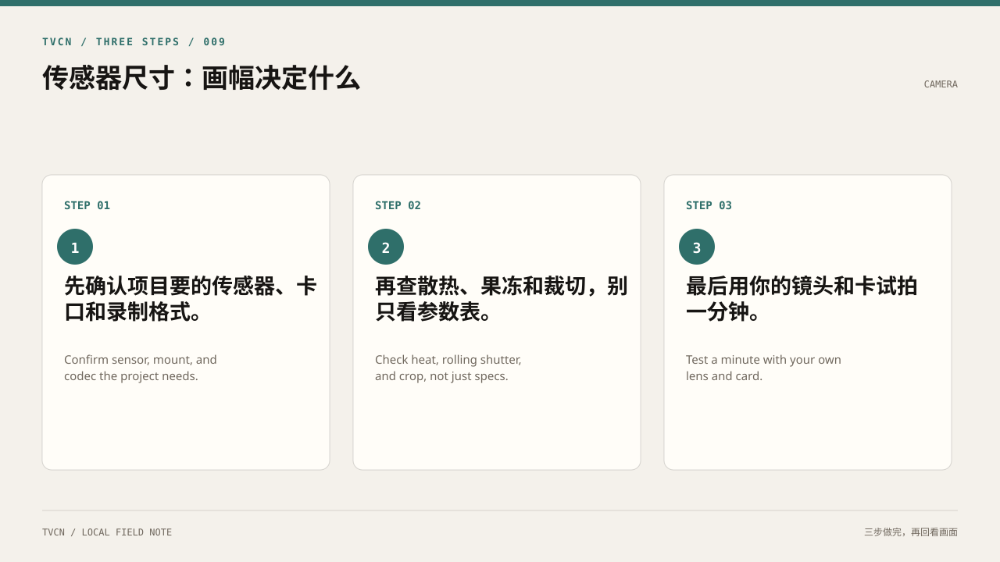

传感器尺寸改变的是视角、景深和低光，不是“电影感”本身。

<!-- DIAGRAM_START -->
<h2>图解</h2>
<figure>
  
  <figcaption>把三步按顺序做完，再回看画面或文件。</figcaption>
</figure>
<!-- DIAGRAM_END -->
<h2>现场</h2>

把同一支镜头分别装到 M4/3、S35 和全画幅机身上，拍同一个半身构图。保持取景一致，比较背景压缩和暗部噪点，再按项目选机身。

<h2>怎么做</h2>

传感器尺寸改变的是视角、景深和低光，不是“电影感”本身。用同一支镜头、同一构图在几个画幅上对比，才知道差别值不值。
<ol><li>把同一支镜头装到 M4/3、S35 和全画幅机身上，保持同一个半身构图。</li><li>比较背景压缩、景深和暗部噪点，不要只看分辨率。</li><li>按项目需要选机身，再看卡口、录制格式和散热。</li></ol>
<h2>别踩</h2>

别把“电影感”当传感器参数；它来自光、镜头和调度。

<h2>验收</h2>
<ul><li>三台机身拍出的半身构图一致，能直接并排比较。</li><li>能指出背景压缩、景深和暗部噪点的具体差别，而不是只说“更有电影感”。</li><li>选中的机身能覆盖项目八成镜头，卡口和录制格式不需要转接凑合。</li></ul>

<!-- DEEP_DIVE_START -->
## 深读

<strong>约 5 分钟。</strong> 画幅不是越大越高级；它先改变视角、景深和重量，再改变画面气质。

### 同一支镜头，换画幅就换视角

一支 50mm 镜头，在全画幅上是 50mm，在 S35 上约 70mm，在 M4/3 上等于 100mm。先算等效焦距，再谈“这镜头够不够广”。

不要拿全画幅的广角去套小画幅；18mm 在 M4/3 上是 36mm，房间会突然变窄。

### 景深要按同构图比

相同构图、相同光圈下，全画幅的景深更浅；小画幅要把光圈开大一到两档，才能接近同样的分离。但开大光圈会带来更多进光，快门和 ND 要重算。

如果你要两个人都在焦点里，小画幅反而省事；如果你要脸从背景里浮出来，全画幅更容易，但焦点也更容不得偏。

### 重量和续航也是画幅

全画幅机身、镜头、电池和 ND 都更重；手持拍一整天，肩膀会先罢工。小画幅适合旅行、活动、纪录片和狭窄空间；全画幅适合低光、浅景深和广角。

先看你要拍多久、走多远、谁来背，再看画幅。参数表不会替你背机器。

### 先借一台拍一天

不要只看参数表。借或租一台目标画幅，按你真实的一天拍：走路、手持、换镜头、低光、导入剪辑。记录肩膀酸的时间、电池换了几块、广角够不够、暗部噪点能不能接受。

同一天再拍一条小画幅，剪在一起看。很多“必须全画幅”的需求，最后只是想要一个更干净的暗部；很多“轻便”的需求，最后发现镜头群更重。

测试时把同一支镜头拧上去，不要用不同镜头比；否则你比较的是镜头，不是画幅。

### 选画幅前，十项确认
<ul><li>先算等效焦距</li><li>同构图再比景深</li><li>确认低光下的噪点</li><li>把镜头、电池和 ND 的重量算进去</li><li>确认机器能连续录多久</li><li>广角边缘画质先试拍</li><li>ND 和快门重新算</li><li>卡和备份够不够</li><li>用三种光各拍一条</li><li>最后再问画幅够不够</li></ul>
画幅是约束，不是等级；先让机器适合这一天，再让它适合你的审美。

<!-- DEEP_DIVE_END -->
