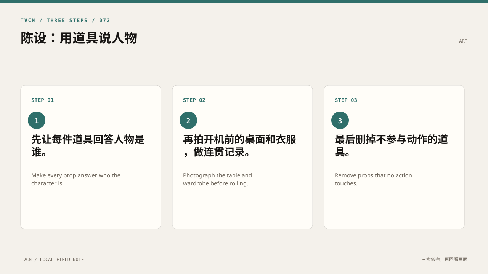

道具不是摆得满。先写人物的三个习惯：鞋怎么放、杯子放哪、墙上留什么。每个习惯对应一个可见痕迹；观众从痕迹读生活，不从数量读丰富。

<!-- DIAGRAM_START -->
<h2>图解</h2>
<figure>
  
  <figcaption>看“给每件道具写一句来历：谁买的、用了多…”和“开机前拍一张全景和桌面、手部、服装细…”两处，判断高光、肤色和声音有没有被同时保住。</figcaption>
</figure>
<!-- DIAGRAM_END -->
<section><h2 id="section-1">陈设先服务“谁住在这里”</h2>
前景留一件能遮挡的物件，后景留一块能呼吸的空白；中间才是人物。
<h2 id="section-2">边界</h2>
陈设不能抢表演。颜色太跳、图案太密，观众会看墙不看人；先压背景，再谈细节。
</section><section><h2 id="section-3">现场</h2>
给每件道具写一句来历：谁买的、用了多久、为什么留着。开机前拍一张全景，收工后再对一遍。
</section><section><h2 id="section-4">怎么做</h2><ol><li>给每件道具写一句来历：谁买的、用了多久、为什么留着。</li><li>开机前拍一张全景和桌面、手部、服装细节。</li><li>删掉不参与动作、也不解释人物的道具。</li></ol></section><section><h2 id="section-5">别踩</h2>
别把陈设做成杂货店；信息太多等于没有信息。
</section><section><h2>判断</h2>
这一页的判断只看三条可观察的验收，不靠口号：
<ul><li><strong>1.</strong> 每件留在画面里的道具都有一句来历，能说出口。</li><li><strong>2.</strong> 全景和细节照能对上，道具位置没有在镜头间漂移。</li><li><strong>3.</strong> 至少删掉一件不参与动作的装饰，画面信息更清楚。</li></ul></section><section><h2>失败</h2>
下面任一条出现，先停，不要靠后期补：
<ul><li><strong>1.</strong> 只做到“每件留在画面里的道具都有一句来历，能说出口”的形式，换一个机位或场景就重现不了。</li><li><strong>2.</strong> 把“全景和细节照能对上，道具位置没有在镜头间漂移”留到后期或口头解释，现场没有留下能复查的记录。</li><li><strong>3.</strong> 别把陈设做成杂货店；信息太多等于没有信息。</li></ul></section><section><h2>延伸</h2>
<strong>10 分钟练习：</strong>用同一扇窗拍三条 10 秒，只改“给每件道具写一句来历：谁买的、用了多…”；比较高光、肤色和背景，选一条能直接剪的。
</section>
<h2>验收</h2><ul><li>每件留在画面里的道具都有一句来历，能说出口。</li><li>全景和细节照能对上，道具位置没有在镜头间漂移。</li><li>至少删掉一件不参与动作的装饰，画面信息更清楚。</li></ul>

<!-- SOURCES_START -->
## 参考与延伸阅读

- [S31] [ARRI Cine Systems](https://www.arri.com/en/cine-systems) — 2026-11-26 访问。用于核对首段“陈设不是买一堆好看的东西，而是让每件道具回答“这个人为什么把它留在这里”。”中的术语与公开背景（摄影机、镜头与灯光的技术资料入口）；不替代现场测试。
- [S23] [SMPTE 标准入口](https://www.smpte.org/standards) — 2026-11-26 访问。用于核对首段“陈设不是买一堆好看的东西，而是让每件道具回答“这个人为什么把它留在这里”。”中的术语与公开背景（时间码、色彩、影院与信号链标准的机构入口）；不替代现场测试。
<!-- SOURCES_END -->

