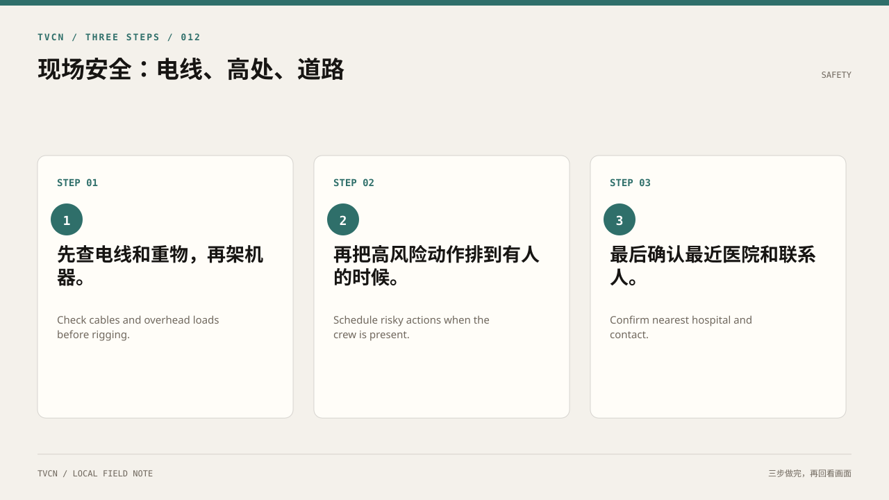

开机前走一遍现场：电线有没有绊人的路径、灯架有没有配重、高处有没有固定点、道路有没有封闭和反光衣。每个风险写一个负责人和一个停止拍摄的条件。

<!-- DIAGRAM_START -->
<h2>图解</h2>
<figure>
  
  <figcaption>看“把过道电缆用胶带压平，每个灯架压上沙…”和“高处的灯架安排人扶，靠道路时全员穿反…”两处，判断高光、肤色和声音有没有被同时保住。</figcaption>
</figure>
<!-- DIAGRAM_END -->
<section><h2 id="section-1">先保人，再保镜头</h2>
把“今天必须拍到”的清单和安全清单放在同一张通告上；任何一项安全条件不满足，先停机，不用“拍完再说”。
<h2 id="section-2">边界</h2>
安全不是形式主义，也不是让非专业人员冒险。需要电工、封路或高空作业时，找有资质的人；不要用“我们以前都这样”当许可。
</section><section><h2 id="section-3">现场</h2>
开机前走一遍现场：过道电缆用胶带压平，每个灯架压沙袋，高处的灯架有人扶，靠近道路时穿反光背心。
</section><section><h2 id="section-4">怎么做</h2>
开机前走一遍，把风险动手改掉，不要只写在纸上。
<ol><li>把过道电缆用胶带压平，每个灯架压上沙袋。</li><li>高处的灯架安排人扶，靠道路时全员穿反光背心。</li><li>把最近医院、集合点和联系人写进通告，开机前读给全组。</li></ol></section><section><h2 id="section-5">别踩</h2>
别让一个人搬灯架；倒下来没人接。
</section><section><h2>判断</h2>
现场只认三个信号：
<ul><li>高光没有死白，暗部仍保留可恢复的细节</li><li>同一条片子里肤色一致，切机位不跳</li><li>声音有独立音轨，不靠机头麦兜底</li></ul></section><section><h2>失败</h2>
下面三种做法会让页面上的细节白做：
<ul><li>曝光对了，但光没有方向，脸和背景粘在一起</li><li>声音只靠机头麦，现场一吵就废</li><li>机位越轴，观众失去空间方向</li></ul></section><section><h2>延伸</h2>
<strong>10 分钟练习：</strong>用同一扇窗拍三条 10 秒，只改“把过道电缆用胶带压平，每个灯架压上沙…”；比较高光、肤色和背景，选一条能直接剪的。
</section>
<h2>验收</h2><ul><li>走道上没有可绊人的电缆，灯架都有沙袋。</li><li>高处灯架有人扶，道路旁的组员穿着反光背心。</li><li>任何组员都能说出最近医院、集合点和现场联系人。</li></ul>

<!-- DEEP_DIVE_START -->
## 深读

<strong>约 5 分钟。</strong> 现场安全不是免责声明，是开机前把电线、高处和道路逐项检查。

### 电线先压边

所有电缆用胶带压边，过道留通道；不要用椅子当灯架；配电不要串太多插排。

人走过的路线先清空，再把灯架放进画面外；绊一次，机器和人都可能报废。

### 高处要有人扶

梯子有人扶，工具用绳绑；不要站在栏杆上；三脚架加沙袋。

举灯过肩先看头顶有没有电线；室外先看风向，柔光箱会变成帆。

### 道路和天气

路边拍摄穿反光衣，设警示锥；先看天气和日落时间；不要为了一个镜头站在车流里。

开机前把紧急联系人、最近医院和集合点发到群里；出事时没人有空翻聊天记录。

### 开机前十分钟

把现场分成三条线：人走的线、电走的线、机器站的线。三条线不交叉，绊倒和踢灯就少一半。

灯架、三脚架、轨道都加配重；户外每加一件高物体，就多一根绳。

把最近医院、紧急联系人和集合点写在纸上，贴在监视器旁；手机没电也能看到。收工同样按这三条线撤：先断电，再收小件，最后搬灯；不要让人在黑暗里跨线。

### 收工前最后一件事

关掉总电源，再收小件，最后搬灯；不要让任何人在黑暗里跨过电缆。把警示锥和反光衣收回同一个箱子，下次不用满场找。

最后看一眼地面：胶带、螺丝、镜头盖，全部捡起来；第二天开机，脚不会先替你发现。出口只有一个时，先清出口，再架灯；不要让灯架挡住唯一出口，也不要让电缆横在门口。先清出口，再谈机位。

### 开机前，安全十项
<ul><li>电缆全部压边</li><li>过道保持清空</li><li>不用椅子当灯架</li><li>插排不超载</li><li>梯子有人扶</li><li>工具系绳</li><li>三脚架加沙袋</li><li>举灯前看头顶</li><li>路边穿反光衣并设锥</li><li>紧急联系人发到群里</li></ul>
安全不是拍得慢，是让所有人还能拍下一条。

<!-- DEEP_DIVE_END -->
<!-- SOURCES_START -->
