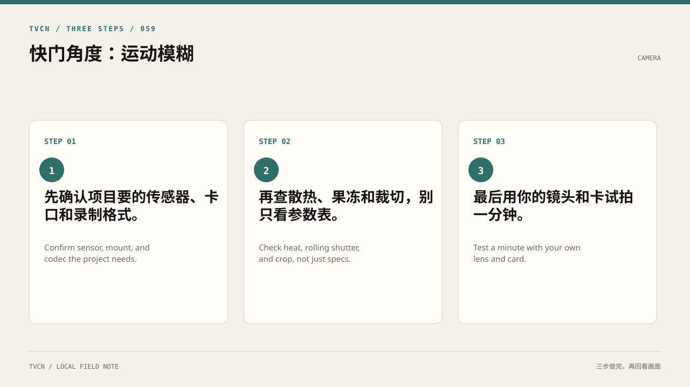

快门 1/50（25p）或 1/48（24p）对应 180 度，运动模糊接近电影感。想要更“锐”的瞬间，可以提高快门；想要更柔的拖影，可以降低，但要注意频闪和果冻。

<!-- DIAGRAM_START -->
<h2>图解</h2>
<figure>
  
  <figcaption>看“25p 下用 180 度，也就是 1…”和“要更利落的动作可用 90 度，要更多…”两处，判断高光、肤色和声音有没有被同时保住。</figcaption>
</figure>
<!-- DIAGRAM_END -->
<section><h2 id="section-1">180 度是起点，不是法律</h2>
快门和灯光要匹配：50Hz 地区用 1/50 或 1/100，避免 1/60 造成滚动黑带。
<h2 id="section-2">边界</h2>
快门不是曝光工具。曝光不够时先加灯或开光圈，不要靠降快门救；慢快门会让动作糊成泥。
</section><section><h2 id="section-3">现场</h2>
25p 下用 180 度快门，也就是 1/50。要更利落的动作可以用 90 度，要更多拖影可以用 360 度，但不要和电网频率打架。
</section><section><h2 id="section-4">怎么做</h2>
先按帧率算出快门，再决定要利落还是拖影。
<ol><li>25p 下用 180 度，也就是 1/50 快门。</li><li>要更利落的动作可用 90 度，要更多拖影可用 360 度。</li><li>在 50Hz 灯光下试拍，确认没有频闪或banding。</li></ol></section><section><h2 id="section-5">别踩</h2>
别所有动作都用 180 度；也别让快门和 50Hz 灯光打架。
</section><section><h2>判断</h2>
现场只认三个信号：
<ul><li>高光没有死白，暗部仍保留可恢复的细节</li><li>同一条片子里肤色一致，切机位不跳</li><li>声音有独立音轨，不靠机头麦兜底</li></ul></section><section><h2>失败</h2>
下面三种做法会让页面上的细节白做：
<ul><li>曝光对了，但光没有方向，脸和背景粘在一起</li><li>声音只靠机头麦，现场一吵就废</li><li>机位越轴，观众失去空间方向</li></ul></section><section><h2>延伸</h2>
<strong>10 分钟练习：</strong>用同一扇窗拍三条 10 秒，只改“25p 下用 180 度，也就是 1…”；比较高光、肤色和背景，选一条能直接剪的。
</section>
<h2>验收</h2><ul><li>快门值能从帧率和角度算出来，不是凭感觉拧。</li><li>动作的拖影程度符合要利落还是要柔和的选择。</li><li>在现场灯光下回放，没有频闪、banding 或滚动黑带。</li></ul>

<!-- DEEP_DIVE_START -->
## 深读

<strong>约 5 分钟。</strong> 快门角度决定运动模糊；先把动作拍自然，再谈风格。

### 180 度是起点

24 帧用 1/48 或 1/50，25 帧用 1/50，30 帧用 1/60；50 帧用 1/100，120 帧用 1/240。这个 180 度让运动有自然拖影，不是电影感的装饰。

如果项目是 25 帧，别照搬 24 帧的 1/48；差一点在快速横摇时会被看见。

### 模糊多寡是信息

手挥、车过、转头，180 度给观众方向；想要定格，提高到 1/250 或 1/500，动作会变硬；想要更糊，降到 1/25，但灯光可能频闪。

日光灯 50Hz 地区用 1/50 或 1/100；60Hz 用 1/60 或 1/120。先拍一条回放，不要凭感觉。

### 升格要补光

120 帧的 180 度是 1/240，进光少两档多；室内先加灯或开大光圈。LED 灯也可能频闪，拍一条慢动作回放，看有没有滚动条。

不要用升格救没有设计的动作；慢下来只会让空洞更明显。

### 先拍三条，再定快门

第一条按 180 度拍，第二条把快门提高一档，第三条降一档；同一动作各拍一次，回放比拖影和频闪。

如果画面里有屏幕、LED 或车灯，先看滚动条和频闪；快门不是唯一变量，灯和帧率也会改。

把选定值写进拍摄表，换场时不要再凭感觉改。现场改一次快门，后期就要重新对一次运动。

### 快门设置，十项确认
<ul><li>先确认项目帧率</li><li>按两倍帧率算快门</li><li>50Hz 灯光用 1/50 或 1/100</li><li>60Hz 灯光用 1/60 或 1/120</li><li>快速动作拍一条回放</li><li>升格前先算进光</li><li>升格前确认灯不闪</li><li>ND 和光圈一起重算</li><li>动作片留一点拖影</li><li>不要用高快门掩盖坏动作</li></ul>
快门先服务动作，再服务风格；动作不清楚，风格就是噪音。

<!-- DEEP_DIVE_END -->
