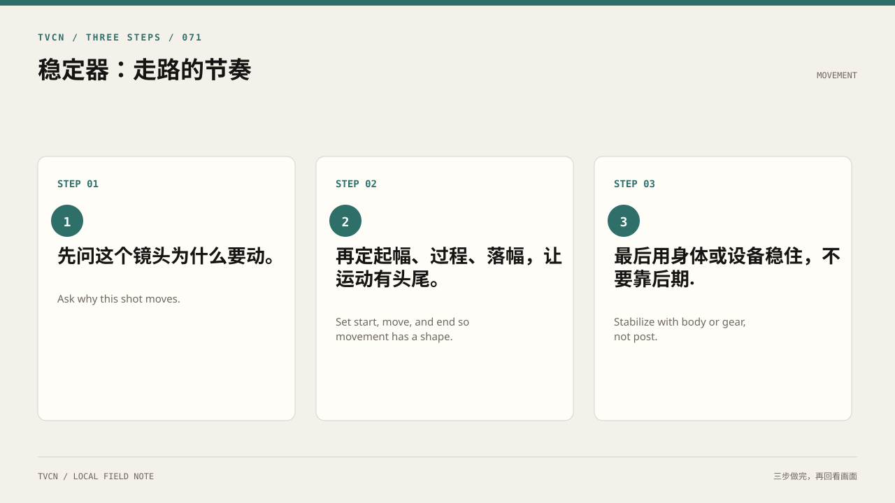

后期稳定会放大画面、裁掉边缘。先确认构图四周有余量；没有余量，稳定后会出现黑边或软边。手持广角比长焦更容易救。

<!-- DIAGRAM_START -->
<h2>图解</h2>
<figure>
  
  <figcaption>看“膝盖微屈，脚跟先落地，走直线”和“上机器前先空走二十米，找到匀速”两处，判断高光、肤色和声音有没有被同时保住。</figcaption>
</figure>
<!-- DIAGRAM_END -->
<section><h2 id="section-1">稳定先看“有没有空间裁切”</h2>
稳定的顺序：先做相机校正，再做稳定，最后做构图微调；不要先裁再稳。
<h2 id="section-2">边界</h2>
稳定不能修运动模糊和果冻。快门太慢、滚动快门太强，稳定只会让变形更明显；先回拍摄解决。
</section><section><h2 id="section-3">现场</h2>
膝盖微屈，脚跟先落地，走直线。上机器前先空走二十米。转弯要慢，不要靠腰拧。
</section><section><h2 id="section-4">怎么做</h2><ol><li>膝盖微屈，脚跟先落地，走直线。</li><li>上机器前先空走二十米，找到匀速。</li><li>转弯要慢，用脚步转，不要靠腰拧。</li></ol></section><section><h2 id="section-5">别踩</h2>
别碎步、别拧腰；稳定器只能消小抖，消不掉脚步的上下跳。
</section><section><h2>判断</h2>
现场只认三个信号：
<ul><li>高光没有死白，暗部仍保留可恢复的细节</li><li>同一条片子里肤色一致，切机位不跳</li><li>声音有独立音轨，不靠机头麦兜底</li></ul></section><section><h2>失败</h2>
下面三种做法会让页面上的细节白做：
<ul><li>曝光对了，但光没有方向，脸和背景粘在一起</li><li>声音只靠机头麦，现场一吵就废</li><li>机位越轴，观众失去空间方向</li></ul></section><section><h2>延伸</h2>
<strong>10 分钟练习：</strong>用同一扇窗拍三条 10 秒，只改“膝盖微屈，脚跟先落地，走直线”；比较高光、肤色和背景，选一条能直接剪的。
</section>
<h2>验收</h2><ul><li>直线行走时画面没有随脚步上下起伏。</li><li>转弯速度均匀，没有突然甩头或横移。</li><li>二十米空走和带机器走的节奏一致。</li></ul>

<!-- DEEP_DIVE_START -->
## 深读

<strong>约 5 分钟。</strong> 稳定器不是开了就稳；走路、握持和重心才决定画面。

### 走路先练三点

膝盖微屈、脚跟先落、身体不要上下弹；速度比平时慢三成；眼睛看前方，不看屏幕。

倒着走一遍，回放看画面有没有上下呼吸；有，就再慢一点。

### 调平与模式

开机前调平三轴，电机不烫；跟随模式适合走位，锁定模式适合固定机位；大风里不要开全跟随。

调平不是看水平仪，是让云台在任何角度都不自己倒；差一点，电机就会一直较劲。

### 常见坏习惯

手臂伸直、手指抓死、转身用腰拧；正确是手臂贴身体、云台靠近重心、转身用脚。

低角度把云台倒过来，高角度把杆升高；不要弯腰驼背去够画面。

### 找一条十米的路线

找一条十米长的走廊或人行道，按正式速度走三遍：正常、慢三成、更慢。每遍回放看画面上下呼吸和左右摆。

再练倒走、侧移、绕人半圈；每种走两遍，记住身体哪个部位先累。

拍摄前先空走一遍，确认地面没有门槛、线缆和湿滑；稳定器怕的不是抖，是突然停。如果路线要上下楼，先决定是抱机器还是拆云台，不要到楼梯口才想。

### 五分钟练习：绕一只杯子

把一只杯子放在地上，围绕它走一整圈，保持杯口在画面同一个位置；走三圈，每圈换一个方向。回放看杯子有没有左右漂、画面有没有上下呼吸。

再把杯子换成一个人，距离拉到两米，练半圈；人不会像杯子一样等你，提前说好走位。如果画面还在漂，先把速度再降一成。

### 开机前，稳定器十项
<ul><li>三轴调平再开机</li><li>电机不烫手</li><li>电池和卡都装好</li><li>选择跟随或锁定模式</li><li>手臂贴住身体</li><li>走路慢三成</li><li>脚跟先落地</li><li>眼睛看前方</li><li>转身用脚不用腰</li><li>拍一条回放看上下呼吸</li></ul>
稳定器的稳，先在身上，再在机器上。

<!-- DEEP_DIVE_END -->
