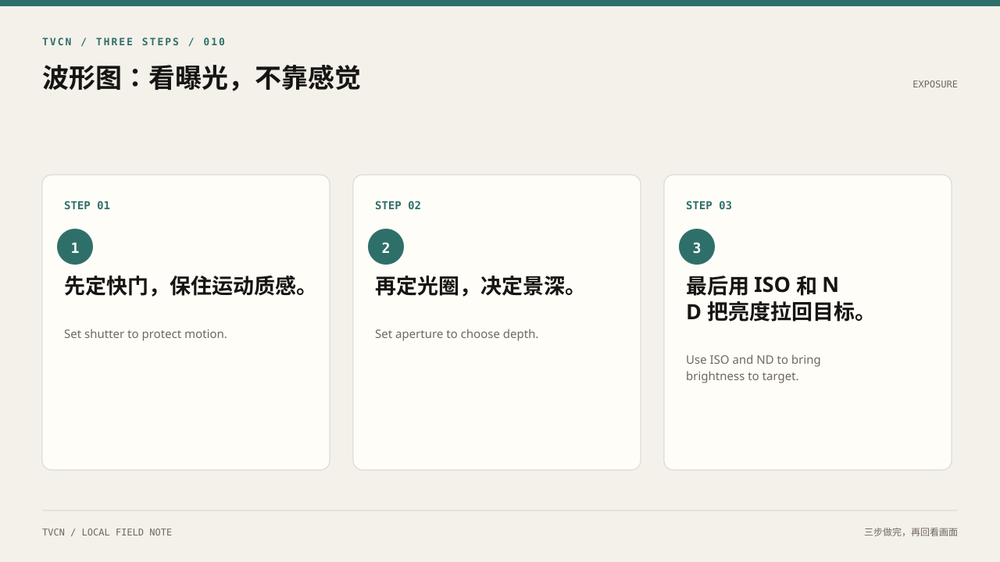

波形图看亮度分布，不看画面好不好看；先保高光，再决定暗部留多少。

<!-- DIAGRAM_START -->
<h2>图解</h2>
<figure>
  
  <figcaption>把三步按顺序做完，再回看画面或文件。</figcaption>
</figure>
<!-- DIAGRAM_END -->
<h2>现场</h2>

人脸放在 55 到 65 IRE，天空压在 95 以下。波形顶到天花板时，先减一档光或加 ND，不要指望后期拉回来。

<h2>怎么做</h2>

波形图看亮度分布，先保高光，再决定暗部留多少。人脸放在 55 到 65 IRE，天空压在 95 以下；波形顶到天花板时，先减光或加 ND。
<ol><li>先把人脸放进 55 到 65 IRE 的区间。</li><li>再把天空或窗户压到 95 IRE 以下，保住细节。</li><li>如果波形还顶到顶，减一档光或加 ND，不要指望后期拉回。</li></ol>
<h2>别踩</h2>

别让波形顶到天花板还指望后期拉回来；高光一死就救不回。

<h2>验收</h2>
<ul><li>人脸落在 55 到 65 IRE，没有一片死白。</li><li>天空或窗户在高光区仍有层次，波形没有贴顶。</li><li>出现过曝时先改光或加 ND，没有用高 ISO 硬撑。</li></ul>

<!-- DEEP_DIVE_START -->
## 深读

<strong>约 5 分钟。</strong> 波形图不是装饰。它把“看着差不多”换成“高光有没有撞顶、肤色落在哪一段”。

### 波形不是越亮越好

波形顶部贴到 100 就是死白，后期拉不回来。Log 素材整体会偏低，不要按 Rec.709 的习惯硬提。先看高光有没有撞顶，再看肤色落在哪一段，最后才看整体亮度。

同一场戏的曝光要一致。换镜位、换镜头后重新看一眼波形；变的是背景亮度，不该是脸。

### 没有波形时的替代

打开斑马纹 95%，脸和窗同时出现斑马就降曝光；有伪色就用紫色或红色盯高光；都没有就先拍一条，回放看直方图。不要相信取景器屏幕，它常被环境光骗。

现场带一张白纸或灰卡，先拍三秒。后期至少知道“白”原本有多白，混合光底下尤其有用。

### Log 素材要留余量

Log 看起来灰，不是让你在现场把它提亮。把高光留在波形顶部下面，给后期留一档；暗部脏一点可以补，高光死了补不回来。

同一场戏先拍一张灰卡，后期所有镜头对着它统一。没有灰卡，就找一面白墙或一张白纸，但别让纸反光过曝。

### 三种会骗你的光

身后的窗、桌上的 practical、白墙反光，都会让取景器看起来比实际亮。看波形，不看屏幕；看高光，不看整体。

如果现场没有波形，先拍一条回放，看直方图最右侧有没有贴边。贴边就是死白，降曝光再拍。

### 曝光前，先确认这十件事
<ul><li>先看高光有没有贴到波形顶部</li><li>再看肤色落在中间偏上还是偏下</li><li>最后才看整体亮度</li><li>同一场戏所有镜头曝光一致</li><li>换镜位后重新看一次波形</li><li>换镜头后重新看一次波形</li><li>没有波形就开斑马纹九十五</li><li>有伪色就用紫色或红色盯高光</li><li>开拍先拍三秒灰卡或白纸</li><li>回放看直方图最右侧有没有贴边</li></ul>
波形不是让你变成技术员，是让你回放时不用骂自己。现场多看一眼，后期少救一小时。

<!-- DEEP_DIVE_END -->
