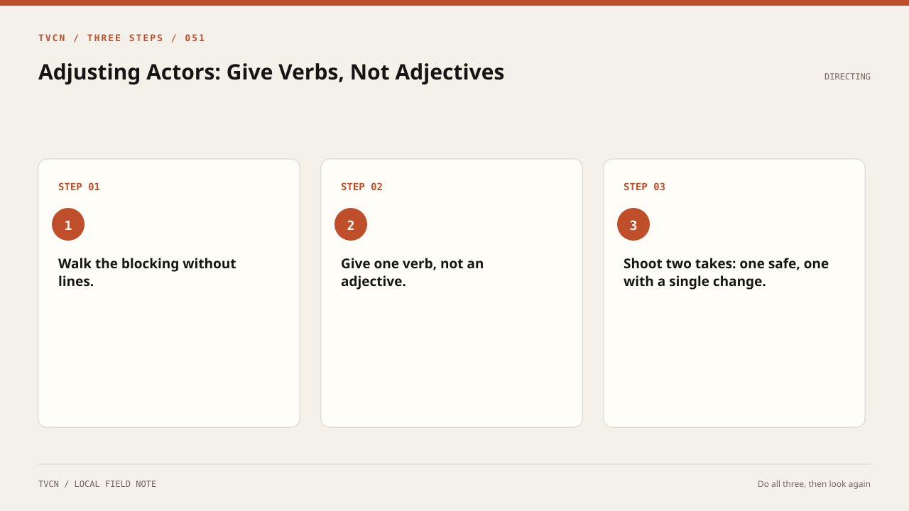

Give actors verbs: slower, hold the anger, do not touch her. Never "be more natural."

<!-- DIAGRAM_START -->
<h2>Diagram</h2>
<figure>
  
  <figcaption>Do the three steps in order, then look again at the image or file.</figcaption>
</figure>
<!-- DIAGRAM_END -->
<h2>On set</h2>

Give one verb at a time, then watch the take. If it is still wrong, change the verb, not the adjective. When the actor asks why, say do it first, we will talk after.

<h2>Do this</h2>

Give the actor a verb: walk slower, hold the anger, do not touch her. Never “be more natural.”
<ol><li>Give one verb at a time, then watch playback.</li><li>If it is still wrong, change the verb, not the adjective.</li><li>If the actor asks why, say “do it first, we'll explain after.”</li></ol>
<h2>Avoid</h2>

Do not give three adjectives at once; the actor plays “confused,” not the character.

<h2>Check</h2>
<ul><li>Each adjustment gives one verb with no adjective stack.</li><li>Two takes differ by one variable and the difference can be named.</li><li>The actor can repeat their next action.</li></ul>
