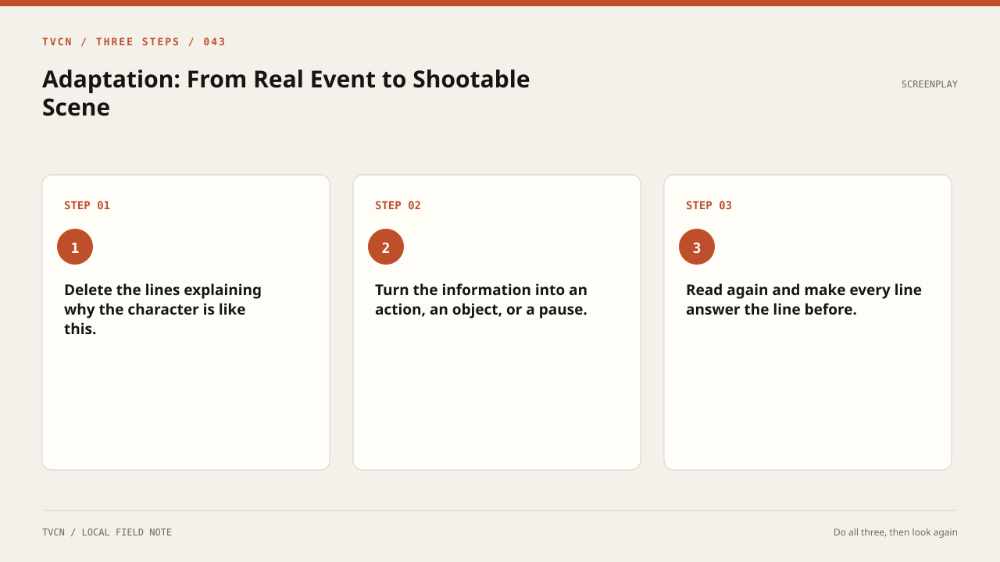

Prose enters the mind through narration; film can only show action and sound. First translate “what he thinks” into “what he does,” then decide which line to cut.

<!-- DIAGRAM_START -->
<h2>Diagram</h2>
<figure>
  
  <figcaption>Watch “Take one filmable core from the real event:” and “Compress time to twenty-four hours and cut years”; judge whether the want can be said with one visible action.</figcaption>
</figure>
<!-- DIAGRAM_END -->
<section><h2 id="section-1">Adaptation changes the medium, not reads the novel aloud</h2>
Choose one action that carries the theme and rebuild events around it. Do not distribute every chapter evenly across every character.
<h2 id="section-2">Limits</h2>
Faithful does not mean line-by-line. Keep the author's judgment and change events; losing the judgment while keeping the plot is the real betrayal.
</section><section><h2 id="section-3">On set</h2>
Take one shootable core from the real event: one person makes one decision in one room. Compress time to 24 hours and cut the years you cannot shoot.
</section><section><h2 id="section-4">Do this</h2>
Adaptation is not retelling events; it finds one conflict that can be shot in two hours.
<ol><li>Take one filmable core from the real event: one person, one room, one decision.</li><li>Compress time to twenty-four hours and cut years of unfilmable backstory.</li><li>Build the film on one character, one space, one choice.</li></ol></section><section><h2 id="section-5">Avoid</h2>
Do not retell the event as a timeline; the audience needs a conflict, not an archive.
</section><section><h2>Judge</h2>
This page passes on three observable checks, not slogans:
<ul><li><strong>1.</strong> The adaptation keeps one core event and one character&#x27;s decision.</li><li><strong>2.</strong> Time is compressed to twenty-four hours and years of backstory are gone.</li><li><strong>3.</strong> The film can be described with one person, one space, and one choice.</li></ul></section><section><h2>Failures</h2>
Any one of these means stop and fix it before post:
<ul><li><strong>1.</strong> Check 1 is only staged (“The adaptation keeps one core event and one ch…”); another camera position or location exposes it.</li><li><strong>2.</strong> Check 2 is left to post or a verbal explanation (“Time is compressed to twenty-four hours and ye…”); nothing on set can be rechecked.</li><li><strong>3.</strong> Do not retell the event as a timeline; the audience needs a conflict, not an archive.</li></ul></section><section><h2>Extend</h2>
<strong>10-minute exercise:</strong> Write one 30-second scene with only “Take one filmable core from the real event:” and “Compress time to twenty-four hours and cut years”. Cut every explanation and ask one person to retell what the character wants.
</section>
<h2>Check</h2><ul><li>The adaptation keeps one core event and one character's decision.</li><li>Time is compressed to twenty-four hours and years of backstory are gone.</li><li>The film can be described with one person, one space, and one choice.</li></ul>

<!-- SOURCES_START -->
## References and further reading

- [S43] [BFI: BFI National Archive](https://www.bfi.org.uk/bfi-national-archive) — Accessed 2026-11-26. Used to check the terminology and public context in the opening paragraph (“Adaptation is not retelling an event; it is finding a confli”) against UK film archive, restoration and exhibition resources; not a substitute for an on-set test.
- [S41] [Writers Guild of America: WGA contract and credit resources](https://www.wga.org/) — Accessed 2026-11-26. Used to check the terminology and public context in the opening paragraph (“Adaptation is not retelling an event; it is finding a confli”) against WGA contract, credit and minimum-compensation terms; not a substitute for an on-set test.
<!-- SOURCES_END -->

