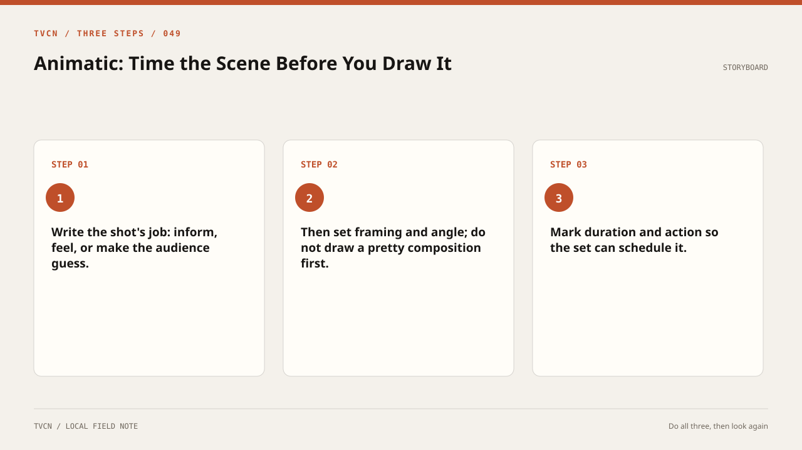

The first job is timing, not drawing. Mark seconds per shot and record voice first; let sound length set the shot. Do not draw everything then add voice; pacing will be wrong.

<!-- DIAGRAM_START -->
<h2>Diagram</h2>
<figure>
  
  <figcaption>Watch “Record the dialogue on a phone and time” and “Write seconds into every panel, then draw.”; judge whether the want can be said with one visible action.</figcaption>
</figure>
<!-- DIAGRAM_END -->
<section><h2 id="section-1">Animatic sets shot length first</h2>
Use simple lines and temp sound to test whether actions connect; if not, return to the board, not effects.
<h2 id="section-2">Limits</h2>
An animatic is not a final. It can be rough, but order, duration and action direction must be locked; changing them later is a rebuild.
</section><section><h2 id="section-3">On set</h2>
Record the lines on a phone and time them at real speed. Put each shot's duration into the board before drawing; keep the total under 110 percent of the target length.
</section><section><h2 id="section-4">Do this</h2>
An animatic fixes shot duration and cut points first; rough drawings are fine, wrong rhythm is not.
<ol><li>Record the dialogue on a phone and time it at real speaking speed.</li><li>Write seconds into every panel, then draw.</li><li>Keep total length within 110 percent of the target.</li></ol></section><section><h2 id="section-5">Avoid</h2>
Do not draw pretty frames before timing; wrong rhythm forces a redraw.
</section><section><h2>Judge</h2>
This page passes on three observable checks, not slogans:
<ul><li><strong>1.</strong> Every shot duration comes from recorded speech at real speed, not a guess.</li><li><strong>2.</strong> Each panel has a duration and total length stays within 110 percent of target.</li><li><strong>3.</strong> Playback at those seconds lines up with the intended cut points.</li></ul></section><section><h2>Failures</h2>
Any one of these means stop and fix it before post:
<ul><li><strong>1.</strong> Check 1 is only staged (“Every shot duration comes from recorded speech…”); another camera position or location exposes it.</li><li><strong>2.</strong> Check 2 is left to post or a verbal explanation (“Each panel has a duration and total length sta…”); nothing on set can be rechecked.</li><li><strong>3.</strong> Do not draw pretty frames before timing; wrong rhythm forces a redraw.</li></ul></section><section><h2>Extend</h2>
<strong>10-minute exercise:</strong> Write one 30-second scene with only “Record the dialogue on a phone and time” and “Write seconds into every panel, then draw.”. Cut every explanation and ask one person to retell what the character wants.
</section>
<h2>Check</h2><ul><li>Every shot duration comes from recorded speech at real speed, not a guess.</li><li>Each panel has a duration and total length stays within 110 percent of target.</li><li>Playback at those seconds lines up with the intended cut points.</li></ul>

<!-- SOURCES_START -->
## References and further reading

- [S42] [Pixar: Pixar in a Box](https://www.khanacademy.org/partner-content/pixar) — Accessed 2026-11-26. Used to check the terminology and public context in the opening paragraph (“An animatic fixes shot length and cut points first; rough dr”) against Story structure, character and visual storytelling lessons; not a substitute for an on-set test.
- [S43] [BFI: BFI National Archive](https://www.bfi.org.uk/bfi-national-archive) — Accessed 2026-11-26. Used to check the terminology and public context in the opening paragraph (“An animatic fixes shot length and cut points first; rough dr”) against UK film archive, restoration and exhibition resources; not a substitute for an on-set test.
<!-- SOURCES_END -->

