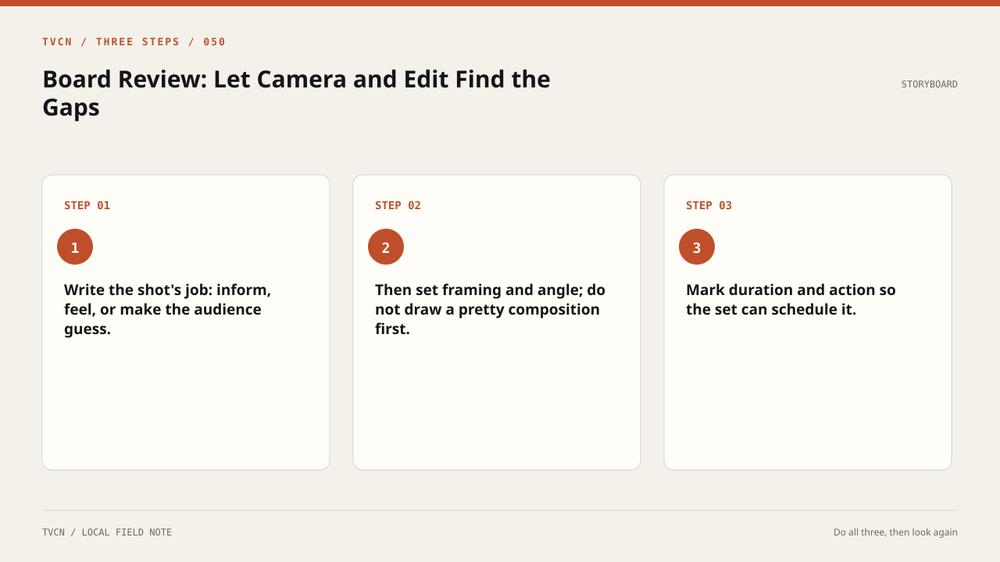

Go through four columns: who acts, where the camera is, what is needed, and how long. A beautiful panel with no camera position still cannot be shot.

<!-- DIAGRAM_START -->
<h2>Diagram</h2>
<figure>
  
  <figcaption>Watch “Give the DP a setup question list and” and “Change only three panels in the meeting; log”; judge whether the want can be said with one visible action.</figcaption>
</figure>
<!-- DIAGRAM_END -->
<section><h2 id="section-1">Review the board for shootability, not drawing quality</h2>
Ask camera and edit each for one “how I would shoot/cut this” question. Specific questions expose gaps early.
<h2 id="section-2">Limits</h2>
A review is not a vote. Do not reject a panel with “it feels wrong”; name whether action, space or time is unclear.
</section><section><h2 id="section-3">On set</h2>
Before the review, give the DP a camera-question list and the editor a gap list. Change only three panels in the meeting; log the rest for the next pass.
</section><section><h2 id="section-4">Do this</h2>
Board review lets camera flag setups and edit flag gaps; the director then changes three panels.
<ol><li>Give the DP a setup question list and the editor a gap list.</li><li>Change only three panels in the meeting; log the rest for next round.</li><li>The director decides last; nobody redraws the whole board at once.</li></ol></section><section><h2 id="section-5">Avoid</h2>
Do not redraw the whole board in review; three panels per round is what ships.
</section><section><h2>Judge</h2>
Three signals are observable on set:
<ul><li>the want is visible in one action</li><li>the obstacle escalates inside the same scene</li><li>delete one expository line and the conflict still holds</li></ul></section><section><h2>Failures</h2>
These three moves erase the detail you just built:
<ul><li>the want is unclear and the scene is only mood</li><li>the obstacle is solved by coincidence, not a decision</li><li>dialogue repeats what the image already says</li></ul></section><section><h2>Extend</h2>
<strong>10-minute exercise:</strong> Write one 30-second scene with only “Give the DP a setup question list and” and “Change only three panels in the meeting; log”. Cut every explanation and ask one person to retell what the character wants.
</section>
<h2>Check</h2><ul><li>Camera and edit each arrive with a question list.</li><li>Only three panels change in the meeting and the rest are logged.</li><li>After the three changes, setups and edit gaps improve concretely.</li></ul>
