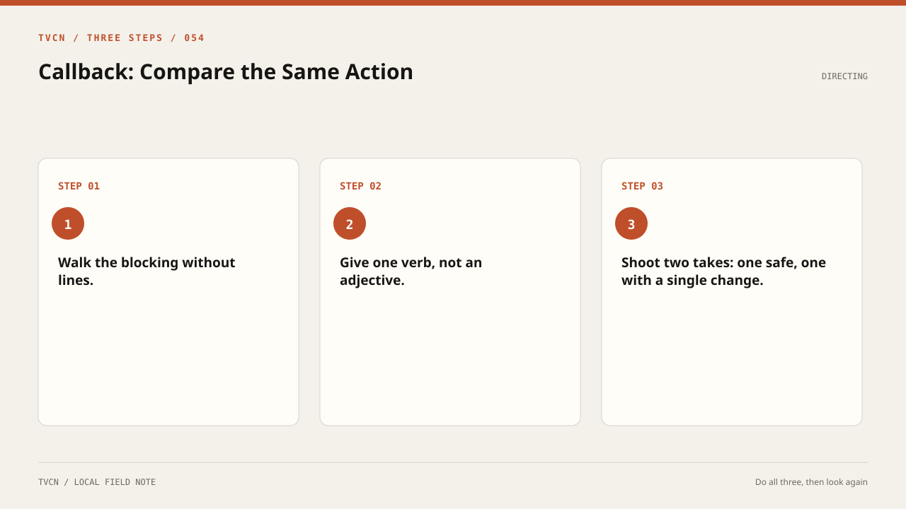

Callbacks should compare the same action, not new monologues.

<!-- DIAGRAM_START -->
<h2>Diagram</h2>
<figure>
  
  <figcaption>Watch “Give the same thirty-second task: enter, search, notice” and “Use the same camera position and same lines”; judge whether the want can be said with one visible action.</figcaption>
</figure>
<!-- DIAGRAM_END -->
<section><h2 id="section-1">On set</h2>
Callback with the same 30-second action: enter, search, notice something wrong. Use the same camera and lines for both actors, then compare the takes.
</section><section><h2 id="section-2">Do this</h2><ol><li>Give the same thirty-second task: enter, search, notice something wrong.</li><li>Use the same camera position and same lines for both actors.</li><li>Compare reactions on playback, not who is more likable.</li></ol></section><section><h2 id="section-3">Avoid</h2>
Do not give each actor a different scene; different material makes comparison useless.
</section><section><h2 id="section-4">Three causes</h2>
For “Callback: Compare the Same Action”, check three directions first. Change one variable, record a 30-second comparison, and see which link the change follows.

<table class="data-table"><thead><tr><th>Cause</th><th>Signal on set</th><th>Five-minute test</th></tr></thead><tbody><tr><td>Reading only</td><td>The callback repeats the first-round scene and the director sees no change</td><td>Use the same scene with two different intentions</td></tr><tr><td>No contrast</td><td>Both versions are identical, so range is invisible</td><td>Ask for one restrained and one outgoing version</td></tr><tr><td>No adjustment</td><td>The actor can only perform the prepared version</td><td>Give one new action and watch the response</td></tr></tbody></table>
</section><section><h2 id="section-5">On-set diagnosis</h2><ol><li>Prepare a 30-second action, not just lines.</li><li>Ask for one version that wants to stay and one that wants to leave; compare the body.</li><li>Give one new instruction: put the cup down before answering. See whether the actor can absorb it.</li></ol></section><section><h2 id="section-6">Fix</h2>
A callback is not another first-round read; it tests whether the actor can change under pressure. Use the same material so range becomes visible.
<ol><li>Fix one action and two lines; every candidate uses the same material.</li><li>Ask for two different intentions, not two different tones.</li><li>Give one adjustment and log how quickly the actor takes it.</li><li>Shoot one wide and one close; check that the performance holds at both sizes.</li></ol></section><section><h2 id="section-7">Failure cases</h2>
With “Callback: Compare the Same Action”, these three moves make it worse. Pick one replacement action and do not change three variables at once.

<table class="data-table"><thead><tr><th>Failure</th><th>Why it gets worse</th><th>Replace with</th></tr></thead><tbody><tr><td>Repeat the same version</td><td>You see polish, not range</td><td>Require a second intention</td></tr><tr><td>Talk only</td><td>The callback becomes an interview and never tests the frame</td><td>Shoot at least one take</td></tr><tr><td>Abstract direction</td><td>“More sincere” is not executable</td><td>Give an action and an object</td></tr></tbody></table>
</section><section><h2 id="section-8">Acceptance table</h2>
Acceptance is not “it feels better”; all four must be identifiable, playable and logged.

<table class="data-table"><thead><tr><th>Check</th><th>Pass line</th><th>Log</th></tr></thead><tbody><tr><td>Same material</td><td>Every candidate uses the same action and lines</td><td>Callback sheet</td></tr><tr><td>Two versions</td><td>The intentions differ and the body shows it</td><td>Compare playback</td></tr><tr><td>Adjustment</td><td>The actor changes after one note</td><td>Log on set</td></tr><tr><td>Sizes</td><td>One usable wide and close</td><td>Review footage</td></tr></tbody></table>
</section><section><h2>Judge</h2>
This page passes on three observable checks, not slogans:
<ul><li><strong>1.</strong> Both actors perform the same thirty-second task with identical lines.</li><li><strong>2.</strong> Camera, lens, and light match so the takes can play side by side.</li><li><strong>3.</strong> Comparison addresses reaction and action, not likability.</li></ul></section><section><h2>Failures</h2>
Any one of these means stop and fix it before post:
<ul><li><strong>1.</strong> Check 1 is only staged (“Both actors perform the same thirty-second tas…”); another camera position or location exposes it.</li><li><strong>2.</strong> Check 2 is left to post or a verbal explanation (“Camera, lens, and light match so the takes can…”); nothing on set can be rechecked.</li><li><strong>3.</strong> Do not give each actor a different scene; different material makes comparison useless.</li></ul></section><section><h2>Extend</h2>
<strong>10-minute exercise:</strong> Write one 30-second scene with only “Give the same thirty-second task: enter, search, notice” and “Use the same camera position and same lines”. Cut every explanation and ask one person to retell what the character wants.
</section>
<h2>Check</h2><ul><li>Both actors perform the same thirty-second task with identical lines.</li><li>Camera, lens, and light match so the takes can play side by side.</li><li>Comparison addresses reaction and action, not likability.</li></ul>

<!-- SOURCES_START -->
## References and further reading

- [S42] [Pixar: Pixar in a Box](https://www.khanacademy.org/partner-content/pixar) — Accessed 2026-11-26. Used to check the terminology and public context in the opening paragraph (“In a callback, do not give a new scene; give the same action”) against Story structure, character and visual storytelling lessons; not a substitute for an on-set test.
- [S41] [Writers Guild of America: WGA contract and credit resources](https://www.wga.org/) — Accessed 2026-11-26. Used to check the terminology and public context in the opening paragraph (“In a callback, do not give a new scene; give the same action”) against WGA contract, credit and minimum-compensation terms; not a substitute for an on-set test.
<!-- SOURCES_END -->

