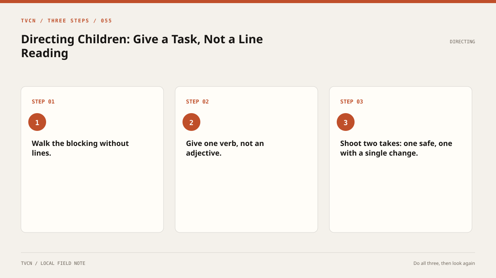

Put child-actor rules on the call sheet: maximum hours, breaks and meals, guardian always present, no closed room alone, no dangerous action.

<!-- DIAGRAM_START -->
<h2>Diagram</h2>
<figure>
  
  <figcaption>Watch “Give a concrete task and a time limit:” and “Do not say “act natural”; state the task”; judge whether the want can be said with one visible action.</figcaption>
</figure>
<!-- DIAGRAM_END -->
<section><h2 id="section-1">Protect rest and guardianship before performance</h2>
Explain any content the child should not see in advance. Direct through games and concrete actions, not emotional manipulation like “imagine your mother died.”
<h2 id="section-2">Limits</h2>
A child's nod is not consent. The guardian can stop at any time; if the child becomes distressed later, delete the footage.
</section><section><h2 id="section-3">On set</h2>
Give the child a concrete task and a time limit: put three things from the table into a bag in 30 seconds. Never say act natural.
</section><section><h2 id="section-4">Do this</h2>
Direct children with tasks, not instructions: hand me the cup works better than “look sad.”
<ol><li>Give a concrete task and a time limit: put three things in a bag in thirty seconds.</li><li>Do not say “act natural”; state the task and the boundary.</li><li>Give feedback right after the take and do not leave the child waiting.</li></ol></section><section><h2 id="section-5">Avoid</h2>
Do not ask a child to perform an emotion; a clear task produces the reaction.
</section><section><h2>Judge</h2>
This page passes on three observable checks, not slogans:
<ul><li><strong>1.</strong> The child receives a concrete task and time limit, not an emotion direction.</li><li><strong>2.</strong> Nobody says “be natural” or “look sad” during the take.</li><li><strong>3.</strong> Feedback arrives right after the task and the child is not left waiting.</li></ul></section><section><h2>Failures</h2>
Any one of these means stop and fix it before post:
<ul><li><strong>1.</strong> Check 1 is only staged (“The child receives a concrete task and time li…”); another camera position or location exposes it.</li><li><strong>2.</strong> Check 2 is left to post or a verbal explanation (“Nobody says “be natural” or “look sad” during…”); nothing on set can be rechecked.</li><li><strong>3.</strong> Do not ask a child to perform an emotion; a clear task produces the reaction.</li></ul></section><section><h2>Extend</h2>
<strong>10-minute exercise:</strong> Write one 30-second scene with only “Give a concrete task and a time limit:” and “Do not say “act natural”; state the task”. Cut every explanation and ask one person to retell what the character wants.
</section>
<h2>Check</h2><ul><li>The child receives a concrete task and time limit, not an emotion direction.</li><li>Nobody says “be natural” or “look sad” during the take.</li><li>Feedback arrives right after the task and the child is not left waiting.</li></ul>

<!-- SOURCES_START -->
## References and further reading

- [S42] [Pixar: Pixar in a Box](https://www.khanacademy.org/partner-content/pixar) — Accessed 2026-11-26. Used to check the terminology and public context in the opening paragraph (“With children, give a task, not an instruction: hand me the ”) against Story structure, character and visual storytelling lessons; not a substitute for an on-set test.
- [S16] [BBC Editorial Guidelines](https://www.bbc.co.uk/editorialguidelines/) — Accessed 2026-11-26. Used to check the terminology and public context in the opening paragraph (“With children, give a task, not an instruction: hand me the ”) against Editorial standards on accuracy, fairness, privacy and secret recording; not a substitute for an on-set test.
<!-- SOURCES_END -->

