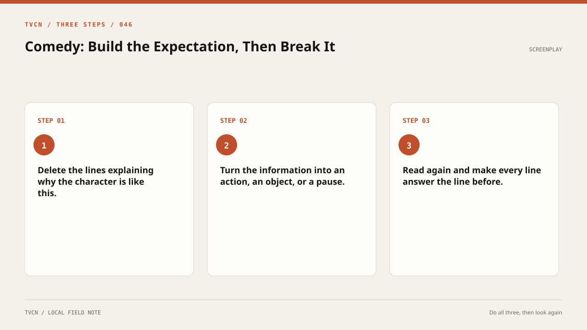

Comedy lets the audience predict the next beat, then removes one crucial condition.

<!-- DIAGRAM_START -->
<h2>Diagram</h2>
<figure>
  
  <figcaption>Do the three steps in order, then look again at the image or file.</figcaption>
</figure>
<!-- DIAGRAM_END -->
<h2>On set</h2>

Write the three steps the audience expects, then replace the second with something plausible but wrong. Do not explain the joke; let the character stay serious.

<h2>Do this</h2>

Comedy lets the audience predict the next beat, then removes one key condition.
<ol><li>Write the three steps the audience expects.</li><li>Replace step two with something logical but wrong.</li><li>Do not explain the joke; let the character keep treating it seriously.</li></ol>
<h2>Avoid</h2>

Do not explain the joke; when the character laughs, the audience stops.

<h2>Check</h2>
<ul><li>The first two steps set a clear expectation and the third is predictable.</li><li>Only one condition breaks; the rest stays logical.</li><li>The character neither explains nor laughs and keeps treating the error seriously.</li></ul>
