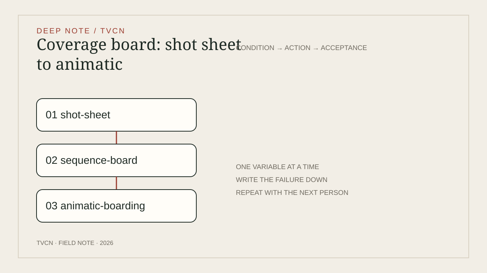

A board is not a pretty drawing; shot sheet, coverage and animatic must cash out on the timeline. One page of &amp;quot;Shot Sheet: Number, Framing, Action, Duration&amp;quot; solves one local problem; joining &amp;quot;Shot Sheet: Number, Framing, Action, Duration&amp;quot;, &amp;quot;Sequence Board: Shoot the Scene, Not the Script&amp;quot; and &amp;quot;Animatic: Time the Scene Before You Draw It&amp;quot; exposes the real failure: conditions are missing, too many variables move, and the result cannot be reproduced.

<!-- DEEP_DIVE_START -->
<!-- DIAGRAM_START -->
<h2>图解</h2>
<figure>
  
  <figcaption>Read &quot;Shot Sheet: Number, Framing, Action, Duration&quot; and &quot;Sequence Board: Shoot the Scene, Not the Script&quot;: write the condition first, then check whether the failure can be recorded.</figcaption>
</figure>
<!-- DIAGRAM_END -->

<section><h2 id="section-1">Problem</h2>
The problem is not a lack of methods; each step works alone, but together they fail because the condition was not written, too many variables moved and the result cannot be reproduced.

The order is condition, judgement, one variable and evidence. A step is complete only when the next person can repeat it.
</section>
<section><h2 id="section-2">Judgement</h2><ul><li>First gate in &quot;Shot Sheet: Number, Framing, Action, Duration&quot;: Every shot has number, size, action, and seconds; no column is missing.</li><li>Second gate in &quot;Sequence Board: Shoot the Scene, Not the Script&quot;: No shot runs over eight seconds without an action.</li><li>Third gate in &quot;Animatic: Time the Scene Before You Draw It&quot;: A third person can repeat the shooting order from the sheet.</li></ul>
If one gate fails, return to its single page; do not hide an unsolved point inside a longer chain.
</section>
<section><h2 id="section-3">Method</h2><ol><li>Write the condition first: turn &quot;Fill shots 1, 3, and 5 first, each with one verb and one duration.&quot; from &quot;Shot Sheet: Number, Framing, Action, Duration&quot; into three rows: material, environment, acceptance.</li><li>Run one minimal action: follow &quot;Shot Sheet: Number, Framing, Action, Duration&quot; for 30 seconds and do not add the second page yet.</li><li>Attach the second page: Cut or split any shot over eight seconds or without an action..</li><li>Use the third page as a control: Read it aloud before rolling so camera and edit can repeat the order..</li><li>Change one variable at a time; write the other conditions down instead of remembering them.</li><li>Film the failure too: put failure and success side by side to see which step cannot be skipped.</li><li>Ask the next person to reproduce from the record; if they cannot, the record is not finished.</li></ol></section>
<section><h2 id="section-4">Field test</h2>
A reproducible test, not a client case: take 30 seconds of material, make version A using &quot;Every shot has number, size, action, and seconds; no column is mi…&quot; from &quot;Shot Sheet: Number, Framing, Action, Duration&quot;, then version B using &quot;No shot runs over eight seconds without an action.&quot; from &quot;Sequence Board: Shoot the Scene, Not the Script&quot;; only one variable may differ. Put them side by side and record what breaks first in &quot;Animatic: Time the Scene Before You Draw It&quot;: condition, action or acceptance. If it works on the first try, add one real constraint and run it again.
</section>
<section><h2 id="section-5">Failure table</h2>
<table class="data-table"><thead><tr><th>Symptom</th><th>Cause</th><th>Replacement action</th></tr></thead><tbody><tr><td>Do not draw what the camera cannot shoot; a board is not an illus…</td><td>Condition was not written</td><td>Return to page one and rewrite the three rows</td></tr><tr><td>Do not draw one panel per line; a board is information order, not…</td><td>Condition was not written</td><td>Return to page one and rewrite the three rows</td></tr><tr><td>Do not draw pretty frames before timing; wrong rhythm forces a re…</td><td>Condition was not written</td><td>Return to page one and rewrite the three rows</td></tr></tbody></table>
</section>
<section><h2 id="section-6">Acceptance</h2><ul><li>Every shot has number, size, action, and seconds; no column is missing.</li><li>No shot runs over eight seconds without an action.</li><li>A third person can repeat the shooting order from the sheet.</li><li>One main action per row</li><li>Five columns: number, size, action, position, duration</li><li>Every group has wide, medium, close, and insert</li><li>Group by setup, not story order</li><li>Draw a line and estimate time at every setup change</li><li>The first three panels show what is shown, hidden, and revealed last.</li><li>Middle shots fill by information order, not line count.</li></ul></section>
<section><h2 id="section-7">Alternatives</h2><ul><li>For a single-point problem in "Shot Sheet: Number, Framing, Action, Duration", go back to <a href="https://story.tvcn.org/en/article/shot-sheet/">Shot Sheet: Number, Framing, Action, Duration</a>; do not use the whole chain.</li><li>To compare two actions, read <a href="https://story.tvcn.org/en/article/sequence-board/">Sequence Board: Shoot the Scene, Not the Script</a> and leave the third page alone.</li><li>For acceptance only, use <a href="https://story.tvcn.org/en/article/animatic-boarding/">Animatic: Time the Scene Before You Draw It</a> as a self-test sheet.</li></ul></section>
