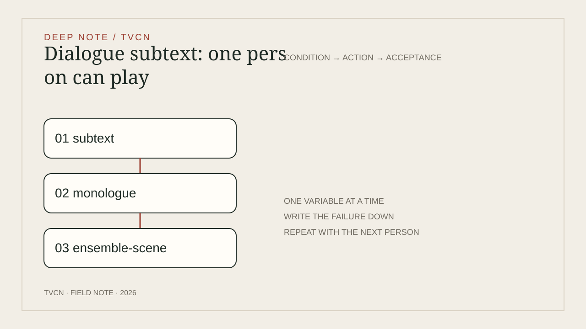

Good dialogue does not say the inner truth; a character says one thing and does another. One page of &amp;quot;Subtext: The Thing Under the Line&amp;quot; solves one local problem; joining &amp;quot;Subtext: The Thing Under the Line&amp;quot;, &amp;quot;Monologue: Give It a Listener and a Block&amp;quot; and &amp;quot;Ensemble Scene: Give Everyone a Task&amp;quot; exposes the real failure: conditions are missing, too many variables move, and the result cannot be reproduced.

<!-- DEEP_DIVE_START -->
<!-- DIAGRAM_START -->
<h2>图解</h2>
<figure>
  
  <figcaption>Read &quot;Subtext: The Thing Under the Line&quot; and &quot;Monologue: Give It a Listener and a Block&quot;: write the condition first, then check whether the failure can be recorded.</figcaption>
</figure>
<!-- DIAGRAM_END -->

<section><h2 id="section-1">Problem</h2>
The problem is not a lack of methods; each step works alone, but together they fail because the condition was not written, too many variables moved and the result cannot be reproduced.

The order is condition, judgement, one variable and evidence. A step is complete only when the next person can repeat it.
</section>
<section><h2 id="section-2">Judgement</h2><ul><li>First gate in &quot;Subtext: The Thing Under the Line&quot;: Every key line has a contradicting or offsetting action.</li><li>Second gate in &quot;Monologue: Give It a Listener and a Block&quot;: The actor plays the hand and body, not the hidden line aloud.</li><li>Third gate in &quot;Ensemble Scene: Give Everyone a Task&quot;: The audience can name what is said and what is actually wanted.</li></ul>
If one gate fails, return to its single page; do not hide an unsolved point inside a longer chain.
</section>
<section><h2 id="section-3">Method</h2><ol><li>Write the condition first: turn &quot;Give each line a hidden action: she says “whatever” and closes the menu.&quot; from &quot;Subtext: The Thing Under the Line&quot; into three rows: material, environment, acceptance.</li><li>Run one minimal action: follow &quot;Subtext: The Thing Under the Line&quot; for 30 seconds and do not add the second page yet.</li><li>Attach the second page: Let the actor play the hand, not the line..</li><li>Use the third page as a control: Review that line and action contradict each other and B reads..</li><li>Change one variable at a time; write the other conditions down instead of remembering them.</li><li>Film the failure too: put failure and success side by side to see which step cannot be skipped.</li><li>Ask the next person to reproduce from the record; if they cannot, the record is not finished.</li></ol></section>
<section><h2 id="section-4">Field test</h2>
A reproducible test, not a client case: take 30 seconds of material, make version A using &quot;Every key line has a contradicting or offsetting action.&quot; from &quot;Subtext: The Thing Under the Line&quot;, then version B using &quot;The actor plays the hand and body, not the hidden line aloud.&quot; from &quot;Monologue: Give It a Listener and a Block&quot;; only one variable may differ. Put them side by side and record what breaks first in &quot;Ensemble Scene: Give Everyone a Task&quot;: condition, action or acceptance. If it works on the first try, add one real constraint and run it again.
</section>
<section><h2 id="section-5">Failure table</h2>
<table class="data-table"><thead><tr><th>Symptom</th><th>Cause</th><th>Replacement action</th></tr></thead><tbody><tr><td>Do not let the line speak the subtext; once said, it is no longer…</td><td>Condition was not written</td><td>Return to page one and rewrite the three rows</td></tr><tr><td>Do not play the monologue to a mirror or empty air; without a lis…</td><td>Condition was not written</td><td>Return to page one and rewrite the three rows</td></tr><tr><td>Do not line up extras waiting for lines; an empty background make…</td><td>Condition was not written</td><td>Return to page one and rewrite the three rows</td></tr></tbody></table>
</section>
<section><h2 id="section-6">Acceptance</h2><ul><li>Every key line has a contradicting or offsetting action.</li><li>The actor plays the hand and body, not the hidden line aloud.</li><li>The audience can name what is said and what is actually wanted.</li><li>A listener is trapped in frame and their reaction is visible.</li><li>The speaker does an action that interrupts the speech.</li><li>Remove the listener and the monologue weakens, proving the relationship matters.</li><li>Everyone in frame has an action and a goal; nobody stands empty.</li><li>At least two actions interfere and a relationship becomes visible.</li><li>Remove any one action and the space visibly empties.</li><li>The condition from Subtext: The Thing Under the Line fits on one line and can be repeated by someone else.</li></ul></section>
<section><h2 id="section-7">Alternatives</h2><ul><li>For a single-point problem in "Subtext: The Thing Under the Line", go back to <a href="https://story.tvcn.org/en/article/subtext/">Subtext: The Thing Under the Line</a>; do not use the whole chain.</li><li>To compare two actions, read <a href="https://story.tvcn.org/en/article/monologue/">Monologue: Give It a Listener and a Block</a> and leave the third page alone.</li><li>For acceptance only, use <a href="https://story.tvcn.org/en/article/ensemble-scene/">Ensemble Scene: Give Everyone a Task</a> as a self-test sheet.</li></ul></section>

<!-- SOURCES_START -->
## References and further reading

- [S42] [Pixar in a Box: Storytelling](https://www.khanacademy.org/partner-content/pixar) — Accessed 2026-11-26. Used to check the terminology/method/rule in the “Problem” section against Pixar storytelling course, not project pricing; it does not verify numbers, model choices or on-set conclusions derived from this page, and is not a substitute for a test.
- [S43] [BFI: National Archive](https://www.bfi.org.uk/bfi-national-archive) — Accessed 2026-11-26. Used to check the terminology/method/rule in the “Judgement” section against BFI archive material, not distribution rules; it does not verify numbers, model choices or on-set conclusions derived from this page, and is not a substitute for a test.
<!-- SOURCES_END -->

