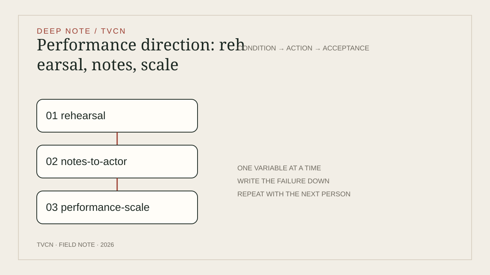

Direction is not shouting one more; it turns action, intention and scale into playable notes. One page of &amp;quot;Rehearsal: Block First, Lines Later&amp;quot; solves one local problem; joining &amp;quot;Rehearsal: Block First, Lines Later&amp;quot;, &amp;quot;Notes to Actors: One Executable Sentence&amp;quot; and &amp;quot;Performance Scale: Closer Camera, Smaller Action&amp;quot; exposes the real failure: conditions are missing, too many variables move, and the result cannot be reproduced.

<!-- DEEP_DIVE_START -->
<!-- DIAGRAM_START -->
<h2>图解</h2>
<figure>
  
  <figcaption>Read &quot;Rehearsal: Block First, Lines Later&quot; and &quot;Notes to Actors: One Executable Sentence&quot;: write the condition first, then check whether the failure can be recorded.</figcaption>
</figure>
<!-- DIAGRAM_END -->

<section><h2 id="section-1">Problem</h2>
The problem is not a lack of methods; each step works alone, but together they fail because the condition was not written, too many variables moved and the result cannot be reproduced.

The order is condition, judgement, one variable and evidence. A step is complete only when the next person can repeat it.
</section>
<section><h2 id="section-2">Judgement</h2><ul><li>First gate in &quot;Rehearsal: Block First, Lines Later&quot;: The first two passes have no lines, only positions and actions.</li><li>Second gate in &quot;Notes to Actors: One Executable Sentence&quot;: On the third pass, pauses still land on actions.</li><li>Third gate in &quot;Performance Scale: Closer Camera, Smaller Action&quot;: The actor can state what they want throughout the scene.</li></ul>
If one gate fails, return to its single page; do not hide an unsolved point inside a longer chain.
</section>
<section><h2 id="section-3">Method</h2><ol><li>Write the condition first: turn &quot;Spend the first twenty minutes on blocking only, taping door, chair, and camera.&quot; from &quot;Rehearsal: Block First, Lines Later&quot; into three rows: material, environment, acceptance.</li><li>Run one minimal action: follow &quot;Rehearsal: Block First, Lines Later&quot; for 30 seconds and do not add the second page yet.</li><li>Attach the second page: Walk the actor through three times without lines, only action and pauses..</li><li>Use the third page as a control: Add lines on the third pass and confirm they land on established positions..</li><li>Change one variable at a time; write the other conditions down instead of remembering them.</li><li>Film the failure too: put failure and success side by side to see which step cannot be skipped.</li><li>Ask the next person to reproduce from the record; if they cannot, the record is not finished.</li></ol></section>
<section><h2 id="section-4">Field test</h2>
A reproducible test, not a client case: take 30 seconds of material, make version A using &quot;The first two passes have no lines, only positions and actions.&quot; from &quot;Rehearsal: Block First, Lines Later&quot;, then version B using &quot;On the third pass, pauses still land on actions.&quot; from &quot;Notes to Actors: One Executable Sentence&quot;; only one variable may differ. Put them side by side and record what breaks first in &quot;Performance Scale: Closer Camera, Smaller Action&quot;: condition, action or acceptance. If it works on the first try, add one real constraint and run it again.
</section>
<section><h2 id="section-5">Failure table</h2>
<table class="data-table"><thead><tr><th>Symptom</th><th>Cause</th><th>Replacement action</th></tr></thead><tbody><tr><td>Do not shout “be natural” from behind the monitor; the actor cann…</td><td>Condition was not written</td><td>Return to page one and rewrite the three rows</td></tr><tr><td>Do not give three notes at once; the actor can execute one.</td><td>Condition was not written</td><td>Return to page one and rewrite the three rows</td></tr><tr><td>Do not use one performance scale for every size; the close-up mag…</td><td>Condition was not written</td><td>Return to page one and rewrite the three rows</td></tr></tbody></table>
</section>
<section><h2 id="section-6">Acceptance</h2><ul><li>The first two passes have no lines, only positions and actions.</li><li>On the third pass, pauses still land on actions.</li><li>The actor can state what they want throughout the scene.</li><li>Walked once without lines</li><li>Marked start, end, and turns</li><li>Tested sitting and standing</li><li>Touched every prop once</li><li>Gave verbs, not adjectives</li><li>Each note contains one executable action.</li><li>The actor can do it immediately without asking “how exactly.”</li></ul></section>
<section><h2 id="section-7">Alternatives</h2><ul><li>For a single-point problem in "Rehearsal: Block First, Lines Later", go back to <a href="https://story.tvcn.org/en/article/rehearsal/">Rehearsal: Block First, Lines Later</a>; do not use the whole chain.</li><li>To compare two actions, read <a href="https://story.tvcn.org/en/article/notes-to-actor/">Notes to Actors: One Executable Sentence</a> and leave the third page alone.</li><li>For acceptance only, use <a href="https://story.tvcn.org/en/article/performance-scale/">Performance Scale: Closer Camera, Smaller Action</a> as a self-test sheet.</li></ul></section>

<!-- SOURCES_START -->
## References and further reading

- [S12] [Animation](https://www.britannica.com/art/animation) — Accessed 2026-11-26. Used to check the terminology and public context in the opening paragraph (“Direction is not shouting one more; it turns action, intenti”) against Encyclopedia entry on animation principles, techniques and industry history; not a substitute for an on-set test.
- [S41] [Writers Guild of America: WGA contract and credit resources](https://www.wga.org/) — Accessed 2026-11-26. Used to check the terminology and public context in the opening paragraph (“Direction is not shouting one more; it turns action, intenti”) against WGA contract, credit and minimum-compensation terms; not a substitute for an on-set test.
- [S10] [Film history and moving-image research](https://www.bfi.org.uk/) — Accessed 2026-11-26. Used to check the terminology and public context in the opening paragraph (“Direction is not shouting one more; it turns action, intenti”) against Entry point to BFI film history, archives and moving-image research; not a substitute for an on-set test.
- [S42] [Pixar: Pixar in a Box](https://www.khanacademy.org/partner-content/pixar) — Accessed 2026-11-26. Used to check the terminology and public context in the opening paragraph (“Direction is not shouting one more; it turns action, intenti”) against Story structure, character and visual storytelling lessons; not a substitute for an on-set test.
- [S16] [BBC Editorial Guidelines](https://www.bbc.co.uk/editorialguidelines/) — Accessed 2026-11-26. Used to check the terminology and public context in the opening paragraph (“Direction is not shouting one more; it turns action, intenti”) against Editorial standards on accuracy, fairness, privacy and secret recording; not a substitute for an on-set test.
<!-- SOURCES_END -->

