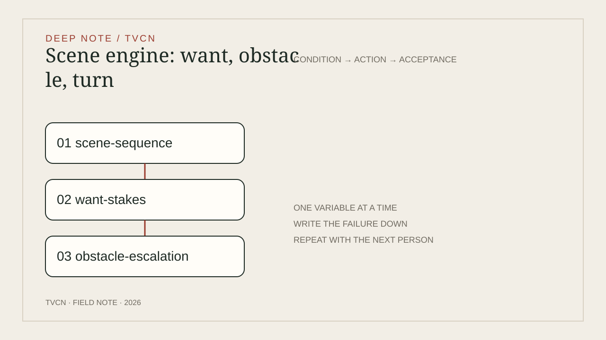

A scene is not information exchange; someone wants something, is blocked, and has to change. One page of &amp;quot;A Sequence: Three Scenes, One Change&amp;quot; solves one local problem; joining &amp;quot;A Sequence: Three Scenes, One Change&amp;quot;, &amp;quot;Want and Stakes: What Does Losing Cost?&amp;quot; and &amp;quot;Escalation: Same Wall, Higher Cost&amp;quot; exposes the real failure: conditions are missing, too many variables move, and the result cannot be reproduced.

<!-- DEEP_DIVE_START -->
<!-- DIAGRAM_START -->
<h2>图解</h2>
<figure>
  
  <figcaption>Read &quot;A Sequence: Three Scenes, One Change&quot; and &quot;Want and Stakes: What Does Losing Cost?&quot;: write the condition first, then check whether the failure can be recorded.</figcaption>
</figure>
<!-- DIAGRAM_END -->

<section><h2 id="section-1">Problem</h2>
The problem is not a lack of methods; each step works alone, but together they fail because the condition was not written, too many variables moved and the result cannot be reproduced.

The order is condition, judgement, one variable and evidence. A step is complete only when the next person can repeat it.
</section>
<section><h2 id="section-2">Judgement</h2><ul><li>First gate in &quot;A Sequence: Three Scenes, One Change&quot;: Each of the three scenes has one change stated as “from what to what.”</li><li>Second gate in &quot;Want and Stakes: What Does Losing Cost?&quot;: Every scene ending changes the conditions of the next.</li><li>Third gate in &quot;Escalation: Same Wall, Higher Cost&quot;: Remove any scene and the sequence breaks, not just loses color.</li></ul>
If one gate fails, return to its single page; do not hide an unsolved point inside a longer chain.
</section>
<section><h2 id="section-3">Method</h2><ol><li>Write the condition first: turn &quot;Scene one states the goal so the audience knows what is wanted.&quot; from &quot;A Sequence: Three Scenes, One Change&quot; into three rows: material, environment, acceptance.</li><li>Run one minimal action: follow &quot;A Sequence: Three Scenes, One Change&quot; for 30 seconds and do not add the second page yet.</li><li>Attach the second page: Scene two blocks it and makes conditions worse..</li><li>Use the third page as a control: Scene three forces a choice and changes what the next scene can be..</li><li>Change one variable at a time; write the other conditions down instead of remembering them.</li><li>Film the failure too: put failure and success side by side to see which step cannot be skipped.</li><li>Ask the next person to reproduce from the record; if they cannot, the record is not finished.</li></ol></section>
<section><h2 id="section-4">Field test</h2>
A reproducible test, not a client case: take 30 seconds of material, make version A using &quot;Each of the three scenes has one change stated as “from what to w…&quot; from &quot;A Sequence: Three Scenes, One Change&quot;, then version B using &quot;Every scene ending changes the conditions of the next.&quot; from &quot;Want and Stakes: What Does Losing Cost?&quot;; only one variable may differ. Put them side by side and record what breaks first in &quot;Escalation: Same Wall, Higher Cost&quot;: condition, action or acceptance. If it works on the first try, add one real constraint and run it again.
</section>
<section><h2 id="section-5">Failure table</h2>
<table class="data-table"><thead><tr><th>Symptom</th><th>Cause</th><th>Replacement action</th></tr></thead><tbody><tr><td>Do not let three scenes repeat one piece of information; without …</td><td>Condition was not written</td><td>Return to page one and rewrite the three rows</td></tr><tr><td>Do not replace the scene with a character biography; the audience…</td><td>Condition was not written</td><td>Return to page one and rewrite the three rows</td></tr><tr><td>Do not swap in a new obstacle each time; without escalation, pres…</td><td>Condition was not written</td><td>Return to page one and rewrite the three rows</td></tr></tbody></table>
</section>
<section><h2 id="section-6">Acceptance</h2><ul><li>Each of the three scenes has one change stated as “from what to what.”</li><li>Every scene ending changes the conditions of the next.</li><li>Remove any scene and the sequence breaks, not just loses color.</li><li>One main question per scene</li><li>Situation differs at the end</li><li>Scene one establishes the norm</li><li>Scene two breaks the old method</li><li>Scene three makes a new choice</li><li>Both boxes hold filmable nouns and actions, not abstractions like dignity or security.</li><li>The want and the cost happen in the same scene without voice-over.</li></ul></section>
<section><h2 id="section-7">Alternatives</h2><ul><li>For a single-point problem in "A Sequence: Three Scenes, One Change", go back to <a href="https://story.tvcn.org/en/article/scene-sequence/">A Sequence: Three Scenes, One Change</a>; do not use the whole chain.</li><li>To compare two actions, read <a href="https://story.tvcn.org/en/article/want-stakes/">Want and Stakes: What Does Losing Cost?</a> and leave the third page alone.</li><li>For acceptance only, use <a href="https://story.tvcn.org/en/article/obstacle-escalation/">Escalation: Same Wall, Higher Cost</a> as a self-test sheet.</li></ul></section>

<!-- SOURCES_START -->
## References and further reading

- [S12] [Animation](https://www.britannica.com/art/animation) — Accessed 2026-11-26. Used to check the terminology and public context in the opening paragraph (“A scene is not information exchange; someone wants something”) against Encyclopedia entry on animation principles, techniques and industry history; not a substitute for an on-set test.
- [S41] [Writers Guild of America: WGA contract and credit resources](https://www.wga.org/) — Accessed 2026-11-26. Used to check the terminology and public context in the opening paragraph (“A scene is not information exchange; someone wants something”) against WGA contract, credit and minimum-compensation terms; not a substitute for an on-set test.
- [S10] [Film history and moving-image research](https://www.bfi.org.uk/) — Accessed 2026-11-26. Used to check the terminology and public context in the opening paragraph (“A scene is not information exchange; someone wants something”) against Entry point to BFI film history, archives and moving-image research; not a substitute for an on-set test.
- [S42] [Pixar: Pixar in a Box](https://www.khanacademy.org/partner-content/pixar) — Accessed 2026-11-26. Used to check the terminology and public context in the opening paragraph (“A scene is not information exchange; someone wants something”) against Story structure, character and visual storytelling lessons; not a substitute for an on-set test.
- [S16] [BBC Editorial Guidelines](https://www.bbc.co.uk/editorialguidelines/) — Accessed 2026-11-26. Used to check the terminology and public context in the opening paragraph (“A scene is not information exchange; someone wants something”) against Editorial standards on accuracy, fairness, privacy and secret recording; not a substitute for an on-set test.
<!-- SOURCES_END -->

