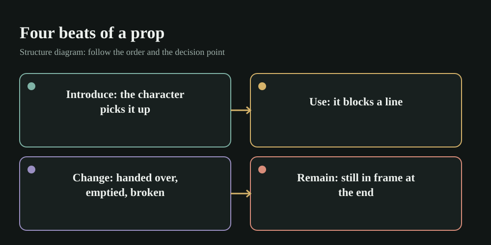

Many scenes stall because the character keeps announcing how they feel. Take that line away and give them something they can hold, put down, hand over or break. The audience cannot see psychology, but they can see a cup go from full to empty.

<!-- DIAGRAM_START -->
<h2 id="diagram">Diagram</h2>
<figure class="diagram">
  
  <figcaption>Check whether the prop is actively used, whether it changes and whether it remains at the end. Only a used prop carries story; a decorative one does not.</figcaption>
</figure>
<!-- DIAGRAM_END -->

<section><h2 id="section-1">On location</h2>
A break-up scene in a kitchen runs three pages: why don't you look at me, what have I done for us, can we try again. After two rehearsals the actors sound like a debate. On the third pass the director puts an unwashed cup between them and gives one action: one wipes it, the other takes it away.
</section>
<section><h2 id="section-2">What to look for</h2><ul><li><strong>Active use:</strong> the prop is not just placed in frame; someone picks it up, puts it down or hands it over, and the action changes where the dialogue goes.</li><li><strong>Change:</strong> water spills, the cup cracks, the key changes hands; the change shows the relationship is no longer the same.</li><li><strong>Remains at the end:</strong> the prop does not need an explanation, but it stays on the table, in a pocket or by the door, and the audience completes the thought.</li></ul></section>
<section><h2 id="section-3">What to do</h2><ol><li>Delete one explanatory line and choose an everyday object tied to it: a cup, keys, a pill box, a delivery slip.</li><li>Give the prop a starting point: who brings it in, where it sits, what state it is in when the audience first sees it.</li><li>Have the other person block one use: take it, hold it down, refuse to take it. The first refusal creates resistance.</li><li>Change the prop once in the scene: empty it, break it, mislabel it, pass it on. The change must be visible on camera, not spoken.</li><li>Do not explain at the end. Leave a position: whose hand is the prop near, and who does not reach for it.</li></ol></section>
<section><h2 id="section-4">Failure modes</h2><ul><li><strong>Decorative props:</strong> ten objects sit on the table and none is used; the audience sees art direction, not character.</li><li><strong>Too many props:</strong> cup, phone and photo all carry meaning at once, so the audience does not know where to look.</li><li><strong>Using the prop as an emotion mark:</strong> a character smashes a cup and nothing follows; the action is punctuation, not story.</li></ul></section>
<section><h2 id="section-5">Limits</h2>
Not every scene needs a prop. A two-person confrontation, a verbal duel or a chase may not need a central object. A prop also cannot replace all dialogue functions; it shows a relationship changing, not exposition. Background still comes from setting, wardrobe, dialogue or an earlier scene.
</section>
<section><h2 id="section-6">Check</h2><ul><li>The prop is actively used by at least one character, and the use changes where the dialogue goes.</li><li>The prop changes once in a visible way.</li><li>The prop remains in frame at the end without being explained in dialogue.</li><li>The deleted explanatory line can be reconstructed from the action by a viewer.</li></ul></section>
<!-- DEEP_DIVE_START -->
## Deep dive

<strong>About 8 minutes.</strong> This section places the same judgement in two different conditions, then gives a counterexample and a reusable model. It does not repeat the page; it decides when to change the method.

### Condition A: intimate relationship scene

In intimate scenes, a prop lets two people avoid constant eye contact. One washes dishes while the other leans in the doorway; the speaker faces away, the listener watches the hands. The prop gives them a reason not to look and gives the audience a third point to observe. The more everyday the object, the better: a towel, a bowl, a child's shoe.

Do not give an intimate scene a heavy symbol such as a wedding photo or a ring; the audience reads the symbol before the person. Everyday objects change in smaller, more credible ways: a towel goes from dry to wet, a bowl from clean to piled up.

### Condition B: public or workplace scene

In public scenes, props also map spatial power. Who sits at the head of the table, who gets the only pen, whose file is pushed to the floor: these are visible maps of relationship. The prop does not need to be treasured; it needs to be used, passed and occupied. The more naturally it is occupied, the clearer the power.

Workplace scenes should avoid props that only announce status: a badge, a nameplate, a coffee cup tells rank, not relationship. Put the prop into a conflict: the signing pen is taken, the key card fails, the file goes to the wrong person. Then status becomes pressure.

### Counterexample: the cup never changes

A short film puts a cup on the table. It is full at the start and full at the end; the couple argues for five minutes and nobody touches it. The director says the cup represents family; the audience sees an unused prop. The cup is not wrong; it never enters the action.

The fix is not a stranger cup. Give it one minimal change: someone drinks, someone pours out cold tea, someone pushes it to the edge. The change does not need to be big; it only needs to show the cup happened to this scene.

### Reusable model

<strong>Introduce → use → change → remain.</strong> Introduce actively, use against resistance, change visibly, remain without explanation. Remove one beat and the prop falls back into background. Before writing the scene ask: if this object were taken away, what would the scene lose? If the answer is nothing, it should not be in frame.

The highest use of a prop is not symbolism but exchange: one person trades a cup for a true sentence, another trades keys for a way out. The audience remembers not what the cup stands for, but what he did with it.

<!-- DEEP_DIVE_END -->
<!-- SOURCES_START -->
## Further reading

- [S42] [Pixar: Pixar in a Box](https://www.khanacademy.org/partner-content/pixar) — accessed 2026-11-26. Used to check the terms, method or rule in the “What to look for” section; not the page's field numbers, gear models or conclusions, and not a substitute for a test or contract.
- [S41] [Writers Guild of America: WGA contract and credit resources](https://www.wga.org/) — accessed 2026-11-26. Used to check the terms, method or rule in the “Limits” section; not the page's field numbers, gear models or conclusions, and not a substitute for a test or contract.
<!-- SOURCES_END -->
