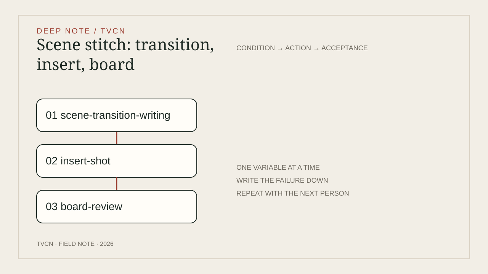

Scenes connect through an unfinished action and the next scene&amp;#x27;s first information, not a transition effect. One page of &amp;quot;Scene Transitions: Carry an Action Across the Cut&amp;quot; solves one local problem; joining &amp;quot;Scene Transitions: Carry an Action Across the Cut&amp;quot;, &amp;quot;Insert Shot: One Detail Beats One Line&amp;quot; and &amp;quot;Board Review: Let Camera and Edit Find the Gaps&amp;quot; exposes the real failure: conditions are missing, too many variables move, and the result cannot be reproduced.

<!-- DEEP_DIVE_START -->
<!-- DIAGRAM_START -->
<h2>图解</h2>
<figure>
  
  <figcaption>Read &quot;Scene Transitions: Carry an Action Across the Cut&quot; and &quot;Insert Shot: One Detail Beats One Line&quot;: write the condition first, then check whether the failure can be recorded.</figcaption>
</figure>
<!-- DIAGRAM_END -->

<section><h2 id="section-1">Problem</h2>
The problem is not a lack of methods; each step works alone, but together they fail because the condition was not written, too many variables moved and the result cannot be reproduced.

The order is condition, judgement, one variable and evidence. A step is complete only when the next person can repeat it.
</section>
<section><h2 id="section-2">Judgement</h2><ul><li>First gate in &quot;Scene Transitions: Carry an Action Across the Cut&quot;: Adjacent scenes share at least one action, object, or sound.</li><li>Second gate in &quot;Insert Shot: One Detail Beats One Line&quot;: The time jump reads without a title card.</li><li>Third gate in &quot;Board Review: Let Camera and Edit Find the Gaps&quot;: Remove the card and the audience can still say how much time passed or where they are.</li></ul>
If one gate fails, return to its single page; do not hide an unsolved point inside a longer chain.
</section>
<section><h2 id="section-3">Method</h2><ol><li>Write the condition first: turn &quot;Find a shared action: door closes in one scene, opens in the next.&quot; from &quot;Scene Transitions: Carry an Action Across the Cut&quot; into three rows: material, environment, acceptance.</li><li>Run one minimal action: follow &quot;Scene Transitions: Carry an Action Across the Cut&quot; for 30 seconds and do not add the second page yet.</li><li>Attach the second page: Or a shared object: cup picked up, then set down..</li><li>Use the third page as a control: Use sound arriving early or late to bridge the spaces without a card..</li><li>Change one variable at a time; write the other conditions down instead of remembering them.</li><li>Film the failure too: put failure and success side by side to see which step cannot be skipped.</li><li>Ask the next person to reproduce from the record; if they cannot, the record is not finished.</li></ol></section>
<section><h2 id="section-4">Field test</h2>
A reproducible test, not a client case: take 30 seconds of material, make version A using &quot;Adjacent scenes share at least one action, object, or sound.&quot; from &quot;Scene Transitions: Carry an Action Across the Cut&quot;, then version B using &quot;The time jump reads without a title card.&quot; from &quot;Insert Shot: One Detail Beats One Line&quot;; only one variable may differ. Put them side by side and record what breaks first in &quot;Board Review: Let Camera and Edit Find the Gaps&quot;: condition, action or acceptance. If it works on the first try, add one real constraint and run it again.
</section>
<section><h2 id="section-5">Failure table</h2>
<table class="data-table"><thead><tr><th>Symptom</th><th>Cause</th><th>Replacement action</th></tr></thead><tbody><tr><td>Do not use a title card for time; if an action can bridge it, do …</td><td>Condition was not written</td><td>Return to page one and rewrite the three rows</td></tr><tr><td>Do not use an insert as decoration; if it carries no information…</td><td>Condition was not written</td><td>Return to page one and rewrite the three rows</td></tr><tr><td>Do not redraw the whole board in review; three panels per round i…</td><td>Condition was not written</td><td>Return to page one and rewrite the three rows</td></tr></tbody></table>
</section>
<section><h2 id="section-6">Acceptance</h2><ul><li>Adjacent scenes share at least one action, object, or sound.</li><li>The time jump reads without a title card.</li><li>Remove the card and the audience can still say how much time passed or where they are.</li><li>The insert carries a specific piece of information, not just beauty.</li><li>It runs one to two seconds and cuts before the key line.</li><li>Remove it and information goes missing, proving it replaced a line.</li><li>Camera and edit each arrive with a question list.</li><li>Only three panels change in the meeting and the rest are logged.</li><li>After the three changes, setups and edit gaps improve concretely.</li><li>The condition from Scene Transitions: Carry an Action Across the Cut fits on one line and can be repeated by someone else.</li></ul></section>
<section><h2 id="section-7">Alternatives</h2><ul><li>For a single-point problem in "Scene Transitions: Carry an Action Across the Cut", go back to <a href="https://story.tvcn.org/en/article/scene-transition-writing/">Scene Transitions: Carry an Action Across the Cut</a>; do not use the whole chain.</li><li>To compare two actions, read <a href="https://story.tvcn.org/en/article/insert-shot/">Insert Shot: One Detail Beats One Line</a> and leave the third page alone.</li><li>For acceptance only, use <a href="https://story.tvcn.org/en/article/board-review/">Board Review: Let Camera and Edit Find the Gaps</a> as a self-test sheet.</li></ul></section>
