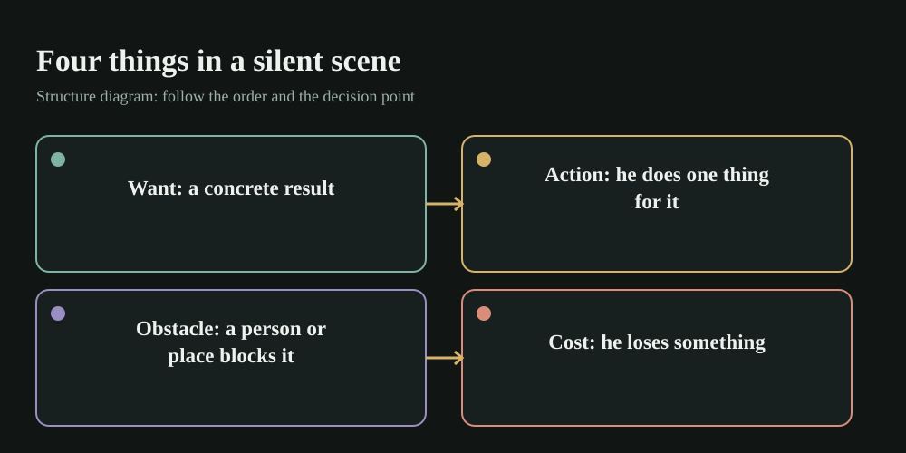

When asked to write without dialogue, many writers add voice-over or ask the actor to “act” the feeling with the face. A silent scene is not an absence of sound; it is a scene where the audience knows what the character wants, who blocks it and what it costs without a line. Sound remains; it just is not carried by dialogue.

<!-- DIAGRAM_START -->
<h2 id="diagram">Diagram</h2>
<figure class="diagram">
  
  <figcaption>Look for want, action, obstacle and cost in the image. A scene carried by expressions and voice-over is not a silent scene.</figcaption>
</figure>
<!-- DIAGRAM_END -->

<section><h2 id="section-1">On location</h2>
A two-minute short follows a mover who does not speak the local language. The draft has eight voice-over lines explaining that he is lonely, wants to belong and misses his family. The director removes all of them and keeps three actions: he puts a coworker's lunchbox in the fridge, waits by the door for a call that will not come, writes his name on a box and rubs it out.
</section>
<section><h2 id="section-2">What to look for</h2><ul><li><strong>The audience can name the want:</strong> not “he is sad” but “he wants the coworker to accept him” or “he wants the call from home”.</li><li><strong>The action meets resistance:</strong> the lunchbox is taken, the phone does not ring, the name is painted over. Without resistance, the action is only a procedure.</li><li><strong>The ending changes:</strong> what he starts doing, he stops doing; the audience sees a decision, not a sequence of tasks.</li></ul></section>
<section><h2 id="section-3">What to do</h2><ol><li>Write one sentence for the want, and make it shootable: get in, be kept, obtain the object, deliver the letter.</li><li>Cut dialogue to zero and keep action sentences: he picks up, puts down, waits, hides, rubs out.</li><li>Set a spatial obstacle: a locked door, a counter, language, time. The obstacle must be visible, not only inside the character.</li><li>Use shot size and eyeline instead of explanation: where he looks is where the audience looks; what he avoids looking at is the information.</li><li>End on an action that does not complete: a hand reaches and withdraws, a door opens halfway and closes. Leave the change in the action.</li></ol></section>
<section><h2 id="section-4">Failure modes</h2><ul><li><strong>Explaining with titles or voice-over:</strong> the image has already played, then a line says “he is lonely”; the audience is told twice and stops watching.</li><li><strong>Repeating actions:</strong> three boxes carried, two tables wiped; there is motion but no relationship changes.</li><li><strong>Expression instead of action:</strong> the actor looks sad and does nothing; the audience sees a mood, not a choice.</li></ul></section>
<section><h2 id="section-5">Limits</h2>
Silent scenes are not for every format. Information-heavy explainers, comedies built on verbal wit and passages needing complex backstory still need dialogue. Silence is not the absence of sound either: room tone, steps, doors and breath must be built, or the scene feels like it is missing a layer.
</section>
<section><h2 id="section-6">Check</h2><ul><li>A stranger can say what the character wants after one viewing.</li><li>At least one visible obstacle exists, and the character tries twice.</li><li>The ending has a change in action, not an emotional summary.</li><li>The information still works with sound off; with sound on, room tone completes the space.</li></ul></section>
<!-- DEEP_DIVE_START -->
## Deep dive

<strong>About 8 minutes.</strong> This section places the same judgement in two different conditions, then gives a counterexample and a reusable model. It does not repeat the page; it decides when to change the method.

### Condition A: silent comedy

Silent comedy runs on expectation and deflection. A character does a small task seriously; the audience forms an expectation, then the environment or another person skews it. The action must be concrete and repeatable, and change on the third pass: twice to establish the rule, once to break it. Do not rely on falls or exaggerated faces; rely on objects and space.

The cost should stay small: losing face, taking the wrong bag, sitting in the wrong chair. If the cost is too high, the audience worries instead of laughs. The ending often returns to the opening action with the relationship reversed: he pushes the door at the start, the door pushes him at the end.

### Condition B: silent tragedy

Silent tragedy runs on repetition, failure and giving up. The character performs the same action again and again, each time a little short; the audience sees him get closer and the cost grow. The key is not to make him cry but to make him stop: a hand stops at the door and does not knock; a phone is lifted and put back.

Do not explain the ending. Leave an object that remains: an unsent letter, cold food, a light left on. The audience will connect the earlier actions. The camera can hold, but do not push into the face; let the space carry the feeling, which is more reliable than tears.

### Counterexample: busy action, no change

A silent passage runs forty seconds: the character washes a cup, wipes the table, arranges shoes, opens a window, closes it. Every action is clear, but after it the audience cannot say what he wants. The problem is not too few actions; the actions do not share one want. He is doing chores, not pursuing a result.

The fix is not another action. Write one sentence first: “he wants someone to stay.” Then remove every action unrelated to it and keep three: placing the other person's shoes, opening the door, turning off the light. All three point at the same person, and the audience links them into a story.

### Reusable model

<strong>Want → action → obstacle → cost.</strong> All four must happen in the image, not only in the director's statement. Run a sound-off test: if a viewer cannot name the four from the picture alone, change the action instead of adding voice-over.

Silence does not mean no lines; it means the function of lines has been taken over by action. Information that action cannot carry goes to sound: steps tell who is coming, a doorbell tells who is outside, breath tells who is holding something in.

<!-- DEEP_DIVE_END -->
<!-- SOURCES_START -->
## Further reading

- [S42] [Pixar: Pixar in a Box](https://www.khanacademy.org/partner-content/pixar) — accessed 2026-11-26. Used to check the terms, method or rule in the “What to look for” section; not the page's field numbers, gear models or conclusions, and not a substitute for a test or contract.
- [S16] [BBC Editorial Guidelines: BBC Editorial Guidelines](https://www.bbc.co.uk/editorialguidelines/) — accessed 2026-11-26. Used to check the terms, method or rule in the “Limits” section; not the page's field numbers, gear models or conclusions, and not a substitute for a test or contract.
<!-- SOURCES_END -->
