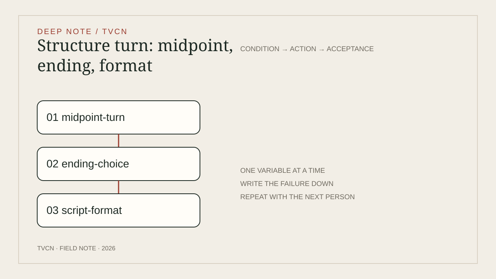

Structure is not a three-act template; the midpoint turns direction and the ending charges for the choice. One page of &amp;quot;Midpoint Turn: Change the Method, Not the Goal&amp;quot; solves one local problem; joining &amp;quot;Midpoint Turn: Change the Method, Not the Goal&amp;quot;, &amp;quot;Ending: Stop After the Choice&amp;quot; and &amp;quot;Script Format: Make the Whole Crew Read It the Same Way&amp;quot; exposes the real failure: conditions are missing, too many variables move, and the result cannot be reproduced.

<!-- DEEP_DIVE_START -->
<!-- DIAGRAM_START -->
<h2>图解</h2>
<figure>
  
  <figcaption>Read &quot;Midpoint Turn: Change the Method, Not the Goal&quot; and &quot;Ending: Stop After the Choice&quot;: write the condition first, then check whether the failure can be recorded.</figcaption>
</figure>
<!-- DIAGRAM_END -->

<section><h2 id="section-1">Problem</h2>
The problem is not a lack of methods; each step works alone, but together they fail because the condition was not written, too many variables moved and the result cannot be reproduced.

The order is condition, judgement, one variable and evidence. A step is complete only when the next person can repeat it.
</section>
<section><h2 id="section-2">Judgement</h2><ul><li>First gate in &quot;Midpoint Turn: Change the Method, Not the Goal&quot;: The goal line is identical before and after midpoint; it is not swapped.</li><li>Second gate in &quot;Ending: Stop After the Choice&quot;: Each column has three filmable actions and the methods look different.</li><li>Third gate in &quot;Script Format: Make the Whole Crew Read It the Same Way&quot;: Without dialogue, the audience can name what method changed.</li></ul>
If one gate fails, return to its single page; do not hide an unsolved point inside a longer chain.
</section>
<section><h2 id="section-3">Method</h2><ol><li>Write the condition first: turn &quot;Use one A4: old method on the left, new method on the right, goal unchanged abov…&quot; from &quot;Midpoint Turn: Change the Method, Not the Goal&quot; into three rows: material, environment, acceptance.</li><li>Run one minimal action: follow &quot;Midpoint Turn: Change the Method, Not the Goal&quot; for 30 seconds and do not add the second page yet.</li><li>Attach the second page: Write three concrete actions per column that look different on screen..</li><li>Use the third page as a control: Shoot the difference so the audience sees the method change, not hears “I change….</li><li>Change one variable at a time; write the other conditions down instead of remembering them.</li><li>Film the failure too: put failure and success side by side to see which step cannot be skipped.</li><li>Ask the next person to reproduce from the record; if they cannot, the record is not finished.</li></ol></section>
<section><h2 id="section-4">Field test</h2>
A reproducible test, not a client case: take 30 seconds of material, make version A using &quot;The goal line is identical before and after midpoint; it is not s…&quot; from &quot;Midpoint Turn: Change the Method, Not the Goal&quot;, then version B using &quot;Each column has three filmable actions and the methods look diffe…&quot; from &quot;Ending: Stop After the Choice&quot;; only one variable may differ. Put them side by side and record what breaks first in &quot;Script Format: Make the Whole Crew Read It the Same Way&quot;: condition, action or acceptance. If it works on the first try, add one real constraint and run it again.
</section>
<section><h2 id="section-5">Failure table</h2>
<table class="data-table"><thead><tr><th>Symptom</th><th>Cause</th><th>Replacement action</th></tr></thead><tbody><tr><td>Do not make midpoint a twist; same goal, new method is the turn.</td><td>Condition was not written</td><td>Return to page one and rewrite the three rows</td></tr><tr><td>Do not explain the ending; too much explanation kills the afterta…</td><td>Condition was not written</td><td>Return to page one and rewrite the three rows</td></tr><tr><td>Do not write a novel; if the crew cannot find scene numbers and s…</td><td>Condition was not written</td><td>Return to page one and rewrite the three rows</td></tr></tbody></table>
</section>
<section><h2 id="section-6">Acceptance</h2><ul><li>The goal line is identical before and after midpoint; it is not swapped.</li><li>Each column has three filmable actions and the methods look different.</li><li>Without dialogue, the audience can name what method changed.</li><li>Method changes, not goal</li><li>The old method worked first</li><li>The midpoint proves it fails</li><li>The new method has a learning cost</li><li>The cost is filmable</li><li>The final shot is an action after the choice with no explanatory voice-over.</li><li>The audience can name what was chosen and what was given up.</li></ul></section>
<section><h2 id="section-7">Alternatives</h2><ul><li>For a single-point problem in "Midpoint Turn: Change the Method, Not the Goal", go back to <a href="https://story.tvcn.org/en/article/midpoint-turn/">Midpoint Turn: Change the Method, Not the Goal</a>; do not use the whole chain.</li><li>To compare two actions, read <a href="https://story.tvcn.org/en/article/ending-choice/">Ending: Stop After the Choice</a> and leave the third page alone.</li><li>For acceptance only, use <a href="https://story.tvcn.org/en/article/script-format/">Script Format: Make the Whole Crew Read It the Same Way</a> as a self-test sheet.</li></ul></section>

<!-- SOURCES_START -->
## References and further reading

- [S42] [Pixar in a Box: Storytelling](https://www.khanacademy.org/partner-content/pixar) — Accessed 2026-11-26. Used to check the terminology/method/rule in the “Problem” section against Pixar storytelling course, not project pricing; it does not verify numbers, model choices or on-set conclusions derived from this page, and is not a substitute for a test.
- [S43] [BFI: National Archive](https://www.bfi.org.uk/bfi-national-archive) — Accessed 2026-11-26. Used to check the terminology/method/rule in the “Judgement” section against BFI archive material, not distribution rules; it does not verify numbers, model choices or on-set conclusions derived from this page, and is not a substitute for a test.
<!-- SOURCES_END -->

