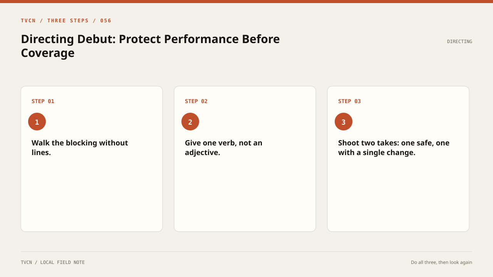

On a first directing job, protect the performance and the scene before chasing more coverage.

<!-- DIAGRAM_START -->
<h2>Diagram</h2>
<figure>
  
  <figcaption>Do the three steps in order, then look again at the image or file.</figcaption>
</figure>
<!-- DIAGRAM_END -->
<h2>On set</h2>

On day one, stage one scene only. Shoot a wide and two close-ups; simplify light and camera so the actor gets full performance time.

<h2>Do this</h2>

On a first directing job, protect the actor and one scene before adding setups.
<ol><li>Schedule only one scene on day one.</li><li>Shoot a wide and two close-ups so a full performance exists.</li><li>Simplify light and camera and leave time for rehearsal and another take.</li></ol>
<h2>Avoid</h2>

Do not schedule ten scenes on day one; more setups mean no complete performance.

<h2>Check</h2>
<ul><li>Day one has one scene and the actor gets full rehearsal time.</li><li>A wide and two close-ups exist, so more than one complete performance is usable.</li><li>Light and setup count stay low enough to wrap on time.</li></ul>
