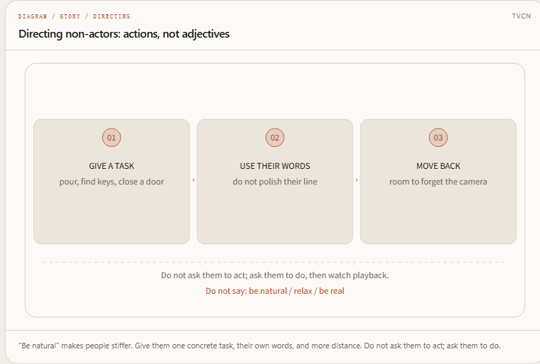

<!-- DIAGRAM_START -->
## Diagram

<figure>
  
  <figcaption>“Be natural” makes people stiffer. Give them one concrete task, their own words, and more distance. Do not ask them to act; ask them to do.</figcaption>
</figure>
<!-- DIAGRAM_END -->

## Give an action, not an emotion

Wipe a cup, find a key, lift a box onto the table. When the hands have a job, the face stops thinking “I am being filmed.” Emotion comes from the task, not from an instruction.

If they are nervous, ask them to walk you through their daily route. Moving helps people relax more than sitting down.

## Put the line in their words

Write the meaning, not a word-for-word script. Let them say it their way. If they stall, ask “what were you thinking then?” Do not correct grammar mid-sentence, and do not make them repeat until it sounds like a broadcast.

The first pass is usually the truest; by the third, it sounds memorized. If you need more, ask about one detail instead of restarting the whole answer.

## Move the camera back and hold the cut

Start on a medium or wide shot so the camera becomes normal. A lens in someone’s face makes a non-actor perform “serious.”

Keep rolling for ten seconds after “cut.” People often say the most human line when they think the take is over.

## Three checks

- The subject has a concrete task, not just sitting still.
- The words sound like theirs, not a script.
- At least one usable moment happens after “cut.”
