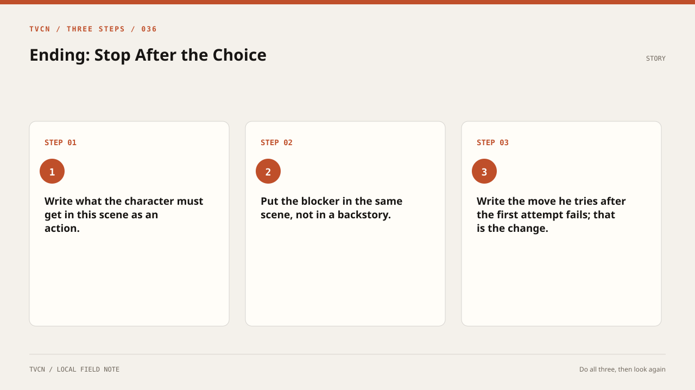

The ending does not explain the choice; it shows the first consequence. If she stays, show her setting down the bag. If she leaves, show the door closing behind her. Stop after the action and let the audience supply the sentence.

<!-- DIAGRAM_START -->
<h2>Diagram</h2>
<figure>
  
  <figcaption>Watch “Make the last shot an action after the” and “Do not add voice-over explaining why.”; judge whether the want can be said with one visible action.</figcaption>
</figure>
<!-- DIAGRAM_END -->
<section><h2 id="section-1">Stop after the choice</h2>
In the last fifteen seconds, keep one action and one reaction shot. No narration summary, no second twist.
<h2 id="section-2">Limits</h2>
An open ending is not a missing ending. The audience must be able to name what she chose; they just are not told what happens next.
</section><section><h2 id="section-3">On set</h2>
The last shot is the action after the choice: put down the key, close the door, walk away. Do not add narration explaining why.
</section><section><h2 id="section-4">Do this</h2>
End after the choice. Do not add an explanation; the line the audience supplies is stronger.
<ol><li>Make the last shot an action after the choice: keys down, door closed, walking away.</li><li>Do not add voice-over explaining why.</li><li>Cut two endings, one stopping on the action and one with ten extra seconds, and compare.</li></ol></section><section><h2 id="section-5">Avoid</h2>
Do not explain the ending; too much explanation kills the aftertaste.
</section><section><h2>Judge</h2>
Three signals are observable on set:
<ul><li>the want is visible in one action</li><li>the obstacle escalates inside the same scene</li><li>delete one expository line and the conflict still holds</li></ul></section><section><h2>Failures</h2>
These three moves erase the detail you just built:
<ul><li>the want is unclear and the scene is only mood</li><li>the obstacle is solved by coincidence, not a decision</li><li>dialogue repeats what the image already says</li></ul></section><section><h2>Extend</h2>
<strong>10-minute exercise:</strong> Write one 30-second scene with only “Make the last shot an action after the” and “Do not add voice-over explaining why.”. Cut every explanation and ask one person to retell what the character wants.
</section>
<h2>Check</h2><ul><li>The final shot is an action after the choice with no explanatory voice-over.</li><li>The audience can name what was chosen and what was given up.</li><li>The ten-second explanation version is weaker and the final cut stops on action.</li></ul>

<!-- DEEP_DIVE_START -->
## Deep dive

<strong>About 5 minutes.</strong> An ending does not finish the plot. It shows the cost of the choice the character has just made.

### Stop after the choice

Do not stop at “he decides to go.” Stop at the first reaction after he goes; a choice needs weight.

The audience should know what he chose, what it cost, and what comes next. When those three are answered, you can cut to black.

If the last shot is only a back walking away, the audience remembers the posture, not the price.

### Closed and open endings

A closed ending answers the main question; an open ending leaves a new one. Both must make the cost visible; neither should be mystery for its own sake.

Open does not mean no answer. It means the answer is inside an action the audience can assemble after leaving.

Closed does not mean explaining everything. Too much explanation leaves the audience nothing to do.

### The last shot

The last shot shows the result of the choice, not an explanation. The audience leaves remembering an image, not a line.

If the last line summarizes the theme, cut it. Let the previous action or the next empty frame speak.

The last shot should be a little quieter than what came before. Not slower; just enough time for the cost to land.

### Do not explain the last image

If the last shot explains, replace it with a result: an empty chair, a light left on, an extra set of bowls on the table.

Let the audience calculate the cost; a conclusion they reach is harder to forget than a line that tells them.

Do not add narration to summarize the last shot. Once narration arrives, the image becomes an illustration.

### Five-minute drill: three endings

Write three endings: answer, silence, irony. One shot each, then choose the one that hurts most.

Read them to someone who has not seen the film and ask what the character lost. If they cannot answer, the ending still stops at the decision, not the cost.

### Ten ending checks
<ul><li>Stop after the choice</li><li>The audience knows what he chose</li><li>The audience knows what it cost</li><li>The last shot shows the result</li><li>No dialogue summarizes the theme</li><li>Closed ending answers the main question</li><li>Open ending leaves a new one</li><li>The answer sits inside an action</li><li>The last beat is quieter</li><li>Someone else can name the loss</li></ul>
An ending does not close the story; it sends the audience out carrying the cost.

<!-- DEEP_DIVE_END -->

> Intent split: this page covers the practical details of “Ending: Stop After the Choice”; start with <a href="https://story.tvcn.org/article/midpoint-turn/">Midpoint Turn: Change the Method, Not the Goal</a> for the cluster-level judgement, then return here.

<!-- INTENT_SCOPE -->

<!-- SOURCES_START -->
## References and further reading

- [S41] [Writers Guild of America: WGA contract and credit resources](https://www.wga.org/) — Accessed 2026-11-26. Used to check the terminology and public context in the opening paragraph (“End after the choice. The sentence the audience supplies is ”) against WGA contract, credit and minimum-compensation terms; not a substitute for an on-set test.
- [S10] [Film history and moving-image research](https://www.bfi.org.uk/) — Accessed 2026-11-26. Used to check the terminology and public context in the opening paragraph (“End after the choice. The sentence the audience supplies is ”) against Entry point to BFI film history, archives and moving-image research; not a substitute for an on-set test.
<!-- SOURCES_END -->

